# SEE Part 1: Individuals

**Study guide for Nepal Singh**

This guide follows the IRS Special Enrollment Examination Candidate Information Bulletin revised **October 9, 2026**, published by PSI Services LLC. That bulletin is the official specification for this cycle. It replaces the older Prometric bulletin.

The bulletin’s testing window is **July 1, 2026 through February 28, 2027**. That is later than a May 1 start. The IRS Enrolled Agent FAQ (updated August 26, 2026) says the exam is generally offered from May through February, and that domestic testing this cycle runs July 1, 2026 to February 28, 2027. Use the October 9, 2026 bulletin.

For exams in that window, every reference is to the Internal Revenue Code, regulations, forms, instructions, and publications **as amended through December 31, 2025**. Unless a question says otherwise, the facts are **calendar year 2025**. The words “current tax year” mean 2025. Do not apply legislation, court decisions, or penalty amounts from after December 31, 2025.

| Item | What the bulletin states |
| --- | --- |
| Part | Part 1 — Individuals |
| Length | 3.5 hours (seat time is longer because of the tutorial, survey, and two scheduled 10-minute breaks) |
| Questions | 100 multiple choice, four options, one best answer |
| Scored questions | 85 |
| Experimental questions | 15, mixed through the exam, not marked, not scored |
| Passing standard | Scaled score of **500** on a scale of 200 to 800 |
| Score report | A pass shows “pass,” not a number. A fail shows a score from 200 to 499 |
| Materials | Closed book. An on-screen calculator is provided |

The bulletin prints **scored-question counts**, not percentages. The shares below are those counts divided by 85, rounded to the nearest percent. They add to 100.

| Domain | Scored questions | Share of the 85 |
| --- | --- | --- |
| 1. Preliminary Work with Taxpayer Data | 14 | 16% |
| 2. Income and Assets | 17 | 20% |
| 3. Deductions and Credits | 17 | 20% |
| 4. Taxation | 15 | 18% |
| 5. Advising the Individual Taxpayer | 11 | 13% |
| 6. Specialized Returns for Individuals | 11 | 13% |

Dollar amounts in this guide are **tax year 2025** unless a sentence names another year. Rev. Proc. 2024-40 set many inflation-adjusted figures as the Code stood on October 22, 2024, and it tells you to check later guidance if Congress amends 2025. Where Publication 17 (2025) or the 2025 Form 1040 instructions print a different number, this guide uses that later number. The standard deduction is the clearest example: the revenue procedure printed $15,000 / $30,000 / $22,500, and the 2025 Form 1040 instructions print the higher amounts in Domain 1. If a figure is not verified here, the text names the publication to check and leaves the number out.

Primary sources are the bulletin’s Part 1 outline, Publication 17 (2025), and the form or publication that actually carries the rule. Each sample question is original.

## How to use this guide with Fast Forward Academy

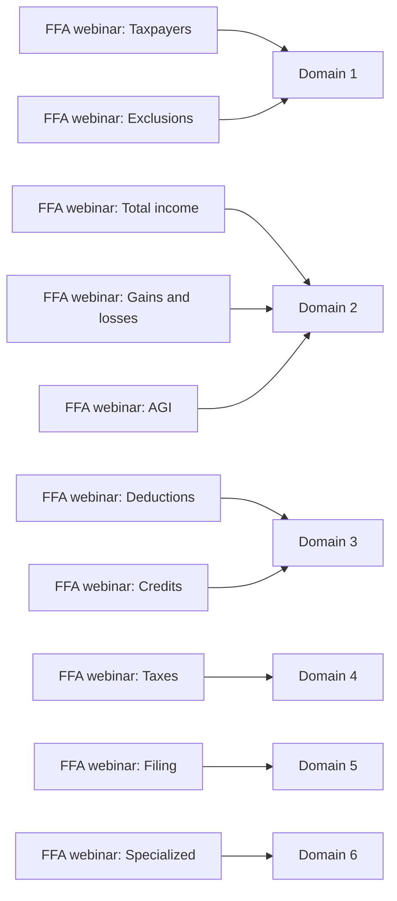

Fast Forward Academy’s public Part 1 bootcamp is organized as ten webinars: taxpayers and dependents, total income, gains and losses, income exclusions, adjusted gross income, deductions from AGI, taxes, credits, filing considerations, and specialized returns. The exam is scored on the six domains in the table above. Read the matching domain in this guide, then drill that domain in Fast Forward Academy.

Line the webinars up this way:

- Taxpayers and dependents, plus the filing-requirement half of filing considerations, are Domain 1.
- Total income, gains and losses, and adjusted gross income are Domain 2. Income exclusions sit in Domain 1 as an intake question and in Domain 2 as the computation.
- Deductions from AGI and the credits webinar are Domain 3.
- The taxes webinar is Domain 4. One exception: the official outline puts the kiddie tax in Domain 1, while that webinar groups it with other taxes. Study it in Domain 1, and expect a tax computation that feels like Domain 4.
- Advice about status, estimates, amendments, marriage, and planning is Domain 5, even when a webinar files it under filing considerations or specialized returns.
- Estate tax, gift tax, and foreign-account reporting are Domain 6.

Read the rules here until you can say the form number and the decision out loud. Then do the academy’s questions for that domain. This guide does not replace those drills, and it does not repeat them.

## Domain 1 — Preliminary Work with Taxpayer Data

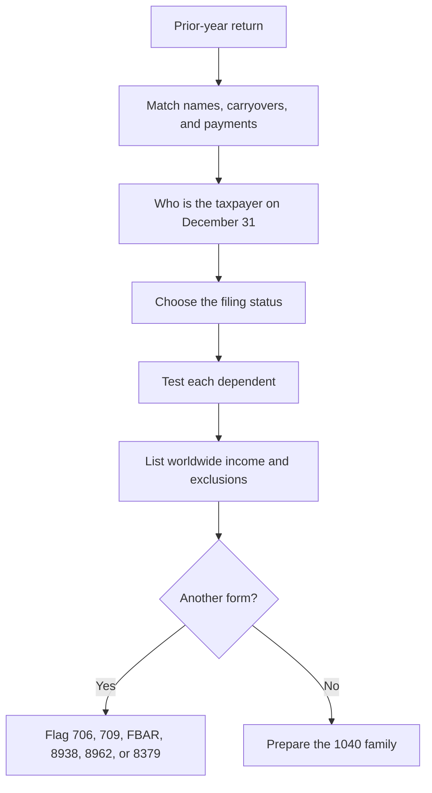

**14 scored questions, about 16% of the exam**

This domain is the interview before any number is computed. You are tested on whether the return should exist, which form, which status, who is a dependent, what last year’s return still affects, and which extra filings the facts trigger. Publication 501 (2025) and the 2025 Instructions for Form 1040 are the spine. Publication 17 (2025), chapter 1, tracks the same rules.

### Filing requirements, due dates, and filing status

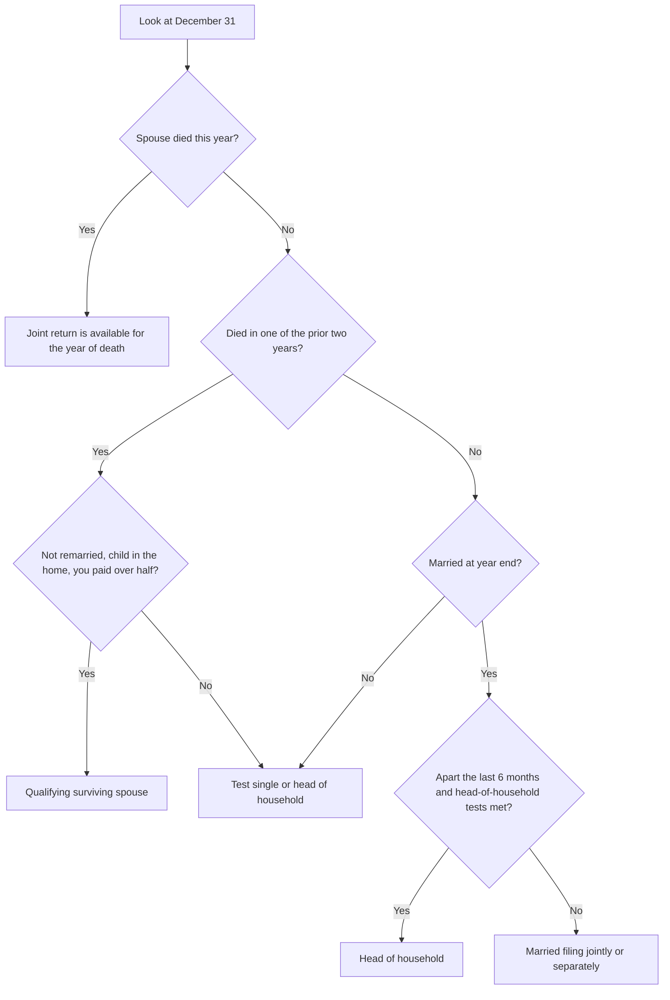

A U.S. citizen or resident alien files based on gross income, filing status, age, and whether someone else can claim them. Gross income includes worldwide income that is not exempt, including foreign earned income you later exclude on Form 2555, and gain from selling a main home even when section 121 excludes some of it. Publication 501 (2025) states that rule in the filing chapter and in the note under Table 1.

**2025 filing thresholds** from Publication 501 (2025), Table 1. File if gross income was at least:

| Status at the end of 2025 | Under 65 | 65 or older |
| --- | --- | --- |
| Single | $15,750 | $17,750 |
| Head of household | $23,625 | $25,625 |
| Married filing jointly, both spouses | $31,500 | One spouse $33,100; both $34,700 |
| Qualifying surviving spouse | $31,500 | $33,100 |
| Married filing separately | $5 at any age | $5 at any age |

For 2025 you are 65 or older if you were born before January 2, 1961. A person reaches 65 on the day before the 65th birthday. A deceased spouse counts as 65 only if the spouse had reached 65 by the date of death.

Also file, even below those amounts, when a special rule applies. The ones Part 1 expects:

- You had net self-employment earnings of the amount that triggers self-employment tax. Confirm the 2025 floor in the Schedule SE instructions. The usual rule is net earnings of $400 or more. That $400 figure is the long-standing Code threshold in section 6017; confirm it in the 2025 instructions before you rely on it in a computation.
- Advance payments of the premium tax credit were made for Marketplace coverage for you, your spouse, or a dependent. File and attach Form 8962, even if income is under the chart. Use Form 1095-A. A dependent who is claimed on someone else’s return does not attach Form 8962 for coverage the other person reconciles.
- You owe household employment tax, additional Medicare tax, net investment income tax, or a recapture such as the first-time homebuyer credit.
- You received a Form 1099-B or 1099-DA that puts you over a filing threshold. Publication 501 tells dependents and others to check those forms.
- You want a refund of withholding or a refundable credit. “Should file” is different from “must file.”

**2025 standard deduction**, from Publication 17 (2025) and the 2025 Instructions for Form 1040. Use these, not the lower amounts in Rev. Proc. 2024-40:

- Single or married filing separately: **$15,750**
- Married filing jointly or qualifying surviving spouse: **$31,500**
- Head of household: **$23,625**

Additional amount for age 65 or blindness, confirmed by the gaps in Publication 501’s filing chart and by Rev. Proc. 2024-40: **$2,000** if unmarried and not a surviving spouse, **$1,600** if married or a qualifying surviving spouse. Each condition gets its own add-on. A single person who is both 65 and blind adds $4,000. A joint couple in which both spouses are 65 adds $3,200.

A person who can be claimed as a dependent gets a limited standard deduction: the greater of **$1,350**, or earned income plus **$450**, and not more than the regular standard deduction for that status. Publication 17 (2025) works two examples with those figures and with the $15,750 ceiling. Add the age or blindness amount on top when it applies. The dependent’s own filing chart is Publication 501, Table 2. A single dependent who is not 65 or blind files if unearned income was more than $1,350, earned income was more than $15,750, or gross income was more than the larger of $1,350 or earned income (up to $15,300) plus $450.

The standard deduction is zero, and the person itemizes, when someone is a married person filing separately whose spouse itemizes, or a nonresident alien who has not made an election to be treated as a resident. A nonresident who is married to a U.S. citizen or resident and elects resident treatment may take the standard deduction. Certain students from India have a treaty exception. Confirm that treaty path in Publication 519.

**Due date.** Publication 17 (2025) says to file the 2025 Form 1040 or 1040-SR by **April 15, 2026**. Form 4868 extends the time to file, generally to October 15. It does not extend the time to pay. Interest and the failure-to-pay penalty run from the original due date on tax that is still unpaid. A presidentially declared disaster can postpone the IRS deadline; the outline expects you to know that a postponement exists and to read the IRS disaster notice rather than assume April 15 still governs. Combat-zone and contingency-operation extensions are in Publication 3.

**Five statuses.** Publication 501: single, married filing jointly, married filing separately, head of household, and qualifying surviving spouse. Marital status is fixed on the last day of the year. Married means married and not legally separated under a final decree. A spouse who died during the year is treated as married at year-end, so a joint return is available for the year of death if the surviving spouse has not remarried by December 31 and is otherwise qualified.

Qualifying surviving spouse is the next step, not the year of death. For a 2025 return the death must have been in 2023 or 2024. You must not have remarried before the end of 2025, you must have a child or stepchild you can claim as a dependent (with the usual Form 8332 nuance), that child must have lived with you all year except for temporary absences, and you must have paid more than half the cost of keeping up the home. The status uses the joint-return tax rates and the joint standard deduction. It is not a joint return.

Head of household requires you to be unmarried or considered unmarried, to have paid more than half the cost of keeping up a home, and to have had a qualifying person. A parent you can claim does not have to live with you if you paid more than half the cost of keeping up the parent’s home for the year. Other qualifying relatives must live with you more than half the year and must be related in one of the ways Publication 501 lists. A friend who is a qualifying relative only because the friend lived with you all year is a dependent, and is not a qualifying person for this status.

You are considered unmarried for head of household, even though you are still married, when you file a separate return, you paid more than half the cost of the home, your spouse did not live in the home during the last six months of the year, the home was the main home of your child, stepchild, or foster child for more than half the year, and you can claim that child. If the noncustodial parent claims the child under the special rule, you can still be considered unmarried when you would have been able to claim the child.

Married filing separately usually produces a higher tax. For 2025 the Form 1040 instructions say a separate return blocks the qualified-tip deduction, the qualified-overtime deduction, the enhanced senior deduction, the student-loan interest deduction, and the education credits, and it sharply limits the earned income credit and the child and dependent care credit. If one spouse itemizes, the other cannot take the standard deduction. The capital-loss deduction limit is $1,500 instead of $3,000. Publication 501 states that $1,500 limit. Community-property states split community income between the spouses even on separate returns. Publication 555 lists Arizona, California, Idaho, Louisiana, Nevada, New Mexico, Texas, Washington, and Wisconsin, and it treats Alaska as opt-in. Confirm the list in Publication 555 before exam day.

**Decision points.** Status before any credit. A child can support head of household for the custodial parent and still be released on Form 8332 for the child tax credit. Cost of keeping up a home includes rent, mortgage interest, real estate taxes, insurance, repairs, utilities, and food eaten in the home. It does not include clothing, education, medical treatment, vacations, life insurance, or transportation.

**Traps.** Using qualifying surviving spouse in the year of death. Giving head of household to a taxpayer whose only household member is an unrelated friend. Forgetting that married filing separately forces itemized deductions when the other spouse itemizes. Treating a disaster postponement as an extension that was filed.

### Residency, identity, and what the prior year still controls

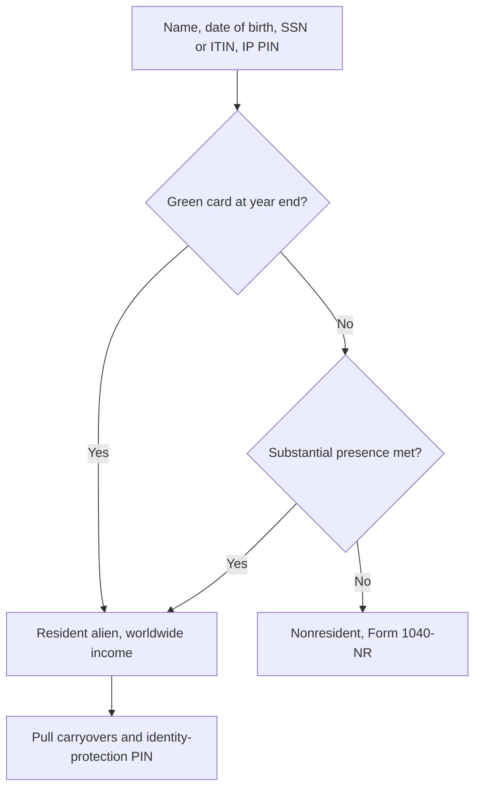

**Identity.** The return name must match Social Security records. An ITIN is applied for on Form W-7. An ITIN is not work authorization. Beginning in 2025, the child tax credit and the additional child tax credit require a Social Security number that is valid for employment and issued by the due date of the return, including extensions. On a joint return only one spouse must have that work-eligible number; the other spouse needs an SSN or ITIN issued by that same date. The credit for other dependents is available with an SSN or ITIN issued by that date. The 2025 Instructions for Form 1040 and the Instructions for Schedule 8812 state those rules. An identity-protection PIN, once issued, belongs on the return. A return that needs the PIN and omits it is rejected. The outline also lists a state-issued photo ID among the facts you gather. Keep it with the due-diligence file for the earned income credit, the child tax credit, the American opportunity credit, and head of household. Form 8867 is the paid-preparer checklist. Rev. Proc. 2024-40 sets the 2025 section 6695(g) penalty at $650 per failure. Confirm that penalty figure against the 2025 Form 8867 instructions, and do not update it for any amount announced after December 31, 2025.

**Residency.** Publication 519 is the source. A lawful permanent resident is a resident under the green-card test. The substantial-presence test is met by 31 days in the current year and 183 days over three years, counting all of the current-year days, one-third of the prior year, and one-sixth of the year before that. Days as an exempt individual, including many students, teachers, and foreign-government-related persons, do not count. A person can be a dual-status alien in the year of arrival or departure. Resident aliens are taxed on worldwide income and generally use Form 1040. Nonresidents use Form 1040-NR and are taxed on U.S.-source income and income effectively connected with a U.S. trade or business. A nonresident spouse may elect under section 6013(g), with the citizen or resident spouse, to be treated as a resident for the whole year.

**Prior-year return.** Compare filing status, dependents, wages, withholding, and large swings. Bring forward capital-loss carryovers, charitable carryovers, unused passive losses, adoption-credit carryovers, foreign-tax-credit carryovers, the prior-year minimum-tax credit on Form 8801, a negative qualified-business-income carryover, remaining basis in an installment sale, depreciation, and estimated-tax vouchers. Read IRS letters before you prepare: an identity-protection PIN, a math-error notice, a CP2000, an earned-income-credit ban, or a disaster notice changes the return you are about to file. An earned-income-credit disallowance often means Form 8862 must be attached before the credit is claimed again.

**Traps.** Treating an ITIN holder as eligible for the 2025 child tax credit. Ignoring a green card because the person lived abroad all year. Leaving last year’s capital-loss carryover off Schedule D. Forgetting that excluded foreign earned income still counts toward the filing threshold.

### Dependency

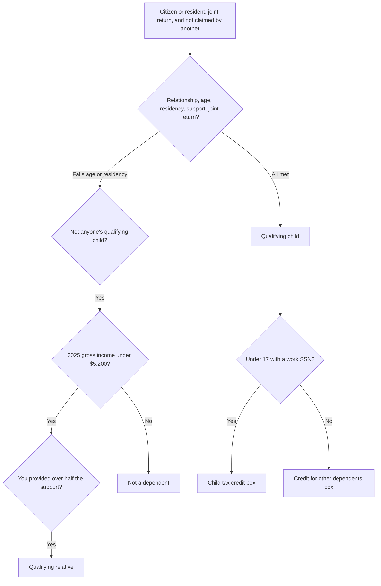

Publication 501 (2025) is the authority. Three tests apply to every dependent: the person is a U.S. citizen, U.S. national, U.S. resident alien, or a resident of Canada or Mexico; the person does not file a joint return except to claim a refund of withholding or estimated tax; and you yourself are not a dependent of another taxpayer, unless that taxpayer files only to claim a refund of withholding or estimated tax.

**Qualifying child.** All of these:

- Relationship: son, daughter, stepchild, foster child, brother, sister, half brother, half sister, stepbrother, stepsister, or a descendant of any of them.
- Age: under 19 at year-end and younger than you (or your spouse if filing jointly); or under 24 at year-end, a student, and younger than you; or any age if permanently and totally disabled.
- Residency: lived with you more than half the year. Temporary absences for school, medical care, vacation, and military service count as time at home. A child born or died during the year can meet the test on the days the child was alive.
- Support: the child did not provide more than half of the child’s own support. This is not the same as you providing half.
- Joint return: the child does not file a joint return, except a return filed only to claim a refund of tax paid.

**Qualifying relative.** All of these:

- Not a qualifying child of you or of any other taxpayer.
- Member of the household for the entire year, or related in one of the listed ways. The relationship list is broader than the qualifying-child list and includes parents, grandparents, aunts, uncles, and in-laws. Cousins must live with you.
- Gross income for 2025 less than **$5,200**. Publication 501 states that figure, and Rev. Proc. 2024-40 sets the section 152(d)(1)(B) amount at $5,200. Gross income here does not include tax-exempt income such as nontaxable Social Security.
- You provided more than half of the person’s support, or a multiple-support agreement applies.

There is no age test for a qualifying relative. A 30-year-old child who fails the qualifying-child age test can still be a qualifying relative if the gross-income and support tests are met.

**Tie-breaker** when a child is a qualifying child of more than one person and they do not agree. If only one of them is a parent, the parent claims the child. If both are parents and they do not file jointly, the child is the qualifying child of the parent with whom the child lived longer. If time is equal, the parent with the higher adjusted gross income claims the child. If no parent claims the child, the person with the highest adjusted gross income claims the child, and that person’s AGI must be higher than the AGI of any parent who could have claimed the child.

**Multiple support.** Form 2120. As a group, two or more people provide more than half the support. No one person provides more than half. Each person in the group could claim the individual except for the support test. The person who claims the dependent must have provided more than 10 percent and must have a signed statement from each other person who provided more than 10 percent.

**Divorced or separated parents.** The custodial parent is the parent with whom the child lived for more nights. That parent generally claims the child. Form 8332, or a similar written declaration, can release the claim so the noncustodial parent claims the child for the child tax credit and the credit for other dependents. The release does not give the noncustodial parent head of household, the earned income credit, or the child and dependent care credit. The 2025 Form 1040 instructions say this directly.

**Traps.** Using the qualifying-relative support test (you provided more than half) on a qualifying child. Counting nontaxable Social Security as gross income for the $5,200 test. Letting a noncustodial parent take the earned income credit because of Form 8332. Claiming a dependent when you yourself can be claimed, other than the refund-only exception.

### Kiddie tax, health coverage, and the extra returns you flag now

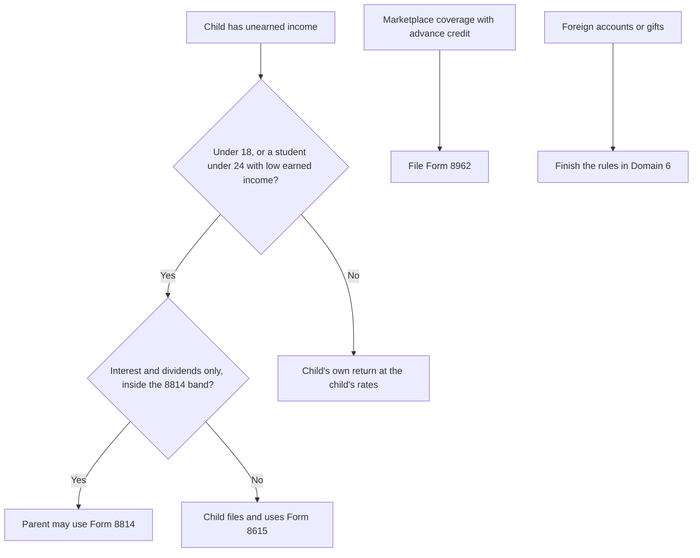

**Kiddie tax.** The outline places minor children’s unearned income here. The tax, under section 1(g), applies the parents’ marginal rates to a child’s net unearned income when the child is under 18 at year-end, or is 18 and the child’s earned income does not exceed half of the child’s support, or is a full-time student age 19 through 23 and earned income does not exceed half of support. At least one parent must be alive, and the child must not file a joint return. Rev. Proc. 2024-40 sets the 2025 amount that reduces net unearned income at **$1,350**. The same revenue procedure says a parent may elect to include the child’s income only when the child’s gross income is more than $1,350 and less than **$13,500**, and the income is only interest, dividends, and capital-gain distributions. That election is Form 8814. Otherwise the child files Form 8615.

The 2025 Form 1040 instructions add a birthday trap: a child born on January 1, 2002 is treated as age 24 at the end of 2025, because a person reaches an age on the day before the birthday. Do not use Form 8814 for that child.

If the child has no earned income and does not itemize, the first $1,350 of unearned income is sheltered by the dependent standard deduction and the next $1,350 is taxed at the child’s rates. The rest is the net unearned income taxed at the parents’ rates. Itemized deductions connected to the unearned income change the subtraction. Confirm the worksheet in the 2025 Instructions for Form 8615 rather than forcing every child through that two-step shortcut.

**Premium tax credit intake.** Ask household size and household income. Household income is modified AGI of the taxpayer plus the AGI of dependents who must file. Reconcile advance credit on Form 8962. Married filing separately is generally ineligible unless the taxpayer qualifies for the abuse or abandonment relief described in the Form 8962 instructions. Confirm the 2025 applicable percentages and repayment caps in those instructions. The revenue procedure’s repayment table was written before you should assume it survived every later 2025 change, so this guide does not copy those cap dollars.

**Other flags you record now and compute later.**

- Foreign financial accounts may require FinCEN Form 114, the FBAR. Specified foreign financial assets may require Form 8938. Both can apply. Domain 6 has the thresholds.
- Gifts may require Form 709. A decedent’s estate may require Form 706. Domain 6.
- A refund that will be taken for a spouse’s past-due child support, student loan, or state tax is an injured-spouse claim, Form 8379. That is not innocent-spouse relief. Domain 5.
- A minister, a household employee, or a service member changes which schedules you attach. Domain 4.
- Schedule 1-A is new for 2025. Ask about qualified tips, qualified overtime, qualified passenger-vehicle loan interest, and the enhanced deduction for seniors before you decide the return is a “simple” 1040.

**2025 Schedule 1-A amounts**, from the 2025 Instructions for Form 1040. These deductions are allowed whether or not the taxpayer itemizes. Married taxpayers must file jointly.

| Deduction | 2025 ceiling | Phaseout starts when modified AGI exceeds |
| --- | --- | --- |
| Qualified tips | $25,000 | $150,000, or $300,000 if married filing jointly |
| Qualified overtime | $12,500, or $25,000 if married filing jointly | $150,000, or $300,000 if married filing jointly |
| Qualified vehicle-loan interest | $10,000, on a vehicle purchased in 2025 for personal use | $100,000, or $200,000 if married filing jointly |
| Enhanced deduction for seniors | $6,000, or $12,000 if both spouses qualify | $75,000, or $150,000 if married filing jointly |

The senior deduction requires birth before January 2, 1961, and a valid Social Security number. The tip and overtime deductions require a valid Social Security number for the person who received the income. Confirm the qualified-tip occupation list and the definition of qualified overtime in the 2025 Instructions for Schedule 1-A. Qualified overtime is the premium portion required by the Fair Labor Standards Act, not every dollar paid for an extra shift.

Publication 17 (2025) also describes a Trump account and Form 4547. A child born after 2024 and before 2029 who is a U.S. citizen may qualify for a $1,000 pilot contribution, elected with the 2025 return. Read Form 4547 before you advise on it. It is new, and the exam can ask only the rule that was in the instructions through December 31, 2025.

### Practice questions

**1.** Priya is single, under 65, and not a dependent. Her 2025 gross income is $15,000, all from wages, and her employer withheld federal income tax. Which statement is correct?

A. She must file because her gross income is over $15,000.
B. She is not required to file based on gross income, and she should file to claim a refund of the withholding.
C. She must file because every worker who had withholding must file.
D. She may not file, because her income is under the standard deduction.

**Answer: B.** Publication 501 (2025), Table 1, sets the 2025 filing threshold for a single person under 65 at $15,750. Her gross income is below that line, so the gross-income rule does not require a return. She should still file to recover withholding. The standard deduction is not a filing ban.

**IRS basis:** Publication 501 (2025), Table 1 and the “who should file” discussion; Publication 17 (2025).

**2.** For 2025, which taxpayer has a gross-income filing requirement at the lowest amount of gross income?

A. A single person under 65.
B. A head of household under 65.
C. A qualifying surviving spouse under 65.
D. A person who is married filing separately, of any age.

**Answer: D.** A married person filing separately must file if gross income is at least $5. The other three statuses in this question use the much higher 2025 thresholds of $15,750, $23,625, and $31,500.

**IRS basis:** Publication 501 (2025), Table 1.

**3.** Luis is 22 at the end of 2025, a full-time student, and younger than his mother. He lived with her all year, did not provide more than half of his own support, and did not file a joint return. He earned $18,000 in wages. Can his mother claim him as a qualifying child?

A. No, because his gross income is at least $5,200.
B. No, because he is over 19.
C. Yes, if the other qualifying-child tests are already met, because a student under 24 can meet the age test.
D. Yes, but only if she provided more than half of his support.

**Answer: C.** A qualifying child who is a student may be under 24 at year-end. The $5,200 gross-income test belongs to qualifying relatives, not qualifying children. The support test for a qualifying child is that the child did not provide more than half of his own support.

**IRS basis:** Publication 501 (2025), qualifying-child tests.

**4.** Nora’s father lived with her all of 2025. He is 70. His only income was $5,200 of taxable interest. Nora provided all of his support. She cannot claim him as a qualifying child because of his age. Can she claim him as a qualifying relative?

A. Yes, because there is no age limit for a qualifying relative and she provided all of his support.
B. No, because his gross income is not less than $5,200.
C. Yes, because interest income is ignored for the gross-income test.
D. No, because a parent must have less than $1,350 of unearned income.

**Answer: B.** Publication 501 (2025) says a qualifying relative’s gross income for the year must be less than $5,200. His interest is gross income, and $5,200 is not less than $5,200. The $1,350 figure is the kiddie-tax and dependent-standard-deduction amount, not the qualifying-relative test.

**IRS basis:** Publication 501 (2025); Rev. Proc. 2024-40, section 152(d)(1)(B) amount.

**5.** Andre is unmarried. His mother lived alone in an apartment all year. He paid more than half the cost of keeping up that apartment, he can claim her as a dependent, and he paid more than half the cost of his own home. Which filing status can he use?

A. Single only, because his mother did not live with him.
B. Head of household, because a dependent parent does not have to live with the taxpayer when the taxpayer paid more than half the cost of the parent’s home.
C. Qualifying surviving spouse, because he supports a parent.
D. Married filing separately.

**Answer: B.** Publication 501 allows head of household when the qualifying person is a dependent parent and the taxpayer paid more than half the cost of keeping up the parent’s home for the year. The parent’s separate apartment does not block the status.

**IRS basis:** Publication 501 (2025), head of household, special rule for parents.

**6.** Jordan’s spouse died on June 1, 2025. Jordan did not remarry. They have a dependent child who lived in the home all year, and Jordan paid all of the household costs. Which status is available for the 2025 return?

A. Qualifying surviving spouse.
B. Married filing jointly, if Jordan otherwise qualifies.
C. Single only.
D. Married filing separately only, because the spouse died before December 31.

**Answer: B.** The year of death is still a married year. A joint return is available if Jordan has not remarried and otherwise qualifies. Qualifying surviving spouse is for the two tax years after the year of death, so it would first be considered for 2026.

**IRS basis:** Publication 501 (2025), married filing jointly in the year of death, and qualifying surviving spouse.

**7.** A child was born on January 1, 2002. At the end of 2025 the child has only interest and dividend income. What do the 2025 Form 1040 instructions say about Form 8814?

A. The parent must use Form 8814 because the child is under 24.
B. The child is treated as age 24 at the end of 2025, so Form 8814 is not used.
C. Form 8814 is available only when the child was born on January 1.
D. The child is treated as age 23, so the parent must use Form 8814.

**Answer: B.** A person reaches an age on the day before the birthday. The 2025 instructions say a child born on January 1, 2002 is age 24 at the end of 2025, and they tell you not to use Form 8814 for that child.

**IRS basis:** 2025 Instructions for Form 1040, Form 8814 discussion.

**8.** The Marketplace paid advance premium tax credit for coverage of a single taxpayer whose 2025 gross income is below the filing threshold. What must the taxpayer do?

A. Nothing, because income is below the filing threshold and the advance credit is final.
B. File a 2025 return and attach Form 8962.
C. File Form 8962 only, and skip Form 1040.
D. File Form 1095-A with FinCEN.

**Answer: B.** If advance credit was paid, the taxpayer must file a return and attach Form 8962 to reconcile it, even when income would not otherwise require a return. Form 1095-A is the Marketplace statement the taxpayer uses. It is not filed with FinCEN.

**IRS basis:** 2025 Instructions for Form 1040, requirement to reconcile advance payments of the premium tax credit.

## Domain 2 — Income and Assets

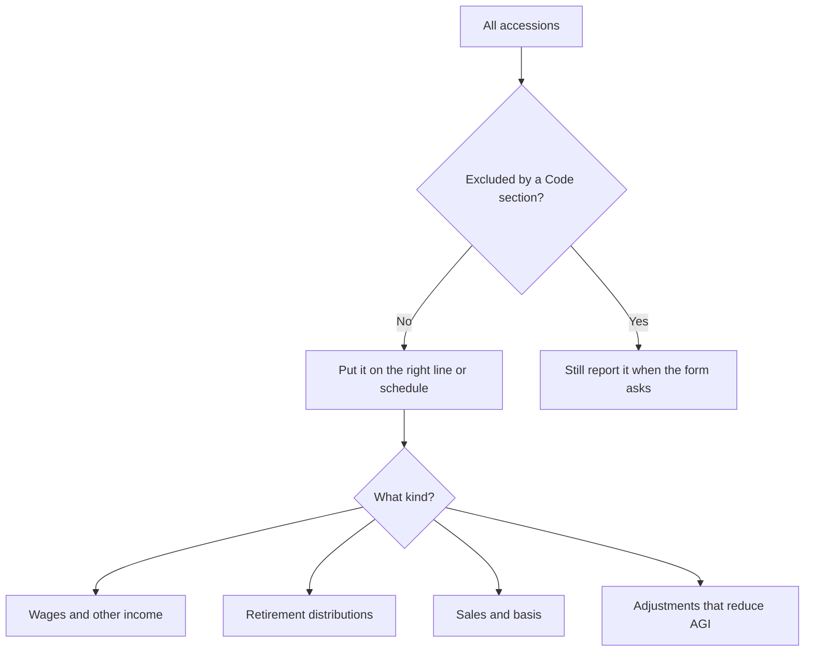

**17 scored questions, about 20% of the exam**

This is the widest domain. Publication 17 (2025) is the map. You are tested on what is income, what is excluded, where it is reported, basis, and the adjustments that arrive at adjusted gross income. Credits and itemized deductions are Domain 3. The extra taxes on this income are Domain 4.

### Wages, interest, dividends, and other income

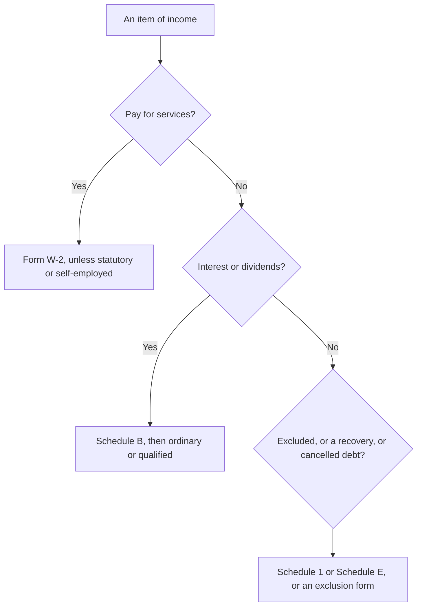

**Wages.** Taxable compensation includes salaries, bonuses, tips, taxable fringe benefits, and most awards. Report them on Form 1040 from Form W-2. Exclusions you should be able to name, and then confirm in Publication 15-B for 2025, include employer health coverage, qualified dependent-care assistance within the statutory cap, and group-term life insurance up to $50,000 of coverage. Coverage over $50,000 is included in wages. Tips are wages even when the 2025 qualified-tip deduction on Schedule 1-A removes some of them from taxable income later. Combat pay may be excluded from income and still elected into earned income for the earned income credit and the additional child tax credit. Publication 3 and Schedule 8812, line 18b.

A statutory employee reports W-2 wages on Schedule C. The W-2 box for statutory employee is the signal. That person pays self-employment-style tax through the wage withholding rules that already applied, so you do not also treat the same wages as ordinary self-employment income. Confirm the handling in the Schedule C instructions.

**Interest.** Taxable interest goes on Form 1040. Tax-exempt interest is reported and is not taxed. It is included in the modified AGI computations that affect Social Security taxation, the premium tax credit, and some savings-bond exclusions. Private-activity-bond interest can be an alternative-minimum-tax preference. Original-issue discount is income as it accrues. U.S. savings-bond interest can be deferred until redemption, and the education exclusion on Form 8815 phases out. For 2025, Rev. Proc. 2024-40 says that exclusion starts to phase out above modified AGI of $99,500 ($149,250 on a joint return) and is gone at $114,500 ($179,250 joint).

**Dividends.** Schedule B when the total requires it. Ordinary dividends are taxed at ordinary rates. Qualified dividends are taxed at the long-term capital-gain rates when the stock meets the holding period: more than 60 days during the 121-day period that begins 60 days before the ex-dividend date. The 2025 Form 1040 instructions walk through a 34-day holding that fails and a 63-day holding that works. A nondividend distribution is a return of capital that reduces basis, and it is gain only after basis is zero. Capital-gain distributions from a mutual fund are long-term capital gain.

**2025 long-term capital-gain breakpoints**, from Rev. Proc. 2024-40. Taxable income up to the zero-rate amount is taxed at 0 percent on adjusted net capital gain and qualified dividends. Income above that, up to the 15 percent amount, is taxed at 15 percent. Income above the 15 percent amount is taxed at 20 percent. These are the rate breakpoints, not the same thing as the 3.8 percent net investment income tax.

| Filing status | 0 percent up to | 15 percent up to |
| --- | --- | --- |
| Married filing jointly, and surviving spouse | $96,700 | $600,050 |
| Head of household | $64,750 | $566,700 |
| Single, and married filing separately | $48,350 | $300,000 for separate returns; $533,400 for other individuals |

Collectibles gain is capped at 28 percent, and unrecaptured section 1250 gain is capped at 25 percent. Those ceilings are in section 1(h). Confirm any 2025 worksheet change in the Schedule D instructions.

**Social Security and equivalent railroad retirement.** Up to 85 percent can be taxable. Provisional income, also called combined income, adds AGI other than the benefits, plus tax-exempt interest, plus one-half of the benefits. The base amounts are statutory and are not inflation-indexed: $25,000 for most single filers, $32,000 for married filing jointly, and zero for a married person filing separately who lived with a spouse at any time during the year. The second tier, above which up to 85 percent is taxable, is $34,000 and $44,000 for those first two statuses. Confirm the worksheet in the 2025 Publication 915. The Form 1040 instructions also say not to count Social Security in the filing-threshold gross income unless one-half of the benefits plus other gross income and tax-exempt interest exceeds $25,000 ($32,000 if married filing jointly), or the taxpayer is married filing separately and lived with the spouse.

**Other income the outline names.**

- **State and local income-tax refunds.** Tax benefit rule. A refund of a tax you deducted is income to the extent the deduction reduced tax. A refund of a year in which you took the standard deduction is not income. Form 1099-G. Publication 525.
- **Gambling.** Winnings are income, including amounts below the Form W-2G threshold. The 2025 Schedule A instructions allow a deduction for gambling losses, including the cost of nonwinning tickets, only to the extent of winnings reported on Schedule 1, and only as an itemized deduction. A taxpayer who takes the standard deduction still reports the winnings and gets no loss deduction.
- **Cancellation of debt.** Form 1099-C income is generally taxable. Exclusions include bankruptcy, insolvency to the extent of the insolvency, and certain qualified real property business indebtedness. Qualified principal residence indebtedness has been a separate exclusion with its own dollar cap and expiration history. Confirm in Publication 4681 whether a 2025 discharge of home debt still qualifies, and confirm the dollar cap there. Do not assume a cap from an older year. Insolvency is measured immediately before the cancellation. The excluded amount cannot exceed the insolvency.
- **Scholarships.** A candidate for a degree excludes amounts used for tuition and required fees, books, and equipment. Room and board are taxable. Payment for teaching or research is wages unless a specific exception applies. Publication 970.
- **Barter.** The fair market value of property or services received is income. Publication 17.
- **Hobby income.** Taxable. Expenses of a hobby are not deducted as a business loss. The activity is not reported as a Schedule C loss.
- **Illegal income.** Taxable. Publication 17.
- **Alimony.** Instruments executed after December 31, 2018: the recipient does not include it, and the payer does not deduct it. Instruments executed on or before that date: the old rules continue unless the instrument is changed to say the new rules apply. Child support and property settlements are never alimony. Publication 504.
- **Constructive receipt.** Income is taxable when it is credited to the taxpayer’s account or set apart, or otherwise made available without a substantial limitation, even if it is not in hand. A check received on December 31 is 2025 income. A contractual restriction that the funds cannot be withdrawn until January is not constructive receipt. Publication 538.
- **Constructive dividends.** A corporation’s payment of a shareholder’s personal expenses is a dividend to the shareholder when the corporation has earnings and profits. It is not tax-free and it is not wages unless it was paid as compensation.
- **Pass-through income.** Schedule K-1 items keep their character. Losses are allowed only after the basis limit, the at-risk limit on Form 6198, and the passive-activity limit on Form 8582, in that order. Qualified-business-income items are reported separately for Form 8995 or 8995-A. Basis goes up for income and contributions and down for distributions and allowed losses.
- **Passive income and losses.** Rental real estate is generally passive. A real-estate professional who materially participates can treat qualifying rentals as nonpassive. Publication 925. An active participant in a rental real estate activity may be allowed a special loss allowance of up to $25,000, phased out between $100,000 and $150,000 of modified AGI. Those dollar amounts are statutory and have not been indexed. Confirm they are unchanged in the 2025 Publication 925 and Instructions for Form 8582. Married filing separately is much more limited, and a couple who lived together at any time during the year generally gets no special allowance.
- **Royalties.** Schedule E, with the expenses of producing them.
- **Personal-property rental.** Renting equipment or other personal property is not Schedule E real estate. If it is a trade or business, use Schedule C. If it is not, Publication 17 puts the income and the related expenses on Schedule 1. A dwelling rented for fewer than 15 days during the year is a different rule: section 280A(g) excludes that rent and disallows the expenses. Confirm the day count in Publication 527.
- **Information returns.** Form 1099-NEC is nonemployee compensation. Form 1099-MISC covers rents, royalties, and other income. Form 1099-K reports payment-card and third-party settlement amounts, which can include nontaxable reimbursements and personal transfers. Report the taxable amount. Ask the payer for a correction when the form is wrong, and keep the reconciliation if the corrected form does not arrive. The 1099-K dollar threshold has changed more than once. Confirm the 2025 threshold in the Form 1099-K instructions rather than memorizing an older $600 or $20,000 figure.
- **Digital assets.** Answer the digital-asset question on Form 1040 even when a broker issues Form 1099-DA. Publication 17 (2025) says that for 2025 the broker may report basis on Form 1099-DA and is not required to. Virtual currency is property. Gain or loss is figured on Form 8949 and Schedule D.
- **Net operating loss.** An NOL is generally carried forward. Post-2017 NOLs are limited to 80 percent of taxable income in the carryforward year, with a farming carryback exception. Confirm the 2025 computation in Publication 536.
- **Foreign income of a citizen or resident.** Taxed unless a treaty or a Code exclusion applies. The foreign earned income exclusion for 2025 is **$130,000**, from Rev. Proc. 2024-40, section 911. The taxpayer must have a tax home abroad and meet either the bona fide residence test or the physical-presence test of 330 full days in a 12-month period. Form 2555. The foreign housing exclusion or deduction is separate and depends on location. Confirm the 2025 housing amounts in the Form 2555 instructions. Foreign tax on income that is taxed by the United States may support a credit on Form 1116. A treaty position that overrides the Code is disclosed on Form 8833 when the instructions require it. Forms 3520, 5471, and 8865 are information returns flagged here and tested again in Domain 6.

**Traps.** Omitting tax-exempt interest and then understating taxable Social Security. Deducting gambling losses above the line. Excluding a 2020 divorce’s “alimony” under the pre-2019 rule. Treating a Form 1099-K as the definition of taxable income. Reporting a constructive dividend as a tax-free shareholder draw.

### Retirement income

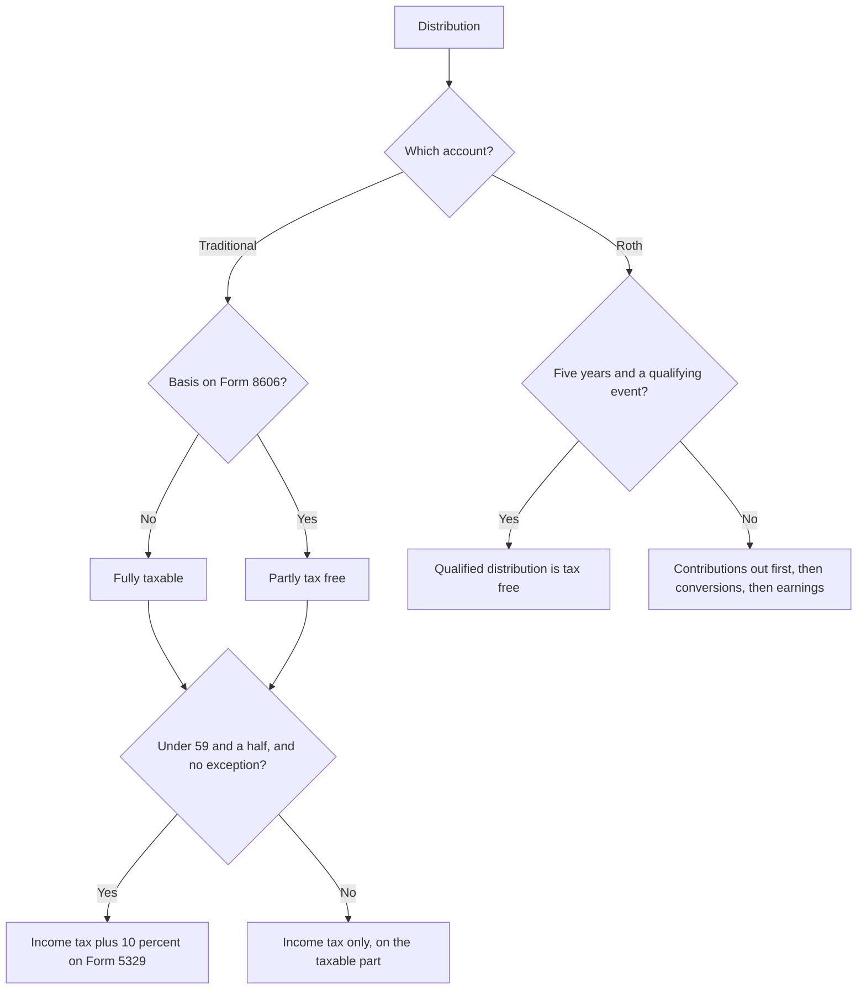

**Traditional and Roth.** Contributions and the deduction limits are in the adjustments section below. Distributions: a traditional IRA is taxable except for basis from nondeductible contributions, tracked on Form 8606. A qualified Roth distribution is tax free. It requires the five-year period and a qualifying event, generally age 59½, death, disability, or a first-time home purchase within the statutory lifetime cap. Nonqualified Roth distributions come out in order: contributions, then converted amounts, then earnings. Earnings are taxable. A conversion included in income is not taxed again. An early distribution of a conversion within five years can still draw the 10 percent additional tax. Publication 590-B.

**Conversions and recharacterization.** Converting a traditional IRA to a Roth is taxable to the extent of the pre-tax amount. Form 8606. A conversion made after 2017 cannot be recharacterized back to a traditional IRA. A regular contribution can still be recharacterized. Publication 590-A (2025).

**Qualified plans.** Form 1099-R. Pre-tax amounts are taxable. After-tax employee contributions are recovered under the plan’s basis rules. A direct rollover to another eligible plan or IRA is not currently taxed when it meets the rollover rules. An indirect rollover must be completed within 60 days, is subject to 20 percent mandatory withholding if paid from a qualified plan, and an IRA-to-IRA rollover is limited to one in a 12-month period. Trustee-to-trustee transfers are not that one-per-year rollover. Publication 575 and Publication 590-A.

**Qualified charitable distribution.** A QCD is a direct transfer from an IRA to an eligible charity. The account owner must be at least 70½. The excluded amount is not also claimed as a charitable deduction, and it counts toward the required minimum distribution. The annual dollar cap is inflation-adjusted. Confirm the 2025 cap in Publication 590-B before you memorize it.

**Early distributions.** The taxable amount is still included in income. Section 72(t) adds 10 percent unless an exception applies. Exceptions are not all the same for IRAs and for qualified plans. Ones you should be able to sort: age 59½, death, total and permanent disability, substantially equal periodic payments, unreimbursed medical expenses above the 7.5 percent of AGI floor, an IRS levy, and a qualified reservist distribution. IRA-only exceptions include qualified higher-education expenses, health-insurance premiums while unemployed, and a first-time homebuyer distribution with a $10,000 lifetime cap. That $10,000 is statutory and is not indexed. Other exceptions, including birth or adoption, terminal illness, domestic abuse, emergency personal expenses, and qualified disasters, have their own caps. Confirm every dollar cap in the 2025 Instructions for Form 5329. The additional tax is reported on Form 5329. The exception removes the 10 percent. It does not remove the income tax.

**Excess contributions.** Section 4973 imposes a 6 percent tax each year the excess stays in the account. Withdrawing the excess, and the earnings, by the due date including extensions avoids the 6 percent tax. The earnings are taxable, and they can be subject to the 10 percent additional tax.

**Prohibited transactions.** If an IRA owner engages in a prohibited transaction, the account ceases to be an IRA as of the first day of that year. The entire value is treated as distributed. Publication 590-A. A loan from an IRA is generally a prohibited transaction. A loan from a qualified plan is not a distribution when it stays inside the section 72(p) limits and repayment rules. Those limits are the lesser of $50,000 or half the vested balance, with a $10,000 floor in the Code’s formula. Confirm the computation in Publication 575. A loan that fails those rules is a deemed distribution.

**Required minimum distributions.** Traditional IRAs and qualified plans require them. Roth IRAs do not, during the original owner’s life. For the years this exam covers, the applicable age is 73 for a person who reaches 73 before the later SECURE 2.0 age of 75. Confirm the birth-year line in Publication 590-B (2025). The penalty for a missed RMD was reduced by the SECURE 2.0 Act to 25 percent of the shortfall, and to 10 percent when it is corrected within the correction window. Confirm those rates in the 2025 Form 5329 instructions, and do not use a penalty figure issued after December 31, 2025.

**Inherited accounts.** A surviving spouse can treat the IRA as the spouse’s own or remain a beneficiary. Most other designated beneficiaries who inherited after 2019 must empty the account by the end of the tenth year after death. Eligible designated beneficiaries, including a surviving spouse, a minor child of the decedent until majority, a disabled or chronically ill person, and a person not more than 10 years younger than the decedent, can still use a life-expectancy method. Confirm the 2025 required-distribution rules for the 10-year period in Publication 590-B. They have been the subject of regulations, and the exam stops at December 31, 2025.

**Foreign pensions.** Generally taxable to a U.S. citizen or resident when distributed, unless a treaty changes the timing or the amount. A treaty position may require Form 8833. The account may also be a foreign financial account for FBAR purposes or a specified foreign financial asset for Form 8938.

**Traps.** Recharacterizing a 2025 Roth conversion. Claiming both a QCD exclusion and a Schedule A deduction for the same dollars. Applying an IRA education exception to a 401(k). Forgetting that basis on Form 8606 makes only part of a traditional distribution tax free. Treating a failed qualified-plan loan as tax free because the employee intended to repay it.

### Property: basis and dispositions

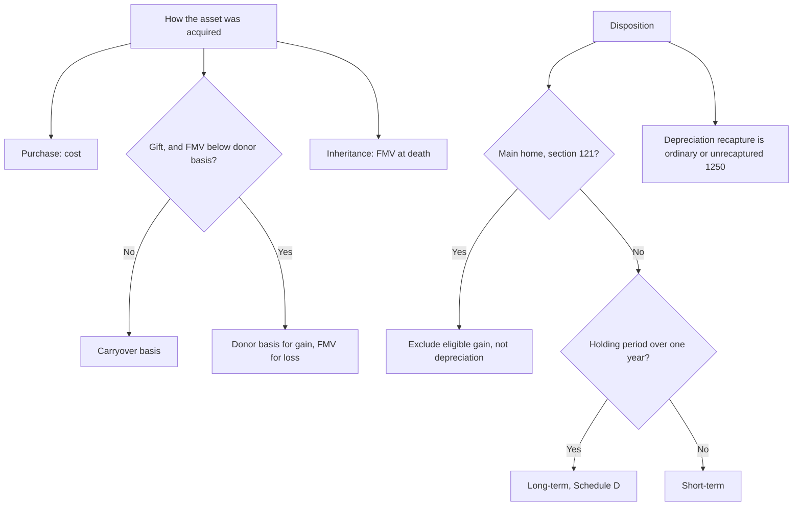

**Basis.** Publication 551.

- Purchased property: cost, including capital improvements, reduced by depreciation allowed or allowable.
- Gift: the donor’s basis, and the donor’s holding period tacks. If the fair market value at the gift was less than the donor’s basis, use the donor’s basis to measure gain and the fair market value to measure loss. If the selling price falls between them, there is neither gain nor loss.
- Inheritance: fair market value at the date of death, whether that is a step up or a step down. The holding period is automatically long-term. If the estate elects alternate valuation on Form 706, basis follows that election. Property that is income in respect of a decedent does not get a step-up. Domain 4.
- Stock split or nontaxable stock dividend: allocate the old basis across the old and new shares. The holding period of the new shares includes the holding period of the old shares. Confirm the allocation on the broker statement, and do not treat a nontaxable stock dividend as income.

**Character.** Short-term is one year or less. Long-term is more than one year. Net capital losses, including unused carryovers, are deducted against ordinary income up to **$3,000** a year, or **$1,500** if married filing separately. Publication 501 states the $1,500 limit. The rest carries forward indefinitely. Section 1245 depreciation recapture on personal property is ordinary income, reported on Form 4797. Unrecaptured section 1250 gain on real property is taxed at a maximum of 25 percent. The section 121 exclusion does not cover depreciation allowed after May 6, 1997.

**Sale of a main home.** Section 121 and Publication 523. A taxpayer can exclude up to **$250,000** of gain, or **$500,000** on a joint return, when the ownership and use tests are met and the taxpayer has not used the exclusion on another home in the prior two years. Those dollar amounts are in the statute and are not inflation-indexed. Ownership: the taxpayer owned the home for at least two years during the five years ending on the sale date. Use: the taxpayer lived in it as a main home for at least two years during that same five-year period. The two years need not be continuous. On a joint return, the $500,000 exclusion requires that both spouses meet the use test, at least one meets the ownership test, and neither has used the exclusion in the prior two years. If one spouse fails the use test, the exclusion is limited to the amount the other spouse could have excluded alone. A reduced exclusion can apply for a sale because of a change in place of employment, health, or certain unforeseen circumstances. Publication 523 has the fraction. Gain that cannot be excluded, including depreciation, is reported. Selling expenses reduce the amount realized.

**Installment sales.** Form 6252. Gain is recognized as payments are received, using the gross-profit percentage. Depreciation recapture is recognized in the year of sale even when payments come later. A related-party buyer who resells within two years can accelerate the original seller’s gain. The date of acquisition carries into the character of the gain. Confirm related-party rules in Publication 537.

**Like-kind exchanges.** Section 1031 and Form 8824. After 2017, like-kind exchange treatment is limited to real property held for productive use in a trade or business or for investment. It does not apply to stocks, bonds, inventory, partnership interests, or a personal residence. Boot is recognized. The replacement property must be identified and received inside the statutory 45-day and 180-day periods.

**Other dispositions the outline names.**

- **Nonbusiness bad debt.** It must be wholly worthless. It is a short-term capital loss. Form 8949. A gift to a relative is not a bad debt. Publication 550.
- **Investor versus trader.** An investor’s gains and losses are capital. Investment interest is deductible on Schedule A only to the extent of net investment income, Form 4952. A trader who has substantial, frequent trading activity and seeks to profit from short-term swings can deduct investment expenses as business expenses. A mark-to-market election under section 475(f) turns those gains and losses into ordinary income and loss. The election has a deadline. Trading gains are not self-employment income merely because the taxpayer is a trader. Confirm the tests in Publication 550.
- **Options.** Stock options that are exercised take a basis that includes the premium. An incentive stock option has no regular-tax income at exercise if the holding periods are met: two years from grant and one year from exercise. The bargain element is an AMT adjustment in the year of exercise. A disqualifying disposition makes the spread ordinary income. An employee stock purchase plan has its own qualifying-disposition rules. Publication 525. Commodity options and listed options that expire or are closed are capital gain or loss for an investor.
- **Publicly traded partnerships.** Losses from a PTP are allowed only against income from that same PTP, and suspended losses free up when the entire interest is disposed of in a taxable transaction. The K-1, not a generic passive-loss pool, controls. Form 8582 instructions.
- **Form 1099-A and Form 1099-C.** A foreclosure or repossession is a sale. The amount realized is generally the debt discharged in a nonrecourse loan, and it is the fair market value in a recourse loan, with the remaining cancelled recourse debt tested as cancellation-of-debt income. Publication 4681 and Publication 544.
- **Virtual currency and other digital assets.** Property. Each disposal is a sale. Basis is what you paid, including fees. A hard fork or airdrop can be ordinary income when you have dominion and control. Publication 17 (2025) and the Form 1040 digital-asset question.

**Traps.** Using fair market value as basis for a gift when computing gain. Applying section 121 to a house the taxpayer owned for two years and never lived in. Treating a stock-for-stock swap as a like-kind exchange. Deducting a partially worthless nonbusiness loan. Forgetting recapture in the year of an installment sale.

### Adjustments to income

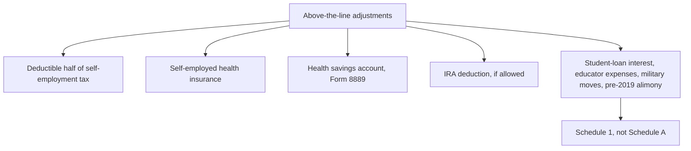

Adjustments reduce adjusted gross income. They are allowed even when the taxpayer takes the standard deduction. They are not itemized deductions, and they are not the Schedule 1-A deductions, which sit in their own place on the 2025 return.

**Self-employment tax deduction.** One-half of the self-employment tax from Schedule SE is an adjustment. It does not reduce the self-employment tax itself. The computation of that tax is Domain 4.

**Self-employed health insurance.** A self-employed person can deduct premiums for medical, dental, and qualified long-term-care coverage for themselves, a spouse, and dependents. The deduction cannot exceed the net profit from the business under which the plan is established. It is not allowed for months the taxpayer was eligible to participate in a subsidized employer health plan, including a spouse’s plan. It is an adjustment, not a Schedule A medical expense. The same premiums are not deducted twice.

**Health savings accounts.** 2025 amounts are from Rev. Proc. 2024-25.

| Item | 2025 amount |
| --- | --- |
| Contribution limit, self-only coverage | $4,300 |
| Contribution limit, family coverage | $8,550 |
| Minimum deductible of a high-deductible health plan | $1,650 self-only, $3,300 family |
| Maximum out-of-pocket | $8,300 self-only, $16,600 family |

An eligible individual who is age 55 or older by year-end may contribute an additional $1,000. That add-on is fixed in section 223(b)(3) and is not inflation-indexed. Confirm that Publication 969 for 2025 still prints $1,000. Contributions are deducted on Form 8889. Distributions used for qualified medical expenses are tax free. A nonqualified distribution is included in income and, if the account beneficiary is under 65, is subject to an additional 20 percent tax. Confirm the 20 percent additional tax in the 2025 Form 8889 instructions.

**IRA contributions for 2025**, from Publication 590-A (2025). The combined traditional and Roth contribution limit is **$7,000**, or **$8,000** if the taxpayer is age 50 or older, and it cannot exceed taxable compensation. A 2026 increase is printed in that publication and is not the law for this exam.

The traditional IRA deduction is phased out when the taxpayer is covered by a workplace plan. For 2025 the phaseout range is:

- Married filing jointly, or qualifying surviving spouse: modified AGI more than $126,000 and less than $146,000.
- Single, or head of household: more than $79,000 and less than $89,000.
- Married filing separately: less than $10,000.

If the taxpayer is not covered but the spouse is, the 2025 phaseout is modified AGI more than $236,000 and less than $246,000. At $246,000 or more, no deduction.

Roth contributions phase out, for 2025, at modified AGI of at least $236,000 and are gone at $246,000 for married filing jointly or a qualifying surviving spouse. For single, head of household, or married filing separately and not living with the spouse, the range starts at $150,000 and the contribution is gone at $165,000. Married filing separately and living with the spouse at any time: the contribution is phased out from more than zero and is gone at $10,000.

Compensation is required. A child with no earned income cannot contribute. A working spouse can support a spousal IRA for a spouse with little or no compensation, within the same dollar limits and the joint compensation limit.

**Other adjustments.**

- **Student-loan interest.** Up to **$2,500**. For 2025, Rev. Proc. 2024-40 phases it out above modified AGI of $85,000 ($170,000 joint) and ends it at $100,000 ($200,000 joint). Married filing separately cannot take it. The 2025 Form 1040 instructions say so.
- **Educator expenses.** Up to **$300** for 2025, from Rev. Proc. 2024-40, for an eligible educator’s unreimbursed classroom costs. Confirm Publication 17 (2025) still uses $300. Health and physical-education supplies that are nonathletic are excluded from the old statutory list; read the current definition before you stretch it.
- **Moving expenses.** Allowed only for a member of the Armed Forces on active duty who moves because of a military order and incident to a permanent change of station. Form 3903. Publication 3.
- **Alimony paid.** Deductible only for instruments that still follow the pre-2019 rule, described above. Publication 504.
- **Write-in adjustments.** A few items, such as a jury-duty pay repayment or certain attorney fees, are write-in adjustments on Schedule 1. Use the 2025 instructions for the exact line. Do not invent a write-in to force a deduction onto the return.

**Traps.** Deducting a traditional IRA contribution when the taxpayer is over the phaseout and covered by a plan. The contribution may still be allowed as a nondeductible contribution on Form 8606, and it may be converted, but it is not a deduction. Deducting self-employed health insurance on Schedule A and as an adjustment. Taking moving expenses for a new civilian job. Using the 2026 IRA limit of $7,500 on a 2025 question.

### Practice questions

**1.** A taxpayer received $1,000 of interest on a state municipal bond in 2025 and also received Social Security benefits. How is the bond interest treated?

A. It is omitted from the return because it is tax-exempt.
B. It is taxed as ordinary income on Schedule B.
C. It is reported as tax-exempt interest, it is not included in taxable interest, and it is included when figuring whether Social Security benefits are taxable.
D. It is a qualified dividend.

**Answer: C.** Tax-exempt interest is reported and is not part of taxable interest. It is added in the Social Security combined-income computation. Publication 17 and Publication 915.

**IRS basis:** Publication 17 (2025); 2025 Instructions for Form 1040; Publication 915.

**2.** In 2025 a taxpayer won $2,000 at a casino and had $2,000 of losing tickets. The taxpayer takes the standard deduction. What is the correct treatment?

A. Omit both, because they net to zero.
B. Include $2,000 of winnings in income. The losses are not deducted, because they are allowed only as an itemized deduction and only up to winnings.
C. Include $2,000 of winnings and deduct $2,000 as an adjustment to income.
D. Deduct the losses against the winnings on Schedule C.

**Answer: B.** Winnings are income even when the taxpayer does not itemize. The 2025 Schedule A instructions allow gambling losses only as an itemized deduction, and only to the extent of winnings.

**IRS basis:** 2025 Instructions for Schedule A, line 16; Publication 17 (2025).

**3.** A lender cancelled $20,000 of recourse credit-card debt in 2025. Immediately before the cancellation the taxpayer’s liabilities exceeded the fair market value of the taxpayer’s assets by $5,000. The taxpayer was not in bankruptcy. How much cancellation-of-debt income is excluded under the insolvency exclusion?

A. $20,000, because any insolvency excludes the entire debt.
B. $5,000, because the exclusion cannot exceed the amount by which the taxpayer was insolvent.
C. $0, because the insolvency exclusion applies only to home mortgages.
D. $15,000, the debt minus a statutory $5,000 floor.

**Answer: B.** The insolvency exclusion is limited to the amount of insolvency measured immediately before the cancellation. The other $15,000 is income. There is no $5,000 statutory floor. Qualified principal residence indebtedness is a different exclusion.

**IRS basis:** Publication 4681; IRC section 108(a)(1)(B) and 108(d)(3).

**4.** An employer handed a taxpayer a paycheck on December 31, 2025. The taxpayer deposited it on January 2, 2026. There was no restriction on cashing it. Which year includes the wages?

A. 2026, because that is the year of deposit.
B. 2025, under the constructive-receipt doctrine.
C. Split evenly between 2025 and 2026.
D. Neither year, until the taxpayer cashes the check.

**Answer: B.** Income credited or made available without a substantial limitation is received. Publication 538. Depositing the check in the next calendar year does not move the wages.

**IRS basis:** Publication 538; Publication 17 (2025).

**5.** In 2025 a taxpayer converted a traditional IRA to a Roth IRA and then changed their mind. The conversion was taxable. Which statement is correct?

A. The taxpayer may recharacterize the conversion back to a traditional IRA within 60 days.
B. A conversion done after 2017 cannot be recharacterized. A regular contribution can still be recharacterized.
C. The conversion is tax free because Roth accounts are always tax free.
D. The taxpayer may recharacterize the conversion if Form 8606 is not filed.

**Answer: B.** Publication 590-A (2025) reflects the rule that Roth conversions can no longer be recharacterized. The taxable portion of the conversion is included in income. Form 8606 reports the conversion. It does not undo it.

**IRS basis:** Publication 590-A (2025); IRC section 408A.

**6.** In 2023 a parent gave a taxpayer shares with the parent’s basis of $8,000 and a fair market value of $5,000. The taxpayer sold the shares in 2025 for $4,000. What is the loss?

A. $4,000, using a zero basis.
B. $1,000, using the fair market value at the gift as the basis for loss.
C. $4,000, using the parent’s $8,000 basis.
D. No loss and no gain, because gift property always has a basis equal to the sale price.

**Answer: B.** When fair market value at the date of the gift is below the donor’s basis, loss is measured from that fair market value. The donor’s basis is used to measure gain. A sale between the two amounts produces neither. Publication 551.

**IRS basis:** Publication 551; IRC section 1015.

**7.** A married couple filing jointly sold their main home in 2025. One spouse owned it for three years. Both spouses lived in it for three years. Neither had used the section 121 exclusion in the prior two years. The realized gain was $480,000, and there was no depreciation. How much of the gain can they exclude?

A. $250,000, because only one spouse owned the home.
B. $480,000, the entire gain, because $500,000 is the maximum and they are under it.
C. $0, because both spouses must be owners.
D. $500,000, even though the gain is only $480,000.

**Answer: B.** On a joint return, a $500,000 exclusion is available when at least one spouse meets the ownership test, both meet the use test, and neither used the exclusion in the prior two years. The exclusion cannot exceed the realized gain, so they exclude $480,000. The $250,000 and $500,000 ceilings are statutory. Publication 523.

**IRS basis:** IRC section 121; Publication 523.

**8.** Which 2025 exchange can qualify as a like-kind exchange under section 1031?

A. Listed stock exchanged for other listed stock.
B. A personal residence exchanged for another personal residence.
C. Real property held for investment exchanged for other real property to be held for investment.
D. A partnership interest exchanged for another partnership interest.

**Answer: C.** After 2017, section 1031 applies to real property held for productive use in a trade or business or for investment. Stock, partnership interests, and a personal residence do not qualify. Form 8824.

**IRS basis:** IRC section 1031; Form 8824 instructions; Publication 544.

## Domain 3 — Deductions and Credits

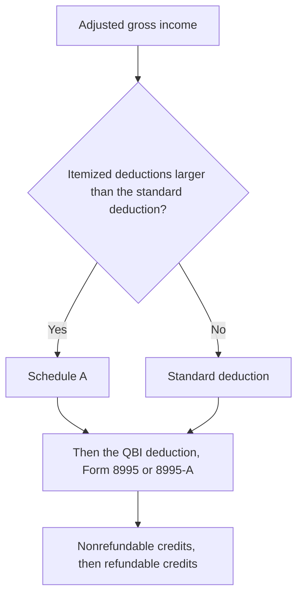

**17 scored questions, about 20% of the exam**

Deductions from AGI and credits are one domain. The order on the return matters: adjusted gross income, then the larger of the standard deduction or itemized deductions, then the qualified business income deduction, then tax, then nonrefundable credits, then other taxes, then payments and refundable credits. Schedule 1-A deductions, covered in Domain 1, are available with either the standard deduction or itemized deductions. Do not put them on Schedule A.

### Itemized deductions

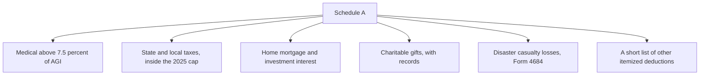

Compare the total with the standard deduction before you commit. Married filing separately, if one spouse itemizes, the other itemizes. A nonresident on Form 1040-NR generally cannot take the standard deduction and uses the itemized-deduction rules in the 1040-NR instructions and Publication 519. Some itemized deductions that residents take are limited or disallowed for nonresidents. Confirm each line in those instructions.

**Medical.** The 2025 Schedule A instructions: deduct the part of medical and dental expenses that exceeds **7.5 percent of AGI**. Include amounts paid for the taxpayer, the spouse, and a dependent, and for a person who would have been a dependent except for the gross-income or joint-return test. Qualified long-term-care premiums are medical expenses only up to the 2025 age caps in Rev. Proc. 2024-40:

| Age at year-end | Cap on includible premiums |
| --- | --- |
| 40 or under | $480 |
| 41 through 50 | $900 |
| 51 through 60 | $1,800 |
| 61 through 70 | $4,810 |
| Over 70 | $6,020 |

Do not include expenses that were reimbursed, cosmetic surgery that is not medically necessary, or nonprescription drugs other than insulin. Premiums deducted as self-employed health insurance are not deducted again. Confirm the 2025 medical standard mileage rate in the Schedule A instructions or Publication 502. This guide does not print that cents-per-mile figure.

**Taxes.** The 2025 instructions raise the overall limit on state and local income, sales, and property taxes to **$40,000** ($20,000 if married filing separately). The limit is reduced when modified AGI exceeds **$500,000** ($250,000 if married filing separately), and it is not reduced below **$10,000** ($5,000 if married filing separately). The taxpayer chooses state and local income taxes or general sales taxes, and may also include state and local real property taxes and personal property taxes, all inside that one cap. Foreign real property taxes are not deductible. Federal income tax is not deductible. An assessment that increases property value is added to basis, not deducted as a tax. A charitable gift that produces a state tax credit is reduced by the credit, and a safe harbor in the Schedule A instructions may let the disallowed piece be treated as a state-tax payment. Read that safe harbor before you move the number.

**Interest.** Qualified residence interest is interest on debt secured by the main home or a second home, and only to the extent the proceeds were used to buy, build, or substantially improve that home. The 2025 Schedule A instructions say to check the box on line 8 when proceeds were used for anything else. Interest on a home-equity loan used to buy a car is personal interest and is not deductible on line 8. Tracing can make interest on those proceeds deductible somewhere else if the proceeds were used in a business or an investment.

Dollar limits, from the 2025 Schedule A instructions: qualifying debt taken out on or before December 15, 2017, is limited to **$1,000,000** ($500,000 if married filing separately). Qualifying debt taken out after that date is limited to **$750,000** ($375,000 if married filing separately), reduced by debt that is already under the $1,000,000 limit. Grandfather and refinance details are in Publication 936. Points on the purchase of a main home can be deducted in the year paid when the Publication 936 tests are met. Points on a refinance are amortized over the life of the loan. Investment interest is deductible only up to net investment income, with a carryforward, on Form 4952.

**Charitable contributions.** Publication 526 and the 2025 Schedule A instructions.

- Cash of any amount needs a bank record or a written record from the charity showing the name, date, and amount.
- A gift of $250 or more also needs a contemporaneous written acknowledgment. Contemporaneous means you have it by the earlier of the filing date or the due date including extensions. The acknowledgment describes the gift and states whether any goods or services were provided. It does not have to value property. Separate gifts are not combined to reach $250. The dinner example in the instructions: $70 paid, $40 value of the dinner, $30 deductible.
- A noncash deduction of more than $500 requires Form 8283. That $500 is measured before income limits. Form 8283 is not a substitute for the written acknowledgment.
- A deduction over $5,000 generally needs a qualified appraisal, with a lower appraisal trigger for certain clothing and household items. A vehicle, boat, or airplane deducted at more than $500 needs the charity’s statement, often Form 1098-C.
- Clothing and household items must be in good used condition or better, unless a single item over $500 is appraised and reported on Form 8283.
- Used property is deducted at fair market value. Ordinary-income property is limited to basis. The percentage-of-AGI ceilings depend on the type of property and the type of charity. The 2025 Schedule A instructions send you to Publication 526 when cash or ordinary-income property is more than 30 percent of AGI, or capital-gain property is more than 20 percent of AGI. Confirm the exact 2025 ceilings, including the cash-to-public-charity ceiling, in Publication 526. This guide does not print a single percentage as if it covered every gift.
- Unused amounts generally carry forward five years. The instructions note that 2021 carryovers deducted in 2025 are subject to a 60 percent limitation.
- Out-of-pocket volunteer expenses can qualify. The 2025 instructions allow actual gas and oil or **14 cents a mile**, plus parking and tolls. The value of your time and the value of blood donated do not qualify. Gifts to individuals, political organizations, and social clubs do not qualify.

**Casualty and theft.** Personal losses are deductible only when they are attributable to a federally declared disaster, and only to the extent each loss exceeds **$100** and the year’s losses exceed **10 percent of AGI**. The 2025 Schedule A instructions state both floors. Use Form 4684. A net qualified disaster loss has its own reporting path and can increase the standard deduction. Personal losses that are not from a federally declared disaster are not deducted on line 15. Losses of income-producing property are a different item and can be deducted on line 16. Do not net a personal casualty against ordinary income.

**Other itemized deductions.** The miscellaneous deductions that used to be subject to the 2 percent floor are not on the 2025 Schedule A list. Line 16 is a closed list. It includes gambling losses to the extent of winnings, the federal estate tax on income in respect of a decedent, amortizable bond premium, and a claim-of-right repayment of more than $3,000. Confirm any other item against that list before you deduct it. Impairment-related work expenses of a person with a disability remain deductible. Publication 529.

**Traps.** Deducting medical expenses from the first dollar. Deducting interest on home-equity proceeds used for personal spending. Forgetting the contemporaneous acknowledgment on a $250 gift that was paid by check. Deducting a house fire that was not part of a federally declared disaster. Claiming state income taxes and general sales taxes.

### Qualified business income deduction

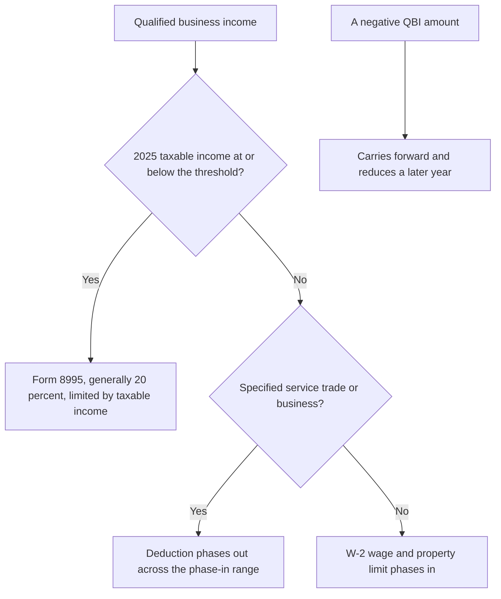

Section 199A allows a deduction of up to 20 percent of qualified business income from a pass-through, plus 20 percent of qualified REIT dividends and publicly traded partnership income, limited to 20 percent of taxable income measured without the deduction itself. It does not reduce adjusted gross income. It is not an itemized deduction. A loss in one qualified business nets against income of another. A remaining negative amount carries forward.

**2025 thresholds**, from Rev. Proc. 2024-40:

| Filing status | Threshold | Top of the phase-in range |
| --- | --- | --- |
| Married filing jointly | $394,600 | $494,600 |
| Married filing separately | $197,300 | $247,300 |
| All other filers | $197,300 | $247,300 |

At or below the threshold, use Form 8995. Specified service trades or businesses, including the fields listed in section 199A such as health, law, accounting, consulting, and financial services, still qualify at or below the threshold. Above the top of the phase-in range, a specified service trade or business produces no QBI deduction. Between the threshold and the top of the range, the deduction is phased down. For a non-specified business, the W-2 wage and unadjusted-basis-immediately-after-acquisition limit phases in across that same range and applies fully above it. Form 8995-A makes that computation. Cooperative dividends and the agricultural adjustment have their own lines. Confirm a close call in the 2025 instructions for those forms.

**Traps.** Subtracting the deduction to arrive at AGI, which then changes a credit phaseout that is based on AGI. Giving a specified service business a full deduction when taxable income is above the top of the 2025 phase-in range. Forgetting a negative QBI carryover from the prior year.

### Credits

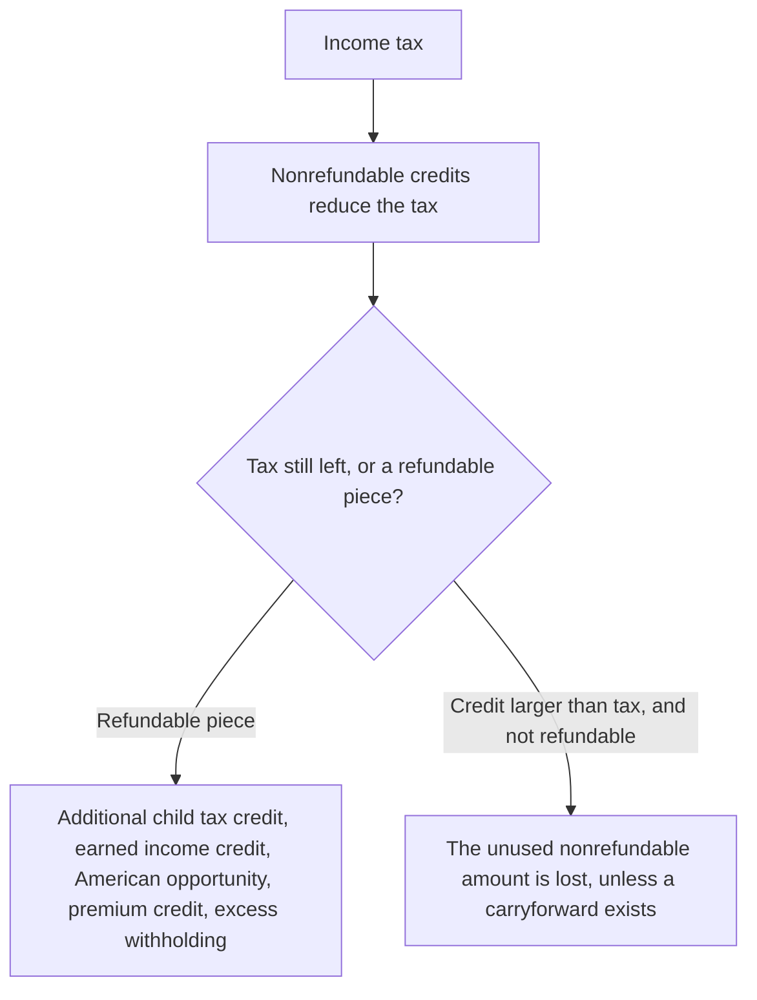

A nonrefundable credit can reduce tax to zero and then stops. A refundable credit can create a refund. Some credits are partly each. The outline’s list is the child and dependent care credit, the child tax credit and the credit for other dependents, education credits, the foreign tax credit, the earned income credit, adoption credits, the premium tax credit, and a group of other credits.

**Child tax credit and credit for other dependents.** 2025 Instructions for Schedule 8812 and the IRS child-tax-credit page.

- The maximum child tax credit is **$2,200** per qualifying child.
- Up to **$1,700** per qualifying child can be the refundable additional child tax credit.
- The child must be under 17 at the end of 2025, must be a dependent, and must meet the qualifying-child relationship, support, residency, and joint-return tests, and must be a U.S. citizen, national, or resident alien. A child who turned 17 on December 30, 2025 is not a qualifying child for this credit. The Schedule 8812 instructions use that example.
- The taxpayer, and the child, need a Social Security number valid for employment and issued before the due date including extensions. On a joint return, one spouse’s work-eligible SSN is enough if the other spouse has an SSN or ITIN by that date.
- The credit starts to phase out when modified AGI exceeds **$200,000**, or **$400,000** if married filing jointly.
- The additional child tax credit requires earned income of at least **$2,500**, with a separate path when the taxpayer has three or more qualifying children. A taxpayer who files Form 2555 cannot claim the additional child tax credit. Nontaxable combat pay can be elected into earned income.
- The credit for other dependents is a nonrefundable credit for a dependent who is not a child-tax-credit qualifying child. Confirm the 2025 per-person amount on the 2025 Schedule 8812 itself. This guide does not print it, because the instructions describe the credit and the form, rather than a sentence this research could quote as the dollar amount. You cannot check both credit boxes for the same person. The credit for other dependents is not refundable.

**Child and dependent care credit.** Form 2441. The qualifying person is generally a dependent under age 13, or a spouse or dependent who is incapable of self-care and lived with the taxpayer more than half the year. The expenses must be for work or for looking for work. There is an earned-income limit, and a spouse who is a student or incapable of self-care is treated as having earned income. Married filing separately is generally not eligible. Employer dependent-care benefits excluded from wages reduce the expenses available for the credit. Confirm the 2025 expense caps and the AGI percentage table in the Form 2441 instructions. Those dollar figures are not copied here.

**Education credits.** Form 8863 and Publication 970. The American opportunity credit is for the first four years of postsecondary education, for a student who is enrolled at least half time and has not been convicted of a felony drug offense. The statutory maximum is **$2,500** per student: 100 percent of the first $2,000 of qualified expenses plus 25 percent of the next $2,000. Up to 40 percent, a maximum of **$1,000**, is refundable, unless the taxpayer is subject to the section 25A(g) limits, including a married person filing separately and certain taxpayers under 24. The lifetime learning credit is 20 percent of up to $10,000 of qualified expenses, a maximum of **$2,000** per return, it is not refundable, and it is not limited to four years. You cannot claim both credits for the same student for the same year. The same expenses cannot also be excluded from a Coverdell account or a section 529 distribution. The American opportunity phaseout is statutory and is not indexed: modified AGI of $80,000 to $90,000, or $160,000 to $180,000 if married filing jointly. Confirm the 2025 lifetime-learning phaseout, which is indexed, in the Form 8863 instructions.

**Foreign tax credit.** Form 1116. The credit is for foreign income tax on income that is also taxed by the United States. It is not allowed on income you excluded under the foreign earned income exclusion. A simplified election lets some taxpayers claim the credit directly on Schedule 3 without Form 1116 when all of the foreign tax is passive and below the instruction’s dollar limit. Confirm that 2025 dollar limit in the Form 1040 instructions. Unused credit carries back one year and forward ten. Section 904.

**Earned income credit.** Publication 596 and Form 1040. It is refundable. The taxpayer must have earned income, a valid Social Security number, and cannot be a qualifying child of another person. Married filing separately is generally disqualified, with a limited exception for separated spouses. Investment income above the 2025 ceiling disqualifies the credit. Rev. Proc. 2024-40 sets that ceiling at **$11,950** and sets these maximum credits:

| Qualifying children | Maximum credit in Rev. Proc. 2024-40 |
| --- | --- |
| None | $649 |
| One | $4,328 |
| Two | $7,152 |
| Three or more | $8,046 |

Confirm the maximum and the phaseout table in the 2025 Form 1040 instructions or Publication 596. The revenue procedure states the figures as the Code stood on October 22, 2024. Use the form instructions if they differ. A paid preparer completes Form 8867. If the IRS disallowed the credit in a prior year, Form 8862 is often required before the taxpayer claims it again. The qualifying-child rules for this credit do not include the support test, and a child can fail to be a dependent and still be a qualifying child for the credit in some cases. Use the Publication 596 tests rather than the dependency tests alone.

**Adoption credit.** Form 8839. For 2025, Rev. Proc. 2024-40 sets the maximum credit at **$17,280** of qualified adoption expenses, and it sets the same $17,280 amount for the adoption of a child with special needs even when expenses are lower. The credit phases out above modified AGI of **$259,190** and is gone at **$299,190**. An employer adoption-assistance exclusion uses the same dollar figures. The credit is nonrefundable in the year of the adoption and carries forward five years. Confirm the carryforward period and any refundable change in the 2025 Form 8839 instructions. A special-needs determination comes from the state, not from a medical diagnosis alone.

**Premium tax credit.** Form 8962 and Form 1095-A. Reconcile the advance credit. Household income and household size drive the allowable credit. Married filing separately is generally ineligible, with relief for abuse or abandonment. A person who is eligible for other minimum essential coverage, such as an affordable employer plan, is generally not eligible for the months of that coverage. Confirm the 2025 applicable-figure table and the repayment caps in the Form 8962 instructions.

**Other credits the outline names.**

- The retirement savings contributions credit, Form 8880, is nonrefundable. The rate is 50, 20, or 10 percent of eligible contributions up to $2,000 per person. The AGI brackets are indexed. Confirm the 2025 brackets on Form 8880. Distributions can reduce the eligible contributions.
- Residential energy credits are on Form 5695. Confirm the 2025 rates and caps in those instructions. Annual limits and carryforwards differ between the two parts of the form.
- The health coverage tax credit, Form 8885, is a narrow credit for eligible trade-adjustment and PBGC recipients. Do not confuse it with the premium tax credit.
- The mortgage interest credit, Form 8396, for holders of a mortgage credit certificate, reduces the Schedule A interest deduction by the credit amount. The Schedule A instructions say to subtract Form 8396, line 3.

**Traps.** Claiming the child tax credit for a child who turned 17 in December. Checking both credit boxes. Claiming the American opportunity credit and the lifetime learning credit for the same student. Taking the foreign tax credit on income that was excluded on Form 2555. Treating the adoption credit for a special-needs child as limited to receipts. Using a qualifying-relative support analysis to deny an earned income credit qualifying child.

### Practice questions

**1.** A taxpayer’s 2025 adjusted gross income is $40,000. Qualified medical expenses are $4,000. None were reimbursed, and none were deducted as self-employed health insurance. How much is deductible on Schedule A?

A. $4,000.
B. $1,000, because only the amount over 7.5 percent of AGI is deductible.
C. $3,000, because the floor is $1,000.
D. $0, because medical expenses are an adjustment to income.

**Answer: B.** The 2025 Schedule A instructions allow the amount that exceeds 7.5 percent of AGI. Seven and a half percent of $40,000 is $3,000, so $1,000 is deductible. The self-employed health insurance deduction is a different provision and was not used here.

**IRS basis:** 2025 Instructions for Schedule A; IRC section 213.

**2.** A married couple filing jointly has 2025 modified AGI of $200,000. They paid $18,000 of state income tax and $30,000 of real property tax, and they will not claim a general sales-tax deduction. What is the maximum state and local tax deduction?

A. $10,000.
B. $40,000.
C. $48,000, the full amount paid.
D. $20,000, because every joint return is limited to $20,000.

**Answer: B.** The 2025 instructions set the cap at $40,000 for a joint return. The phaseout begins only when modified AGI exceeds $500,000, so this couple is under the phaseout. The $10,000 figure is the floor the cap will not fall below after the phaseout, not the cap itself. The $20,000 figure is the married-filing-separately cap.

**IRS basis:** 2025 Instructions for Form 1040 and Instructions for Schedule A, line 5e.

**3.** In 2025 a taxpayer borrowed on a home-equity loan secured by the main home and used all of the proceeds to buy a personal car. The loan is well under $750,000. How is the interest treated?

A. It is qualified residence interest because the loan is secured by the home.
B. It is not qualified residence interest, because the proceeds were not used to buy, build, or substantially improve the home.
C. It is an adjustment to income.
D. It is deductible as investment interest.

**Answer: B.** The 2025 Schedule A instructions limit the deduction to interest on qualifying debt, which is debt used to buy, build, or substantially improve the home that secures the loan. Security alone is not enough. Personal interest on a car is not investment interest and is not an adjustment.

**IRS basis:** 2025 Instructions for Schedule A, limits on home mortgage interest; Publication 936.

**4.** On March 1, 2025 a taxpayer wrote one check for $300 to a public charity and received nothing in return. The taxpayer has the cancelled check. The return will be filed on April 1, 2026. Which statement is correct?

A. The cancelled check is enough.
B. The taxpayer also needs a contemporaneous written acknowledgment from the charity, in hand by the earlier of the filing date or the due date including extensions.
C. No record is required for a gift under $500.
D. Form 8283 replaces the acknowledgment.

**Answer: B.** Cash of any amount needs a bank record or a written charity record. A single gift of $250 or more also needs a contemporaneous written acknowledgment. Form 8283 is for noncash deductions over $500 and does not replace the acknowledgment.

**IRS basis:** 2025 Instructions for Schedule A, gifts of $250 or more and cash recordkeeping.

**5.** A taxpayer’s personal belongings were stolen in 2025. The loss was not from a federally declared disaster. The taxpayer had no casualty gains. How is the theft treated on Schedule A?

A. Deduct the loss above $100 and above 10 percent of AGI.
B. Deduct the full loss as an other itemized deduction.
C. Do not deduct it as a personal casualty or theft loss.
D. Deduct it on Schedule C.

**Answer: C.** The 2025 Schedule A instructions allow a personal casualty or theft loss only when it is attributable to a federally declared disaster, and then only after the $100 and 10 percent floors. A non-disaster personal theft with no casualty gains is not deducted. Schedule C is for a business.

**IRS basis:** 2025 Instructions for Schedule A, line 15; Publication 547.

**6.** A single taxpayer’s 2025 taxable income, before the qualified business income deduction, is $100,000. The only qualified business is a specified service trade or business with $40,000 of qualified business income. Which form and result fit the 2025 thresholds?

A. No deduction, because a specified service trade or business never qualifies.
B. Form 8995. The taxpayer is under the $197,300 threshold, so the specified-service limit does not remove the deduction.
C. Form 8995-A, because every specified service business is phased out.
D. An itemized deduction on Schedule A.

**Answer: B.** Rev. Proc. 2024-40 sets the 2025 threshold for a single filer at $197,300. At or below the threshold, a specified service trade or business can still produce a deduction, computed on Form 8995, and the deduction is not an itemized deduction. The wage-and-property limit and the specified-service phaseout apply above the threshold.

**IRS basis:** Rev. Proc. 2024-40, section 199A amounts; 2025 Instructions for Form 8995; IRC section 199A.

**7.** A taxpayer’s child turned 17 on December 30, 2025, lived with the taxpayer all year, and is a U.S. citizen claimed as a dependent. The child has a Social Security number valid for employment. For 2025, which credit can the child support?

A. The child tax credit.
B. The additional child tax credit only.
C. Neither the child tax credit nor the credit for other dependents, because the child is 17.
D. The credit for other dependents, if the taxpayer otherwise qualifies, and not the child tax credit.

**Answer: D.** The Schedule 8812 instructions say a child who turned 17 on December 30, 2025 was not under 17 at year-end, so the child is not a qualifying child for the child tax credit or the additional child tax credit. A dependent who is not a child-tax-credit qualifying child can support the credit for other dependents. Both boxes cannot be checked.

**IRS basis:** 2025 Instructions for Schedule 8812; IRS child tax credit page.

**8.** A taxpayer paid qualified education expenses in 2025 for one undergraduate student in a third year of school, enrolled at least half time. The taxpayer wants both the American opportunity credit and the lifetime learning credit for that student. Which statement is correct?

A. Both credits may be claimed for the same student for the same year.
B. The American opportunity credit may be claimed for that student. The lifetime learning credit may not be claimed for the same student for the same year.
C. Only the lifetime learning credit is allowed after the first year of school.
D. Neither credit is allowed after the first year.

**Answer: B.** The American opportunity credit covers the first four years. The lifetime learning credit covers an unlimited number of years. Form 8863 does not allow both credits for the same student for the same year. A different student on the same return could still support the other credit.

**IRS basis:** 2025 Instructions for Form 8863; Publication 970; IRC section 25A.

## Domain 4 — Taxation

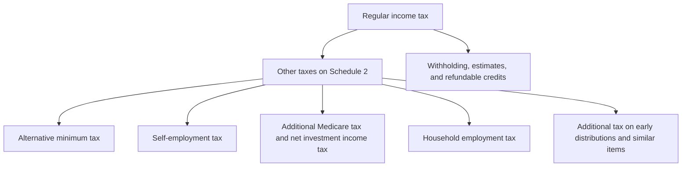

**15 scored questions, about 18% of the exam**

Domain 4 is the tax itself, after income and deductions are known. The questions are computations and classifications: which tax applies, which form, and which safe harbor. Publication 17 (2025) and Schedule 2 are the index.

### Taxes that sit on top of the regular tax

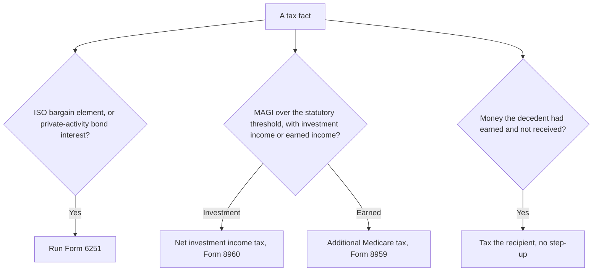

**Alternative minimum tax.** Form 6251. The taxpayer pays the excess of tentative minimum tax over the regular tax. For 2025, Rev. Proc. 2024-40 sets these exemption amounts:

| Status | Exemption | Phaseout starts at |
| --- | --- | --- |
| Married filing jointly, or surviving spouse | $137,000 | $1,252,700 |
| Unmarried, other than a surviving spouse | $88,100 | $626,350 |
| Married filing separately | $68,500 | $626,350 |

The 26 percent rate applies until the excess taxable income above the exemption computation reaches $239,100 ($119,550 if married filing separately). Above that, the rate is 28 percent. Confirm the phaseout rate on the 2025 Form 6251. Common adjustments and preferences: the bargain element of an incentive stock option at exercise, certain depreciation differences, and tax-exempt interest on specified private activity bonds. State and local tax deductions and miscellaneous itemized deductions that are already disallowed for regular tax do not create a second add-back.

The credit for prior-year minimum tax, Form 8801, carries forward the minimum tax that came from deferral items, such as the ISO bargain element, and can reduce regular tax in a later year. Exclusion items do not create that credit. A child’s AMT exemption, when the kiddie tax applies, is limited to the child’s earned income plus $9,550 for 2025. Rev. Proc. 2024-40 states that limit.

**Net investment income tax.** Section 1411 and Form 8960. The tax is **3.8 percent** of the smaller of net investment income or the amount by which modified AGI exceeds the statutory threshold. The thresholds are not indexed: **$250,000** for married filing jointly or a qualifying surviving spouse, **$200,000** for single or head of household, and **$125,000** for married filing separately. Net investment income includes interest, dividends, annuities, royalties, rents, passive activity income, and net gain from disposing of property, reduced by the deductions properly allocable to that income. It does not include wages, self-employment income, or tax-exempt municipal bond interest. Confirm the 2025 threshold statement in the Form 8960 instructions.

**Additional Medicare tax.** Section 3101(b)(2) and Form 8959. The rate is **0.9 percent** on the amount by which Medicare wages, railroad compensation, and self-employment income exceed the same statutory thresholds: $200,000, $250,000, and $125,000. An employer withholds the 0.9 percent when wages from that employer exceed **$200,000**, without regard to the employee’s filing status or other jobs. A joint couple can be over-withheld or under-withheld. Form 8959 reconciles it. This tax is not part of self-employment tax, and there is no deduction for half of it.

**Income in respect of a decedent.** Section 691 and Publication 559. IRD is income the decedent earned but did not include before death, such as unpaid wages, traditional IRA balances, and installment-sale gain. The recipient includes it in income and keeps the character it would have had. There is no basis step-up. If the estate paid estate tax on that item, the recipient deducts the estate tax attributable to it. The 2025 Schedule A instructions list that deduction as an other itemized deduction.

**Other taxes on the outline.**

- **First-time homebuyer credit repayment.** The 2008 credit is repaid in installments. Form 5405 computes the repayment, and it is an additional tax. A sale or a change in the home’s use can accelerate it. Confirm any remaining balance against the taxpayer’s prior Form 5405 rather than a remembered installment.
- **Uncollected Social Security and Medicare tax on tips.** If the employer could not withhold the tax, the employee reports it on Form 4137. Amounts already shown on Form W-2, box 12, codes A and B, are reported as tax on the return. They are not income.
- **Underpayment penalty and interest.** The penalty is computed on Form 2210. Interest under section 6601 is separate and is not a penalty. Neither is deductible as an itemized deduction. The safe harbor is in Domain 5 because the outline places penalty avoidance with advising, and the computation sits here. Know both: the penalty is not a flat percentage of the balance due, and withholding is treated as paid evenly during the year unless the taxpayer elects actual dates.

**Traps.** Running AMT because the taxpayer itemizes state taxes. Those taxes are already limited for regular tax and are not, by themselves, the old AMT add-back. Forgetting Form 8959 when a joint couple each earned $150,000 and neither employer withheld the 0.9 percent, because neither paycheck crossed $200,000. Giving IRD a date-of-death basis.

### Employment taxes and special taxpayers

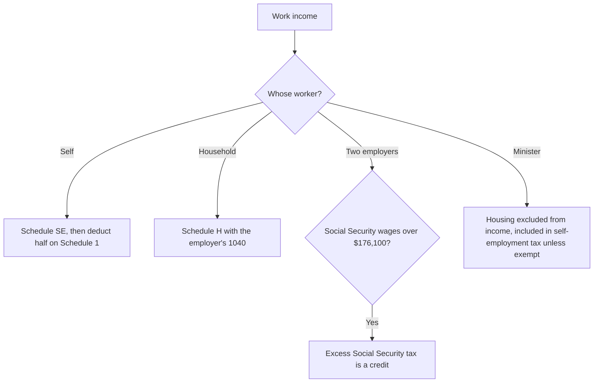

**Self-employment tax.** Schedule SE. Net earnings from self-employment of $400 or more generally require the tax. Confirm that floor in the 2025 Schedule SE instructions. The tax is 12.4 percent for Social Security plus 2.9 percent for Medicare, which is 15.3 percent, applied to 92.35 percent of net earnings. The Social Security portion applies only until combined wages and self-employment earnings reach the 2025 wage base of **$176,100**. Publication 17 (2025) uses that wage base. Medicare has no wage base. Optional methods can produce a small amount of coverage when net earnings are low. Confirm the 2025 optional-method ceilings in the Schedule SE instructions before you compute them. One-half of the self-employment tax is the adjustment in Domain 2.

**Excess Social Security withholding.** If two or more employers withheld Social Security tax on combined wages above $176,100, the employee claims the excess as a refundable credit on Schedule 3. Publication 17 (2025) states this. If one employer withheld too much, the employer adjusts it. The employee does not claim that excess as the Schedule 3 credit. Tier 1 railroad retirement tax is combined with Social Security tax for this purpose.

**Household employees.** Schedule H and Publication 926. A household employee is an employee even though the employer is a family. The employer files Schedule H with Form 1040 when cash wages reach the year’s Social Security and Medicare threshold, or when the employer withheld federal income tax at the employee’s request, or when federal unemployment tax applies. Confirm the 2025 cash-wage threshold in the Schedule H instructions. This guide does not print it. Federal unemployment tax generally applies when the employer paid $1,000 or more in any calendar quarter. That $1,000 test is the Code rule. Confirm it in the 2025 Schedule H instructions. The employer issues Form W-2. The employee does not report those wages on Schedule C. A parent, a spouse, and a child under 21 have special FICA and FUTA exceptions. Publication 926.

**Clergy.** Publication 517. A minister pays income tax on salary and pays self-employment tax on ministerial earnings, including the housing allowance and the fair rental value of a parsonage, unless the IRS approved an exemption from self-employment tax on Form 4361. The housing allowance is excluded from income tax to the extent it does not exceed the lesser of the designated amount, actual housing costs, or the fair rental value. It is not excluded from self-employment tax by that income-tax exclusion. A minister who is exempt from self-employment tax under Form 4361 does not pay it on ministerial earnings and does not earn Social Security coverage for those earnings.

**Military.** Publication 3. Combat-zone compensation can be excluded from income. The taxpayer may elect to count nontaxable combat pay as earned income for the earned income credit and the additional child tax credit. Moving expenses are allowed for a permanent change of station, on Form 3903. Reservists traveling more than 100 miles may have an adjustment for unreimbursed travel. Confirm that rule in Publication 3 rather than treating it as an itemized deduction.

**Traps.** Deducting half of self-employment tax and also deducting it from the Schedule SE tax. Claiming excess Social Security tax when only one employer was involved. Putting a nanny on Schedule C of the nanny’s return at the employer’s insistence. Excluding a housing allowance from self-employment income because it was excluded from wages.

### Practice questions

**1.** A single taxpayer’s 2025 modified AGI is $220,000. Net investment income is $10,000. The rest of the income is wages. What is the net investment income tax?

A. 3.8 percent of $220,000.
B. 3.8 percent of $10,000, because that is smaller than the $20,000 by which modified AGI exceeds $200,000.
C. 0.9 percent of $20,000.
D. No tax, because wages are more than half of the income.

**Answer: B.** The tax is 3.8 percent of the smaller of net investment income or the excess of modified AGI over the threshold. For a single taxpayer the threshold is $200,000. The excess is $20,000. Net investment income is $10,000, so the tax is 3.8 percent of $10,000. Wages are not net investment income. The 0.9 percent tax is the additional Medicare tax.

**IRS basis:** IRC section 1411; Form 8960 instructions.

**2.** Each spouse earned $180,000 in wages from a separate employer in 2025. They file jointly. Neither employer withheld additional Medicare tax. Which statement is correct?

A. No additional Medicare tax is due, because neither employer paid more than $200,000.
B. Additional Medicare tax is due on the amount of their combined earned income over $250,000, computed on Form 8959.
C. Additional Medicare tax is due on the full $360,000.
D. The tax is 3.8 percent of $360,000.

**Answer: B.** Employers withhold the 0.9 percent tax only when wages from that employer exceed $200,000. The couple’s joint threshold is $250,000. Form 8959 computes the tax on the excess and credits any withholding. None was withheld here. The 3.8 percent tax is the net investment income tax.

**IRS basis:** IRC section 3101(b)(2); 2025 Form 8959 instructions.

**3.** A taxpayer has one employer in 2025 and that employer withheld Social Security tax on wages of $190,000. The 2025 Social Security wage base is $176,100. How does the taxpayer recover the excess withholding?

A. Claim it as a refundable credit on Schedule 3.
B. Ask that employer to correct the withholding. The Schedule 3 credit is for excess tax withheld by two or more employers.
C. Deduct it as an adjustment to income.
D. File FinCEN Form 114.

**Answer: B.** Publication 17 (2025) tells a worker with two or more employers and wages over $176,100 to claim the excess as a credit. When one employer withholds too much, the employer makes the adjustment. The credit is not an AGI adjustment, and it is not an FBAR item.

**IRS basis:** Publication 17 (2025), excess social security withholding.

**4.** Which item is an adjustment to income rather than a reduction of the self-employment tax?

A. The deductible half of self-employment tax.
B. The 0.9 percent additional Medicare tax.
C. The standard deduction.
D. The qualified business income deduction.

**Answer: A.** Schedule SE computes the full self-employment tax. One-half of that tax is then deducted on Schedule 1. It does not reduce the tax on Schedule 2. The additional Medicare tax is computed on Form 8959 and is not half deductible. The standard deduction and the QBI deduction are not self-employment items.

**IRS basis:** 2025 Instructions for Schedule SE and Schedule 1; Publication 334.

**5.** A taxpayer exercised an incentive stock option in 2025 and held the shares through year-end. The bargain element is $20,000. The taxpayer sold nothing. What is the regular-tax and AMT result for 2025?

A. $20,000 of ordinary income for regular tax, and no AMT adjustment.
B. No regular-tax income in 2025 if the ISO holding periods are still open, and an AMT adjustment for the bargain element.
C. $20,000 of long-term capital gain for regular tax.
D. A tax-free fringe benefit for both regular tax and AMT.

**Answer: B.** A qualifying ISO exercise is not income for regular tax in the year of exercise. The spread is an adjustment on Form 6251. A sale in a later year, after the holding periods, produces capital gain for regular tax. A disqualifying disposition would change the regular-tax result. Publication 525.

**IRS basis:** IRC sections 56(b)(3) and 422; Form 6251 instructions; Publication 525.

**6.** A taxpayer inherited a traditional IRA in 2025. The decedent had a basis of zero. What is the income-tax treatment of distributions to the beneficiary?

A. They are tax free because inherited property receives a step-up to fair market value.
B. They are income in respect of a decedent. The beneficiary includes the taxable distributions, and there is no step-up.
C. They are taxed to the estate only, never to the beneficiary.
D. They are a nontaxable gift.

**Answer: B.** Traditional IRA balances are income in respect of a decedent. Section 691 taxes the recipient, and section 1014(c) denies a step-up. If the estate paid estate tax on the IRD, the beneficiary may deduct that estate tax as an itemized deduction.

**IRS basis:** IRC sections 691 and 1014(c); Publication 559; 2025 Instructions for Schedule A, line 16.

**7.** A family paid a nanny cash wages above the 2025 household-employment threshold and withheld Social Security and Medicare tax. How is the tax reported?

A. The nanny files Schedule C and Schedule SE for those wages.
B. The employer files Schedule H with the employer’s Form 1040 and gives the nanny a Form W-2.
C. The employer files Form 709.
D. No return is required, because a household is not a business.

**Answer: B.** Household employment taxes are reported on Schedule H with the employer’s income tax return. The worker is an employee and receives a Form W-2. The wages are not converted into self-employment income. Publication 926.

**IRS basis:** Publication 926; 2025 Instructions for Schedule H.

**8.** A minister received a salary and a properly designated housing allowance in 2025. The allowance does not exceed actual housing costs or the fair rental value. The minister has no Form 4361 exemption. Which statement is correct?

A. The allowance is excluded from income tax and from self-employment tax.
B. The allowance is excluded from income tax, within the limits, and is included in net earnings from self-employment.
C. The allowance is wages on Form W-2 and is never subject to self-employment tax.
D. The allowance is deductible on Schedule A as housing interest.

**Answer: B.** Publication 517 excludes a qualifying housing allowance from income tax and includes it in self-employment earnings unless the minister has an approved exemption from self-employment tax. It is not a Schedule A deduction.

**IRS basis:** Publication 517; IRC section 107.

## Domain 5 — Advising the Individual Taxpayer

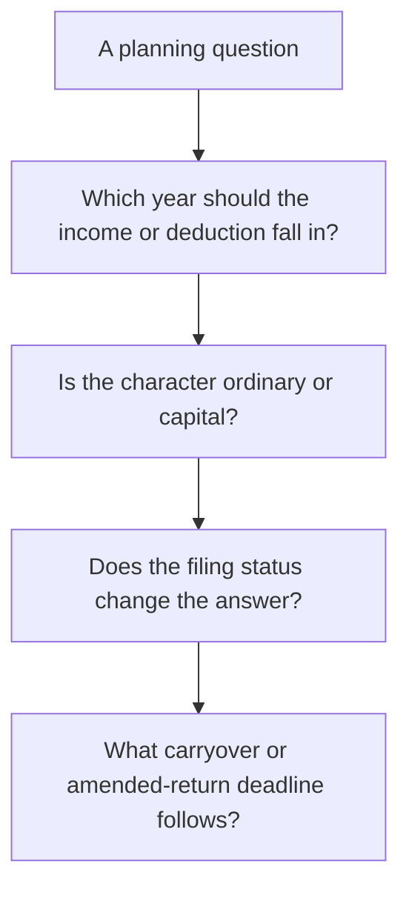

**11 scored questions, about 13% of the exam**

This domain is advice, not a second computation of the same credit. The outline covers reporting duties, property and education and retirement and estate planning at the individual level, marriage and divorce, carryovers, injured spouse and innocent spouse, estimated tax, timing, character, the choice among filing statuses, claims for refund, and the jurat. You use the rules from Domains 1 through 4 and say what the taxpayer should do.

### Reporting, character, and planning choices

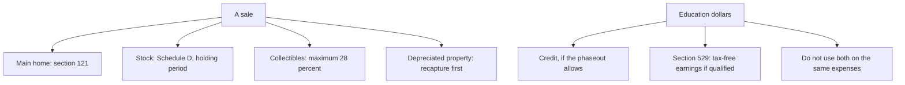

**Reporting obligations.** A person who pays rent, compensation, or other fixed or determinable income in a business may have to file Form 1099-NEC or 1099-MISC. Confirm the 2025 dollar threshold in the General Instructions for Certain Information Returns, because that threshold has changed. Barter exchange income is reportable. Cash received in a trade or business of more than $10,000 is reported on Form 8300. That $10,000 figure is statutory. The taxpayer’s own digital-asset activity still has to be answered on Form 1040. Advice includes telling the client that a Form 1099 does not define taxable income, and that missing a required 1099 is the client’s filing duty, not a reason to omit the income.

**Property sales.** Choose the character before you choose the rate. Inventory and dealer property produce ordinary income. Investment stock held more than one year produces long-term capital gain. Collectibles, including many antiques, art, gems, and precious metals, are taxed at a maximum of 28 percent, not at the 15 percent rate. Depreciation recapture is ordinary or is unrecaptured section 1250 gain. A main home is tested under section 121 before any remainder is capital gain. Selling expenses and basis fixes come before the exclusion.

**Education planning.** The American opportunity credit and the lifetime learning credit were stated in Domain 3. A section 529 plan does not give a federal deduction for contributions. Earnings are tax free when distributed for qualified education expenses. The same expenses cannot support both a tax-free 529 distribution and an education credit. A donor can front-load five years of the annual gift exclusion. That election is a gift-tax election, not an income-tax deduction. A limited rollover from a 529 plan to the beneficiary’s Roth IRA is allowed when the statutory conditions are met. Confirm the 2025 dollar limits and the 15-year account requirement in Publication 970 before you quote a cap.

**Retirement planning.** Advise on the deduction versus a Roth contribution, using the 2025 phaseouts in Domain 2. A Roth conversion is income in the year of the conversion and cannot be recharacterized. Required distributions, the 10 percent additional tax, and qualified charitable distributions are Domain 2 rules you now apply as advice: a QCD is better than taking the distribution into income and then claiming a charitable deduction, because the QCD keeps the amount out of AGI. Name a beneficiary. A missing beneficiary sends the account through the estate and can force faster distribution. An annuity’s taxable portion is figured with the exclusion ratio. Publication 939. Basis recovery is not a second deduction.

**Estate planning at the individual level.** A gift carries over the donor’s basis. An inheritance takes fair market value at death, except for income in respect of a decedent. That difference, not the gift-tax annual exclusion alone, drives “give versus wait.” Life insurance proceeds are generally excluded from the beneficiary’s income under section 101, and they are included in the decedent’s gross estate if the decedent owned the policy or held an incident of ownership. A gift of the policy more than three years before death can remove the proceeds from the estate. Section 2035. Long-term-care benefits under a qualified contract are excluded within the per-diem limits. Confirm the 2025 per-diem amount in Publication 525 or the Form 8853 instructions. Charitable remainder trusts and family limited partnerships are planning tools. The income-tax result of a family partnership is a Part 2 topic. For Part 1, know that a gift of a partnership interest is a gift, and that retained control can pull the asset back into the estate.

**Character and timing.** Ordinary income is taxed at the ordinary brackets. Long-term capital gain and qualified dividends use the 0, 15, and 20 percent schedule in Domain 2. Advice is often to hold an asset past the one-year line, to bunch charitable gifts and medical expenses into a year when they will exceed the standard deduction, and to recognize a loss in a year that already has gains. A cash-method individual includes income on receipt and deducts expenses when paid. Constructive receipt blocks a plan to push a December check into January by leaving it in a drawer. Prepaid interest and prepaid rent have their own timing rules. Publication 538.

**Carryovers that change another year.** Capital losses, charitable contributions, passive losses, adoption credit, foreign tax credit, prior-year minimum tax credit on Form 8801, residential energy credit, and a negative QBI amount. Tell the client which form carries the number. A capital-loss carryover is on the Schedule D worksheet, not on Form 1040-X, unless the original return omitted it.

**Traps.** Advising a 15 percent rate on collectibles. Using the same tuition for a credit and a tax-free 529 distribution. Recommending a QCD and a charitable deduction for one transfer. Ignoring a negative QBI carryover when next year’s income appears.

### Marriage, divorce, estimates, and claims

```mermaid
flowchart TD
  joint["A joint return"] --> both["Joint and several liability"]
  both --> inn{"Relief from the tax itself?"}
  inn -->|Yes| f8857["Form 8857, innocent spouse"]
  inn -->|No| offset{"Refund taken for the other spouse's debt?"}
  offset -->|Yes| f8379["Form 8379, injured spouse"]
  pay["Tax will be owed"] --> harbor{"Withholding and estimates meet a safe harbor?"}
  harbor -->|No| f2210["Form 2210, and increase estimates"]
```

**Status as advice.** Married filing jointly usually produces the lowest tax and is required for several 2025 deductions, including qualified tips, qualified overtime, and the enhanced senior deduction. The cost is joint and several liability: each spouse is liable for the entire tax. Married filing separately can limit that exposure, and it costs the credits and deductions listed in Domain 1. Head of household is often better than single when a qualifying person exists, and it is often better than married filing separately when the considered-unmarried tests are met. In a community-property state, separate returns still report each spouse’s half of community income. Publication 555. A common-law marriage that is valid in the state where it began is a marriage for federal tax purposes even after the couple moves. Publication 501.

**Divorce.** Property transferred between spouses, or incident to divorce, is generally not a sale. Section 1041. The recipient takes carryover basis. Alimony follows the date-of-instrument rule in Domain 2. Child support is not income and not deductible, and a payment that is tied to a contingency about the child is treated as child support even if the decree calls it alimony. The custodial parent claims the child unless Form 8332 releases the child tax credit. The release does not move head of household or the earned income credit.

**Innocent spouse and injured spouse.** These are different forms.

- Innocent spouse relief, Form 8857, asks the IRS to relieve a spouse of tax, interest, and penalties on a joint return. Section 6015 has three paths: classic innocent-spouse relief when the spouse did not know and had no reason to know of an understatement, separation of liability for taxpayers who are divorced, widowed, or living apart, and equitable relief when the other paths fail. The outline expects you to know which problem this is and which form to file. The detailed procedural rules are also Part 3.
- Injured spouse relief, Form 8379, allocates a joint refund when the refund was, or will be, taken to pay a past-due debt of the other spouse, such as child support, a federal student loan, or a state income tax. It does not relieve anyone of the tax on the return. It can be filed with the joint return or after the offset.

**Estimated tax.** Publication 505 and section 6654. In general, a penalty applies when the total of withholding and timely estimates is less than the smaller of 90 percent of the current year’s tax or 100 percent of the prior year’s tax, and the balance due is at least $1,000. If the prior year’s adjusted gross income was more than **$150,000** ($75,000 if married filing separately for the prior year), the prior-year safe harbor is **110 percent** of that prior-year tax. Withholding can be increased late in the year and is still treated as paid evenly unless the taxpayer elects otherwise. Estimates are due quarterly. A mid-year jump in income is handled with the annualized-income method on Form 2210, which can reduce or remove the penalty. Farmers and fishermen have a special rule. Confirm the 2025 due dates in Publication 505. The January payment falls in the next calendar year.

**Claims for refund.** Form 1040-X. A claim must generally be filed by the later of three years from the date the return was filed or two years from the date the tax was paid. Section 6511. A return filed early is treated as filed on the due date for this purpose. A return that was never filed leaves the two-year-from-payment period. Bad debts and worthless securities have a seven-year period. An NOL carryback has its own period. Confirm special periods in Publication 556. Filing an amended return does not extend the statute of limitations on assessment in the way a new original return would. It does start the claim period rules above. The taxpayer should not file a second original return to “replace” the first one.

**Penalty of perjury.** The jurat on Form 1040 says the taxpayer has examined the return and that it is true, correct, and complete under penalties of perjury. A preparer signs a separate declaration. The taxpayer remains responsible for the return. Advice to sign a return the taxpayer has not reviewed, or to omit income the taxpayer knows about, is not advice you give. A frivolous return can bring a civil penalty. Confirm the 2025 frivolous-return penalty amount in the Form 1040 instructions if a question requires the dollar figure. This guide does not print it.

**Traps.** Filing Form 8379 to escape a spouse’s unreported income. That is Form 8857. Choosing married filing separately and then claiming the American opportunity credit. Missing a refund because the three-year period ran while the taxpayer waited for a corrected 1099. Increasing an estimate in January and assuming it is treated like December withholding.

### Practice questions

**1.** A married couple wants the lowest legal tax on a correct return, and they also want each spouse protected from liability for the other spouse’s unreported income. Which point do you tell them?

A. Married filing jointly removes joint and several liability.
B. Married filing jointly usually produces the lower tax, and it creates joint and several liability. Married filing separately limits that liability and can increase the tax and disallow credits.
C. Head of household is always available to both spouses.
D. Filing two single returns is the required solution for a married couple.

**Answer: B.** Publication 501 describes the joint-return liability and the costs of filing separately. Spouses are not single. Head of household is available only when its own tests are met, and both spouses cannot use it for one household.

**IRS basis:** Publication 501 (2025); IRC section 6013(d)(3).

**2.** The IRS offset a joint refund against one spouse’s past-due federal student loan. The other spouse wants that spouse’s share of the refund. Which form is filed?

A. Form 8857.
B. Form 8379.
C. Form 1040-X only.
D. Form 706.

**Answer: B.** Form 8379 is the injured-spouse allocation. Form 8857 is for relief from the tax on a joint return. An amended return is not the allocation form, and Form 706 is the estate tax return.

**IRS basis:** Instructions for Form 8379; Instructions for Form 8857.

**3.** A taxpayer’s 2024 adjusted gross income was $200,000. For 2025 the taxpayer wants a safe harbor that does not depend on guessing 2025 tax. Which payment pattern meets the prior-year safe harbor?

A. 90 percent of the 2024 tax.
B. 100 percent of the 2024 tax.
C. 110 percent of the 2024 tax, through withholding and timely estimates.
D. $1,000.

**Answer: C.** Because 2024 AGI was more than $150,000, the prior-year safe harbor is 110 percent of the 2024 tax. One hundred percent is the safe harbor when prior AGI is not over that threshold. Ninety percent is the current-year test, which requires knowing the 2025 tax. The $1,000 figure is the balance-due threshold, not a safe harbor.

**IRS basis:** IRC section 6654; Publication 505.

**4.** A taxpayer sold a collectible antique held for three years. The gain is long-term. What is the maximum capital-gain rate on that gain?

A. 0 percent.
B. 15 percent.
C. 20 percent.
D. 28 percent.

**Answer: D.** Collectibles gain is taxed at a maximum of 28 percent under section 1(h). The 0, 15, and 20 percent rates apply to adjusted net capital gain, which does not include collectibles gain. The 3.8 percent net investment income tax can also apply. It is a different tax.

**IRS basis:** IRC section 1(h); Schedule D instructions.

**5.** A parent wants to pay a child’s college tuition. The parent also wants the American opportunity credit for those same dollars. Which plan works?

A. Pay the tuition from a section 529 distribution that excludes the earnings, and claim the American opportunity credit for the same tuition.
B. Claim the American opportunity credit for the qualified expenses, and do not also exclude those same expenses through a 529 distribution.
C. Deduct the tuition as an adjustment and claim the credit.
D. Claim the lifetime learning credit and the American opportunity credit for that child for that year.

**Answer: B.** The same qualified expenses cannot support both a tax-free 529 distribution and an education credit. There is no double credit for one student, and the tuition deduction the question imagines is not a second benefit stacked on the credit. Publication 970.

**IRS basis:** Publication 970; IRC sections 25A and 529.

**6.** A taxpayer is choosing between giving appreciated stock to a child and leaving the stock to the child at death. The stock has been held for years and has a large unrealized gain. Which income-tax difference matters?

A. The child takes the parent’s basis in either case.
B. A lifetime gift generally carries over the parent’s basis. An inheritance generally takes fair market value at death.
C. Both transfers are tax free and both give a basis of zero.
D. The gift is ordinary income to the child in the year of the gift.

**Answer: B.** Section 1015 assigns a carryover basis to gift property, with the loss rule in Domain 2. Section 1014 assigns a fair-market-value basis to inherited property, other than income in respect of a decedent. The gift is not income to the child. Gift tax is a separate question.

**IRS basis:** IRC sections 1014 and 1015; Publication 551.

**7.** A taxpayer filed the 2022 return on April 15, 2023 and paid the tax with the return. On November 1, 2026 the taxpayer discovers a missed deduction for 2022. What is the general refund deadline?

A. The claim is timely, because a missed deduction can always be filed within seven years.
B. The claim is late. The general deadline was three years from the April 15, 2023 filing date.
C. The claim is timely for two more years, because payment starts a five-year period.
D. No deadline applies if the deduction is real.

**Answer: B.** Section 6511 requires a claim by the later of three years from filing or two years from payment. Both periods expired before November 1, 2026. The seven-year period is for bad debts and worthless securities, not for an ordinary missed deduction. Form 1040-X is the claim.

**IRS basis:** IRC section 6511; Instructions for Form 1040-X; Publication 556.

**8.** A preparer has finished a return. The taxpayer has not read it and asks the preparer to sign the jurat for the taxpayer so the return can be filed. What is the correct advice?

A. The preparer may sign the taxpayer’s jurat because the preparer also signs under penalties of perjury.
B. The taxpayer must sign the jurat. The taxpayer is responsible for the return being true, correct, and complete.
C. The jurat is optional when a preparer is paid.
D. The taxpayer signs only if a refund is claimed.

**Answer: B.** The jurat is the taxpayer’s declaration under penalties of perjury. A preparer’s signature is a separate declaration. It does not replace the taxpayer’s signature, and it does not move responsibility off the taxpayer.

**IRS basis:** 2025 Form 1040 jurat; IRC section 6065.

## Domain 6 — Specialized Returns for Individuals

```mermaid
flowchart TD
  fact["A specialized fact"] --> death{"Someone died, and the estate may owe tax?"}
  death -->|Yes| f706["Form 706, estate tax"]
  fact --> gift{"A gift above the annual exclusion, or a future interest?"}
  gift -->|Yes| f709["Form 709, gift tax"]
  fact --> forgn{"Foreign accounts or specified foreign assets?"}
  forgn -->|Accounts| fbar["FinCEN Form 114"]
  forgn -->|Specified assets| f8938["Form 8938 with the return"]
```

**11 scored questions, about 13% of the exam**

This domain is Form 706, Form 709, and the international information returns. Form 1041, the estate’s or trust’s income tax return, appears because people file it when they should file Form 706, or they file Form 706 when the only duty is Form 1041. The income tax of the decedent’s final year is still Form 1040.

### Estate tax

```mermaid
flowchart TD
  gross["Gross estate"] --> assets["Probate and nonprobate property"]
  assets --> life{"Incidents of ownership over life insurance?"}
  life -->|Yes| incl["Include the proceeds"]
  assets --> joint["Joint property, under the consideration rules"]
  gross --> ded["Debts, expenses, and the marital and charitable deductions"]
  ded --> tax["Tax, then the unified credit"]
  tax --> port{"Elect portability of any unused exclusion?"}
  port -->|Yes| timely["Timely Form 706, even if no tax is due"]
```

**What is in the gross estate.** The gross estate includes property the decedent owned, property the decedent gave away and kept a prohibited interest in, and several nonprobate items. For Part 1, know these:

- Jointly held property with a spouse is generally included at half. Joint property with someone else is included to the extent the decedent furnished the consideration. Section 2040.
- Life insurance proceeds are included if they are payable to the estate or if the decedent held an incident of ownership at death, such as the right to change the beneficiary. Section 2042. A policy the decedent transferred within three years of death can come back in under section 2035.
- Traditional IRAs and other retirement benefits are included at their date-of-death value. They are also income in respect of a decedent to the beneficiary. Estate tax inclusion and income tax are not the same tax.
- A retained life estate, a revocable transfer, and certain transfers taking effect at death are included. Sections 2036, 2037, and 2038.

**Deductions and the marital deduction.** Debts, funeral expenses, and administration expenses are deductible on Form 706, with the rule that some administration expenses are claimed either on Form 706 or on the estate’s Form 1041, not twice. The marital deduction is unlimited for property that passes to a surviving spouse who is a U.S. citizen, if the interest is not a nondeductible terminable interest. A terminable interest can still qualify if a QTIP election is made. There is no unlimited marital deduction for a surviving spouse who is not a U.S. citizen, unless the property passes to a qualified domestic trust. The charitable deduction is available for property passing to a qualified charity.

**Unified credit and portability.** For a decedent dying in 2025, the basic exclusion amount is **$13,990,000**. The Instructions for Form 706 revised September 2025 state that figure, and Rev. Proc. 2024-40 states it as well. The applicable credit is the tax on that amount. Lifetime taxable gifts use the same credit, so taxable gifts after 1976 are added back in the computation. Portability lets a surviving spouse use the deceased spouse’s unused exclusion, the DSUE. The election is made on a timely Form 706, including a return filed only to elect portability when the estate is under the filing threshold. If the return is not timely, the unused exclusion is lost. Confirm the 2025 portability procedure in those Form 706 instructions.

**Filing.** Form 706 is required when the gross estate plus adjusted taxable gifts exceed the basic exclusion amount, and it is the return used to elect portability even when it is not required. It is due **nine months** after the date of death. Form 4768 requests an extension to file. An extension to file is not an extension to pay. Confirm the 2025 interest rules in the Form 706 instructions.

Form 1041 is the fiduciary income tax return. It reports the estate’s or trust’s income. It is not the estate tax return. A final Form 1040 is still required for the decedent’s income through the date of death when the filing thresholds are met. Publication 559.

**Traps.** Filing Form 1041 and thinking the estate tax is done. Including life insurance that the decedent did not own and held no incident of ownership over. Allowing an unlimited marital deduction for a noncitizen spouse without a qualified domestic trust. Missing portability because no tax was due.

### Gift tax

```mermaid
flowchart TD
  transfer["A transfer for less than full consideration"] --> donee{"Present interest?"}
  donee -->|No| taxable["No annual exclusion, Form 709"]
  donee -->|Yes| excl["2025 exclusion, $19,000 per donee"]
  excl --> over{"Value above the exclusion?"}
  over -->|Yes| f709["Form 709, and unified credit may reduce the tax to zero"]
  over -->|No| none["No Form 709, unless gift splitting"]
  direct["Tuition or medical paid directly to the provider"] --> skip["Not a gift, and it does not use the exclusion"]
```

**Annual exclusion.** For 2025, the first **$19,000** of gifts of a present interest to each donee is excluded. Rev. Proc. 2024-40. A present interest is an unrestricted right to the immediate use, possession, or enjoyment of the property. A gift of a future interest, such as a remainder that the donee cannot enjoy now, does not qualify. A gift to a spouse who is not a U.S. citizen has a separate 2025 exclusion of **$190,000**. Gifts to a U.S.-citizen spouse qualify for the marital deduction.

**What is not a taxable gift.** Tuition paid directly to an educational organization, and medical expenses paid directly to the provider, are not gifts. Section 2503(e). The payment must be direct. Reimbursing the donee does not qualify. Political contributions and gifts that are not transfers of property, such as services, have their own limits. Support that is a legal obligation is not a gift.

**Gift splitting.** Section 2513. Spouses can elect to treat a gift made by one of them as made one-half by each, which doubles the annual exclusions and uses both unified credits. Both spouses must consent, and both generally must be U.S. citizens or residents. Both file Form 709 when splitting is elected, even if one spouse made no other gifts. The consent covers all gifts that year.

**Unified credit and the estate.** Taxable gifts above the annual exclusion reduce the exclusion available at death. The gift tax computed on Form 709 can be zero because of the unified credit, and the gifts still get added back on the estate tax return. Basis of gifted property is the income-tax question in Domain 2. Paying gift tax can produce a basis adjustment under section 1015(d). Confirm that adjustment in Publication 551 before you apply it.

**Generation-skipping transfer tax.** A direct skip, such as a gift to a grandchild when the child is alive, can trigger GST tax in addition to gift tax. The GST exemption tracks the basic exclusion amount. Confirm the 2025 exemption and the Form 709 reporting lines in the Form 709 instructions. An indirect skip through a trust uses different allocation rules. Know that GST is a third tax, not a larger annual exclusion.

**Filing.** Form 709 is an annual return. It is due on April 15 of the following year, the same day as Form 1040. An extension of time to file the income tax return generally extends the time to file Form 709. Form 8892 is the extension when the donor does not extend the income tax return. An extension to file is not an extension to pay. A donor files when gifts to any one donee exceed the annual exclusion, when spouses elect gift splitting, when a gift is of a future interest, or when GST tax is due. A gift under the annual exclusion of a present interest, with no splitting and no GST, does not require a return.

**Traps.** Applying the annual exclusion to a future interest. Treating tuition paid to the student as a section 2503(e) exclusion. Splitting gifts without the other spouse’s consent. Assuming a return is unnecessary because the unified credit reduces the tax to zero. The return is still required when the gifts exceed the annual exclusion.

### International information reporting

```mermaid
flowchart TD
  acct["Foreign financial accounts over $10,000 at any time"] --> fbar["FinCEN 114, not with the 1040"]
  asset["Specified foreign financial assets over the Form 8938 threshold"] --> f8938["Form 8938, with the return"]
  both["The same account can be on both forms"] --> file["Filing one does not satisfy the other"]
  real["Foreign real estate owned directly"] --> neither["Neither form"]
  stock["Foreign stock not held in an account"] --> only8938["Form 8938 only"]
```

The IRS comparison of Form 8938 and FBAR requirements, reviewed September 19, 2026, is the source for this section. Filing one form does not replace the other.

**FBAR, FinCEN Form 114.** A U.S. person, including a citizen, a resident alien, and certain entities, files when the aggregate value of foreign financial accounts exceeds **$10,000** at any time during the calendar year. The test is cumulative. Two accounts that together exceed $10,000 are both reported. Report financial accounts at a foreign financial institution, including a foreign branch of a U.S. bank. An account at a U.S. branch of a foreign bank is not reported. Signature authority is enough, subject to the exceptions in the FinCEN instructions, even when the person has no financial interest. The maximum value is converted at the year-end exchange rate. The form is filed electronically with FinCEN, not with the income tax return, and not with the IRS. It is due April 15, with an automatic extension to October 15. Foreign real estate held directly, foreign currency held directly, and personal property are not accounts.

**Form 8938.** Specified individuals report specified foreign financial assets when the totals exceed the threshold. The form is attached to the income tax return and is due with that return, including extensions. Specified foreign financial assets include foreign financial accounts and foreign stock, partnership interests, and similar assets that are not held in an account. Directly held foreign real estate is not a specified foreign financial asset. An interest in a foreign entity that owns the real estate can be. Signature authority alone, with no financial interest, does not by itself require Form 8938.

Thresholds for specified individuals, from the IRS comparison:

| Where the taxpayer lives | Unmarried, or married filing separately | Married filing jointly |
| --- | --- | --- |
| In the United States | More than $50,000 on the last day, or more than $75,000 at any time | More than $100,000 on the last day, or more than $150,000 at any time |
| Outside the United States | More than $200,000 on the last day, or more than $300,000 at any time | More than $400,000 on the last day, or more than $600,000 at any time |

These thresholds are not the FBAR’s $10,000 test. A taxpayer can be under the Form 8938 threshold and still have an FBAR duty.

**Other information returns on the outline.**

- Form 5471, for certain U.S. persons with an interest in a foreign corporation. Category of filer drives which schedules are required.
- Form 8865, for certain U.S. persons with an interest in a foreign partnership.
- Form 3520, for transactions with foreign trusts and for large gifts or bequests from foreign persons. Confirm the 2025 gift threshold in the Form 3520 instructions.
- Form 8621 can apply to a passive foreign investment company. It is easy to miss when a foreign mutual fund is involved.

These forms are attached to the income tax return or filed as their instructions require. They are not the FBAR.

**Penalties and the statute.** Failure to file can bring a civil penalty, and a willful FBAR violation is a different and heavier penalty. The IRS comparison page notes that FBAR civil penalties are adjusted for inflation. The Candidate Information Bulletin says not to use penalty amounts from after December 31, 2025. Learn the structure, and confirm the dollar amount in the instructions that apply to a 2025 failure rather than memorizing a later inflation adjustment. A substantially incomplete Form 8938 can keep the statute of limitations on the whole return open. Section 6501(c)(8). Omitted income from foreign assets can also extend the assessment period. Domain 6 tests that these consequences exist. The representation procedure for fighting the penalty is Part 3.

**Traps.** Filing Form 8938 and believing the FBAR is satisfied. Reporting foreign stock held in a brokerage account both as the account and again as each stock. Reporting a house the taxpayer owns in another country on the FBAR. Using the Form 8938 “living abroad” thresholds for a taxpayer who lives in the United States and takes a vacation abroad. Forgetting signature authority over a parent’s foreign account.

### Practice questions

**1.** A decedent died on March 1, 2025. The gross estate plus adjusted taxable gifts exceeds the 2025 basic exclusion amount. When is Form 706 due if no extension is filed?

A. April 15, 2026.
B. December 1, 2025, nine months after the date of death.
C. March 1, 2026.
D. With the decedent’s final Form 1040, on April 15, 2026.

**Answer: B.** Form 706 is due nine months after the date of death. Nine months after March 1, 2025 is December 1, 2025. The income tax return of the decedent is a separate Form 1040. Form 4768 can extend the filing date. It does not change the nine-month rule when no extension is filed.

**IRS basis:** Instructions for Form 706 (revised September 2025); IRC section 6075(a).

**2.** An estate is below the filing threshold for estate tax. The executor wants the surviving spouse to be able to use the deceased spouse’s unused exclusion. What must be filed?

A. Nothing, because portability is automatic.
B. A timely Form 706, even though no estate tax is due.
C. Form 1041 only.
D. Form 709 only.

**Answer: B.** Portability of the DSUE is elected on a timely Form 706. An estate that is not otherwise required to file still files that return to make the election. Form 1041 reports the estate’s income. It does not elect portability.

**IRS basis:** Instructions for Form 706 (revised September 2025); IRC section 2010(c).

**3.** A decedent owned a life insurance policy on the decedent’s life and held the right to change the beneficiary. The proceeds were paid to an adult child. What is included in the gross estate?

A. Nothing, because the proceeds were paid to a child and life insurance is always income-tax free.
B. The proceeds, because the decedent held an incident of ownership.
C. The cash surrender value only.
D. The proceeds, only if the child is the executor.

**Answer: B.** Section 2042 includes proceeds when the decedent held an incident of ownership, including the right to change the beneficiary. The income-tax exclusion under section 101 is a different tax. It does not remove the proceeds from the gross estate.

**IRS basis:** IRC sections 101 and 2042; Instructions for Form 706.

**4.** In 2025 a taxpayer gave a friend $19,000 cash, with no strings attached, and gave a different friend a future interest worth $10,000. Which statement is correct?

A. Neither gift is reported, because each is at or under $19,000.
B. The cash gift uses the 2025 annual exclusion. The future interest does not qualify for the annual exclusion and is reported on Form 709.
C. Both gifts are excluded as present interests.
D. The future interest is excluded because it is under $19,000, and the cash gift is taxable because cash is a future interest.

**Answer: B.** Rev. Proc. 2024-40 sets the 2025 present-interest exclusion at $19,000 per donee. A future interest does not qualify for that exclusion, at any amount. The cash gift of a present interest at the exclusion amount does not, by itself, require a return.

**IRS basis:** Rev. Proc. 2024-40, section 2503; IRC section 2503(b); Instructions for Form 709.

**5.** Spouses want to treat a $30,000 present-interest gift, made in 2025 by one spouse to one donee, as made half by each. What is required?

A. Nothing. Gift splitting is automatic for all married couples.
B. Both spouses must consent, and both generally file Form 709.
C. Only the donor files, and the consent is oral.
D. The donee files Form 709.

**Answer: B.** Section 2513 requires the spouses’ consent to split gifts. The consent applies to all gifts that year, and both spouses file Form 709 when the election is made. The donee does not file the gift tax return.

**IRS basis:** IRC section 2513; Instructions for Form 709.

**6.** A grandparent paid a university $40,000 in 2025 by a check made out to the university, for a grandchild’s tuition. The grandparent made no other gifts to the grandchild. What is the gift-tax result?

A. A taxable gift of $40,000.
B. A taxable gift of $21,000, after the $19,000 exclusion.
C. Not a taxable gift, because tuition paid directly to the educational organization is excluded under section 2503(e).
D. A taxable gift unless the grandchild is a dependent.

**Answer: C.** Section 2503(e) excludes tuition paid directly to the institution. The payment does not use the annual exclusion. Paying the grandchild, who then pays the school, would not qualify for this exclusion.

**IRS basis:** IRC section 2503(e); Instructions for Form 709.

**7.** A U.S. citizen who lives in the United States had two foreign bank accounts in 2025. The highest combined balance at any one time was $12,000. Neither account alone exceeded $10,000. What is the FBAR result?

A. No FBAR, because neither account exceeded $10,000.
B. File FinCEN Form 114, because the aggregate value exceeded $10,000. The form is not filed with Form 1040.
C. File Form 8938 only, because the FBAR applies only to accounts over $50,000.
D. Report the accounts on Schedule B and file nothing else.

**Answer: B.** The IRS comparison page says the FBAR applies when the aggregate value of foreign financial accounts exceeds $10,000 at any time during the year. Both accounts are reported. The form is filed with FinCEN. Schedule B asks a question about foreign accounts. Answering it does not file the FBAR. The $50,000 figure is a Form 8938 threshold, not the FBAR test.

**IRS basis:** IRS, Comparison of Form 8938 and FBAR Requirements (reviewed September 19, 2026).

**8.** A U.S. resident owns foreign stock certificates kept in a safe at home, not in any financial account. The stock is a specified foreign financial asset and is above the Form 8938 threshold. The resident owns no foreign accounts. Which forms apply?

A. FinCEN Form 114 only.
B. Form 8938 only.
C. Both FinCEN Form 114 and Form 8938.
D. Neither, because the stock is not real estate.

**Answer: B.** The IRS comparison table says foreign stock or securities not held in a financial account are reported on Form 8938 and are not reported on the FBAR. The FBAR reports financial accounts. Directly held foreign real estate would be on neither form. This asset is stock, so Form 8938 applies.

**IRS basis:** IRS, Comparison of Form 8938 and FBAR Requirements, types of foreign assets (reviewed September 19, 2026).

## One-page quick review

```mermaid
flowchart LR
  see["If you see this"] --> think["Think this"]
  see --> q1["Child under 17"]
  q1 --> a1["Child tax credit, else other dependents"]
  see --> q2["Turned 17 this year"]
  q2 --> a2["Not the child tax credit"]
  see --> q3["Spouse died this year"]
  q3 --> a3["Joint return, not qualifying surviving spouse"]
  see --> q4["Foreign accounts over $10,000"]
  q4 --> a4["FBAR with FinCEN"]
  see --> q5["Gift of a future interest"]
  a5["Form 709, no annual exclusion"]
  q5 --> a5
```

**If you see this, think this.**

| You see | Think |
| --- | --- |
| Status on December 31 | The five statuses. Year of death can be a joint return. |
| Qualifying child | Age, relationship, abode, the child did not provide half of their own support. No gross-income test. |
| Qualifying relative | Gross income under $5,200 for 2025, and you provided over half the support. |
| Form 8332 | Moves the child tax credit, not head of household and not the earned income credit. |
| Tax-exempt interest | Report it. It can make Social Security taxable. |
| Form 1099-K | Reconcile to taxable income. The form is not the tax. |
| Alimony after 2018 | Not income, not deductible. |
| Standard deduction vs. Schedule A | Larger one. Schedule 1-A can apply either way in 2025. |
| Home-equity proceeds used personally | Not qualified residence interest. |
| Gift of $250 or more | Contemporaneous written acknowledgment. |
| Specified service business under the QBI threshold | Deduction still available. |
| Child turned 17 | Credit for other dependents, not the child tax credit. |
| Two employers and wages over $176,100 | Excess Social Security credit. One employer: the employer fixes it. |
| Wages of $180,000 on each of two joint spouses | Additional Medicare tax, even with no withholding. |
| Incentive stock option held at year-end | AMT adjustment. |
| Unpaid wages of a decedent | Income in respect of a decedent. No step-up. |
| Refund offset for a spouse’s debt | Form 8379. Tax relief is Form 8857. |
| Prior AGI over $150,000 | 110 percent estimated-tax safe harbor. |
| Missed deduction | Three years from filing or two years from payment. |
| Estate tax | Form 706, nine months. Income of the estate is Form 1041. |
| Unused estate exclusion | Portability on a timely Form 706. |
| Tuition paid to the school | Not a gift. |
| Foreign account over $10,000 | FBAR. Form 8938 is a separate test. |

**2025 figures to memorize**, all for tax year 2025.

| Item | Amount | Source |
| --- | --- | --- |
| Standard deduction, single or married filing separately | $15,750 | Publication 17 (2025); 2025 Form 1040 instructions |
| Standard deduction, joint or qualifying surviving spouse | $31,500 | Same |
| Standard deduction, head of household | $23,625 | Same |
| Additional amount, 65 or blind | $2,000 unmarried; $1,600 married or qualifying surviving spouse | Publication 501 (2025) filing chart; Rev. Proc. 2024-40 |
| Qualifying-relative gross-income test | Less than $5,200 | Publication 501 (2025) |
| Social Security wage base | $176,100 | Publication 17 (2025) |
| Child tax credit / additional child tax credit | $2,200 / up to $1,700 | 2025 Schedule 8812 instructions |
| Child tax credit phaseout | $200,000, or $400,000 joint | Same |
| SALT cap | $40,000, or $20,000 married filing separately, not phased below $10,000 / $5,000 | 2025 Schedule A instructions |
| IRA contribution limit | $7,000, or $8,000 if age 50 or older | Publication 590-A (2025) |
| HSA limit | $4,300 self-only, $8,550 family | Rev. Proc. 2024-25 |
| Foreign earned income exclusion | $130,000 | Rev. Proc. 2024-40 |
| QBI threshold | $197,300, or $394,600 joint | Rev. Proc. 2024-40 |
| Gift annual exclusion | $19,000 per donee | Rev. Proc. 2024-40 |
| Basic exclusion amount, deaths in 2025 | $13,990,000 | Form 706 instructions, revised September 2025 |
| Section 121 exclusion | $250,000, or $500,000 joint | IRC section 121 |
| Capital-loss deduction | $3,000, or $1,500 married filing separately | Publication 501 (2025) |
| FBAR | Over $10,000 aggregate, any time | IRS Form 8938 and FBAR comparison |

**Forms.**

| Job | Form |
| --- | --- |
| Individual return | 1040, 1040-SR, or 1040-NR |
| New 2025 deductions | Schedule 1-A |
| Itemized deductions | Schedule A |
| Business, rent, employee | C, E, SE, H |
| Credits for children | 8812, 2441, 8862, 8867 |
| Education and retirement savings | 8863, 8880, 8889, 8606, 5329 |
| Premium tax credit | 8962 and 1095-A |
| QBI | 8995 or 8995-A |
| AMT and its credit | 6251 and 8801 |
| Additional Medicare and NIIT | 8959 and 8960 |
| Foreign earned income and foreign tax | 2555 and 1116 |
| Injured spouse and innocent spouse | 8379 and 8857 |
| Amended return | 1040-X |
| Estate tax and estate income | 706 and 1041 |
| Gift tax | 709 |
| Foreign accounts and assets | FinCEN 114 and Form 8938 |

Confirm any number this page attributes to Rev. Proc. 2024-40 against the 2025 form instructions before exam day. Where those instructions are higher or newer, the instructions win. The exam tests the law as amended through December 31, 2025.
