# SEE Part 2: Businesses

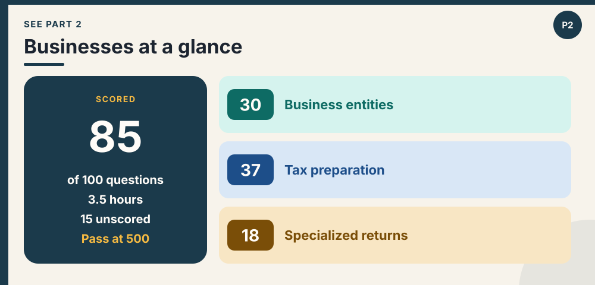

Study guide for Nepal Singh.

**Bulletin used.** PSI Services LLC, *Candidate Information Bulletin, Internal Revenue Service Enrolled Agent Special Enrollment Examination*, revised October 9, 2026 (the PSI SEE Candidate Information Bulletin). The IRS page “Enrolled agents: Frequently asked questions,” SEE availability item updated August 26, 2026, states the same window. A traditional testing window runs from May 1 through the end of February. For this cycle the official window is **July 1, 2026 through February 28, 2027** for candidates testing in the United States. International scheduling and testing were delayed; the bulletin says a new international start date had not been set. March and April are the annual blackout while the exam is updated.

**What this exam is.** Part 2 — Businesses. Each part is **3.5 hours** of testing (seat time is longer because of the tutorial, survey, and breaks). You will see **100 multiple-choice questions**: **85 scored** and **15 experimental (unscored)**. The experimental items are mixed in and are not marked. They do not help or hurt the score.

**Passing standard.** Scaled scores run from **200 to 800**. The passing scaled score is **500**. A passing report shows a pass, not a number. A failing report shows a scaled score from 200 through 499 plus a diagnostic.

**Law on this exam.** For exams in this window, references are to the Code, regulations, forms, instructions, and publications as amended through **December 31, 2025**. Unless a question says otherwise, it is about **calendar year 2025**. “Current tax year” means 2025. Ignore legislation, cases, and penalty amounts that took effect after December 31, 2025.

**Domain weights.** The bulletin prints scored-question counts, not percentages.

| Domain | Scored questions | Share of the 85 |
| --- | ---: | ---: |
| 1. Business Entities and Considerations | 30 | 30/85 |
| 2. Business Tax Preparation | 37 | 37/85 |
| 3. Specialized Returns and Taxpayers | 18 | 18/85 |

Some public prep charts round those shares to 35%, 44%, and 21%. Use the bulletin’s counts when you decide where to spend time. Domain 2 is the largest block.

Every dollar amount, rate, or phaseout below is tied to a tax year or to an IRS text, and the citation is in the same paragraph or in the question’s IRS basis. If a figure changes every year and this guide does not quote it, the sentence tells you which 2025 publication to open before you memorize a number.

Sample questions in this guide are original. They are not Fast Forward Academy items and they are not the IRS sample set.

## How to use this guide with Fast Forward Academy

Read a domain in this guide first. Then drill that same domain in Fast Forward Academy. This guide is the rule book. FFA is the question bank. Do not treat either one as a substitute for the other.

Fast Forward Academy’s public Part 2 bootcamp list (topic names only) lines up with the official outline like this:

| FFA public block | Study it with |
| --- | --- |
| Business entity overview; accounting periods and methods | Domain 1 |
| Uniform capitalization; inventory | Domain 2, income |
| Expenses, compensation, credits, loss limits | Domain 2 |
| Property types, basis, like-kind exchanges | Domain 2, assets |
| Corporations: section 351, services for stock, control | Domain 1 |
| Corporate deductions, Schedule M-1, tax, distributions, redemptions | Domain 1, and M-1 again in Domain 2 |
| S corporations: Form 1120-S, basis, distributions | Domain 1 |
| Partnerships: dealings, basis, distributions, dispositions | Domain 1 |
| Retirement plans, SEP, SIMPLE, qualified and nonqualified | Domain 3 |
| Estates and trusts, farmers, exempt organizations | Domain 3 |

Rental real estate is its own block in official Domain 3. If your FFA property lesson sits next to like-kind exchanges, still drill rentals again when you reach Domain 3.

When a figure in an FFA explanation disagrees with a 2025 IRS instruction cited here, follow the IRS instruction for this exam window. FFA’s screen can update on a different schedule than the bulletin.

## Domain 1 — Business Entities and Considerations

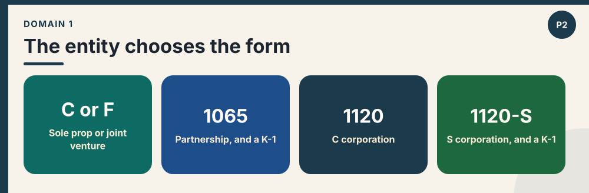

30 scored questions.

This domain is entity choice, the life of a partnership, the life of a C corporation, and the life of an S corporation. Basis and distributions are the center of the score. Employment-tax forms appear here as reporting duties and again in Domain 2 as deductions and deposits.

### Entity choice, classification, year, and hobby

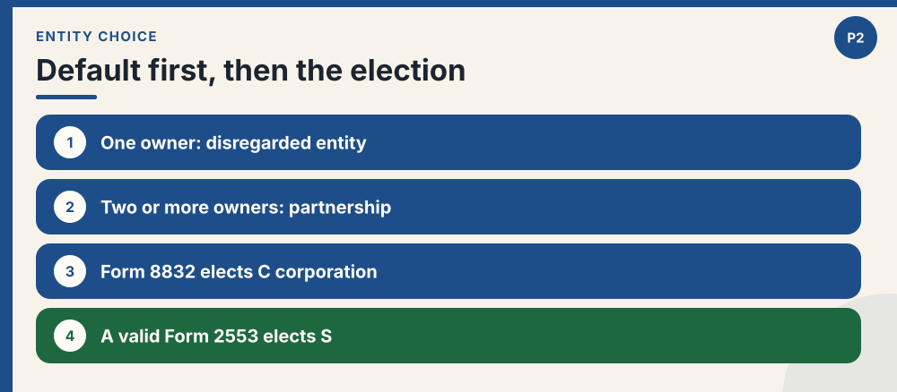

**Sole proprietorship.** One owner, no separate income-tax return. Business income and expenses go on Schedule C (Form 1040), or Schedule F if it is a farm. Net profit is generally subject to self-employment tax on Schedule SE. The owner’s basis in business assets is the owner’s own basis. A sale of the business is a sale of each asset.

**Qualified joint venture.** Publication 541 describes a qualified joint venture as an unincorporated business wholly owned by spouses who file a joint return and who both materially participate, and who elect out of partnership treatment. Each spouse then reports a share on a separate Schedule C (or Schedule F) and a separate Schedule SE. A business owned in the name of a state-law entity such as an LLC is outside that election. Spouses in a community-property state who wholly own an LLC as community property have a separate choice, described in IRS chief-counsel and publication guidance, to treat the LLC as a disregarded entity. Confirm the current wording in Publication 541 before you rely on a community-property shortcut.

**Partnership.** Two or more owners, no corporate election. File Form 1065. The partnership files an information return. Partners pay tax on their shares. A domestic multi-member LLC is a partnership by default.

**C corporation.** Formed under state law, or elected on Form 8832. Files Form 1120. The corporation pays tax. Shareholders are taxed again when earnings are distributed as dividends.

**S corporation.** A small-business corporation that files a valid Form 2553. Files Form 1120-S. Income, losses, and separately stated items pass through to shareholders. The corporation can still owe built-in gains tax, excess net passive income tax, and LIFO recapture tax. Confirm those computations in the 2025 Instructions for Form 1120-S when a question gives prior C-corporation years.

**LLC.** The IRS looks through the state label. Default classification is in Treasury Regulation 301.7701-3 and the Instructions for Form 8832:

- Domestic eligible entity, one owner: disregarded (Schedule C, E, or F, as appropriate).
- Domestic eligible entity, two or more owners: partnership.
- Either may elect to be a corporation on Form 8832.
- A corporation, including an LLC that has elected corporate status, uses Form 2553 to be an S corporation. Form 8832 is the classification election. Form 2553 is the S election.

A per se corporation (a business incorporated under a state corporation statute) is a corporation. It does not “check the box” into partnership status.

**Tax-exempt entities and associations.** They can be owners or they can be the entity under exam. Domain 3 covers exemption and Form 990. Here, remember they are not automatic S-corporation shareholders, and a partnership or corporation that wants exemption files an application, not a business income-tax return alone.

**Employer identification number.** Use Form SS-4. A partnership, corporation, or S corporation needs an EIN. A sole proprietor who has no employees and no retirement plan or excise filing can use a Social Security number on Schedule C. The moment that sole proprietor hires an employee, pays excise, or opens a qualified plan, an EIN is required. Confirm the current “who needs an EIN” list on the Form SS-4 instructions.

**Accounting period.**

- A partnership generally must use the tax year of its partners under the majority-interest, principal-partner, and least-aggregate-deferral tests, unless it has a business-purpose year or a section 444 election. Individuals as partners usually force a calendar year.
- An S corporation uses a calendar year unless it establishes a business purpose or makes a section 444 election.
- A C corporation may adopt a fiscal year. A qualified personal service corporation is generally required to use a calendar year. Publication 542 covers the personal-service-corporation year rules.
- Section 444 allows a limited deferral and requires required payments. Confirm the deferral length in the 2025 instructions for the election form before you memorize months.

**Reporting.** Wages go on Forms W-2 and W-3. Employee withholding certificates are Forms W-4. Payments to independent contractors and other reportable payments go on the Form 1099 series (1099-NEC for nonemployee compensation). The dollar threshold for each form is in the *2025 General Instructions for Certain Information Returns*. Confirm that year’s threshold there. Cash received in a trade or business over $10,000 is reported on Form 8300. That $10,000 figure is the statutory line on Form 8300; confirm it in the 2025 form instructions.

**Hobby versus business.** Section 183 and Treasury Regulation 1.183-2. An activity is a business when the taxpayer enters it to make a profit. The regulation’s factors are: how the taxpayer carries on the activity, expertise, time and effort, expectation that assets will appreciate, the taxpayer’s success in similar activities, history of income and loss, the amount of occasional profits, the taxpayer’s financial status, and elements of personal pleasure. A profit in three of five tax years (two of seven for horse activities) creates a presumption of profit motive. For 2025, income from an activity not engaged in for profit is still included in income. Expenses of that activity that fall into the miscellaneous-itemized-deduction category remain in the suspension that runs through tax years beginning before January 1, 2026. Confirm the 2025 reporting lines in the Instructions for Schedule 1 (Form 1040).

**Decision points.**

- Liability protection under state law does not choose the federal tax regime. The election does.
- A second owner, or a second class of owner the S rules reject, changes the return.
- Spouses can be a qualified joint venture only when the publication’s tests are met. An LLC in a non-community-property state with two spouse-members is a partnership unless it elects corporate status.

**Traps.**

- Filing Form 8832 when the task was an S election, or filing Form 2553 when the entity is still a disregarded LLC and the election was never made effective.
- Treating a qualified joint venture as a partnership and filing Form 1065, or the reverse.
- Using a fiscal year for an S corporation or a partnership of individuals without a business-purpose or section 444 election.

**Yearly items.** Due dates move when they fall on a weekend or holiday. For tax year 2025, March 15, 2026 is a Sunday, so the unextended calendar-year Form 1065 and Form 1120-S dates fall on the next business day, Monday, March 16, 2026. April 15, 2026 is a Wednesday, so the unextended calendar-year Form 1120 date is April 15, 2026. Always re-check the 2025 form instructions for holiday shifts. Extension is Form 7004. An extension extends the time to file. It does not extend the time to pay.

### Partnerships

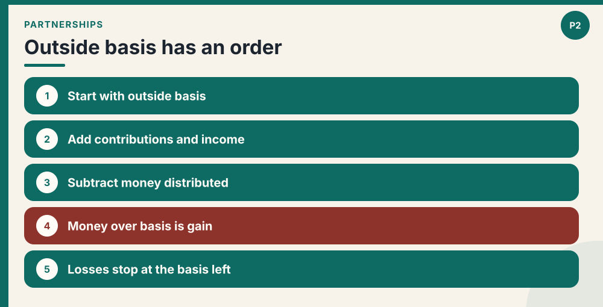

Publication 541 (Rev. December 2025) is the partnership text for this guide. The partner’s basis worksheet is in the Partner’s Instructions for Schedule K-1 (Form 1065). Follow that worksheet’s line order on computational questions.

**Formation.** A partnership is created by agreement, including a written agreement, an oral agreement, or conduct. General partners have personal liability for partnership debts. Limited partners have limited liability and, if they take part in control beyond what state law allows, may lose that protection for state-law purposes. Capital contributions may be money, property, or services. File Form 1065 by the 15th day of the third month after year end (March 16, 2026 for calendar year 2025, as noted above). Form 7004 extends the return. Late-filing penalties are in the Form 1065 instructions; the dollar amount is inflation-adjusted, so read the 2025 instructions rather than an older chart.

**Contributions of property.** Section 721: no gain or loss to the partner or the partnership when property is contributed solely in exchange for a partnership interest. The partnership’s basis in the property is the partner’s adjusted basis, increased by gain the partner recognizes (Publication 541). The partner’s outside basis starts as money contributed plus the adjusted basis of property contributed, plus gain recognized on the contribution.

Built-in gain or loss at contribution is allocated back to the contributing partner under section 704(c). If that contributed property is distributed to another partner within seven years, the contributing partner recognizes the remaining built-in gain or loss (Publication 541).

**Liabilities.** An increase in a partner’s share of partnership liabilities is a deemed cash contribution and increases outside basis. A decrease is a deemed cash distribution and decreases outside basis. Publication 541’s worked example: a partner who contributes encumbered property reduces outside basis by the share of the mortgage treated as assumed by the other partners. If that share exceeds the partner’s basis, the partner recognizes gain from the sale of the partnership interest, basis becomes zero, and that gain does not increase outside basis.

Only liabilities that create asset basis, that give rise to a current deduction, or that are nondeductible noncapital expenses are included in basis. A partner’s share of accounts payable of a cash-method partnership is not part of outside basis (Publication 541).

**Services for an interest.** A capital interest received for services is ordinary compensation income, measured by its fair market value. A profits interest can fall under the Publication 541 safe-harbor discussion: it is not a taxable capital shift when the interest is a profits interest, the partner does not dispose of it within two years, and it is not a limited interest in a publicly traded partnership. Read the three bullets in Publication 541 before you treat every profits interest as tax-free.

**Outside basis, year by year.** Publication 541 increases basis for later contributions (including a larger share of liabilities), the distributive share of taxable and tax-exempt income, and excess depletion other than oil and gas depletion allocated to the partners. It decreases basis, never below zero, for money and the partnership’s adjusted basis of property distributed (including a smaller share of liabilities), losses, nondeductible expenses that are not capital expenditures (including the partner’s full share of section 179 expense even when the partner cannot deduct all of it), oil and gas depletion up to the partner’s share of basis in the wells, the partner’s share of foreign taxes for tax years beginning after 2017, and the partner’s share of the adjusted basis of property the partnership gives to charity.

The K-1 worksheet applies that list in a set order. Learn this order:

1. Increase for income items, including tax-exempt income, and for contributions and liability increases.
2. Decrease for distributions. Money in excess of basis is gain, generally capital, under section 731. Basis does not go below zero.
3. Decrease for nondeductible noncapital expenses.
4. Decrease for deductible losses and for section 179. The loss stops at zero. The rest carries forward.

Current-year income increases basis before the distribution test and before the loss limit. A cash distribution can be tax-free because of this year’s income. A loss cannot be deducted if the distribution already used the basis.

**Distributions.** A current distribution of money causes gain only when money (including marketable securities treated as money) exceeds outside basis. Property other than money generally does not cause gain. The partner’s basis in distributed property is the partnership’s adjusted basis, capped at the partner’s remaining outside basis after money received in the same transaction (Publication 541). In a liquidating distribution, the partner’s entire remaining outside basis moves into the property received, with a required allocation order: unrealized receivables and inventory first, up to the partnership’s basis in those items, then other property. Publication 541 states the allocation steps.

Inventory is substantially appreciated for the distribution rules when its fair market value is more than 120% of the partnership’s adjusted basis (Publication 541). A distribution that shifts hot assets (unrealized receivables or substantially appreciated inventory) can produce ordinary income.

**Partner dealings.**

- Guaranteed payments (section 707(c)) are determined without regard to partnership income. The partnership deducts them (or capitalizes them when the cost is a capital cost, including organization and syndication costs that must be capitalized). The partner reports them as ordinary income on Schedule E. They are not subject to income-tax withholding. If the guaranteed payment creates a partnership loss, the partner still reports the full guaranteed payment and separately takes the loss only to the extent of outside basis (Publication 541). A partner includes a guaranteed payment for the tax year in which the partnership’s year ends. Publication 541’s example: a calendar-year partner in a fiscal-year partnership includes the payments in the partner’s year in which the partnership year closes.
- Guaranteed payments for services are self-employment income. A general partner’s distributive share of trade-or-business income is also self-employment income. A limited partner’s share has a narrower self-employment rule. Confirm the limited-partner line in the 2025 Schedule SE instructions.
- Losses on sales of property between a partnership and a partner who owns, directly or indirectly, more than 50% of capital or profits are disallowed. The disallowed loss reduces the partners’ outside bases. Gain on a later sale is recognized only to the extent it exceeds the previously disallowed loss (Publication 541).
- Family partnerships. Capital must be a material income-producing factor, or the family member must contribute substantial services, before the IRS will respect a gifted interest. Donors and donees are subject to reallocation when the donee is not the real owner. Publication 541 covers family partnerships; read that section with section 704(e).

**Disposition of an interest.** Amount realized is cash plus relief of liabilities plus other property. Outside basis is subtracted on the date of sale (Publication 541: adjust basis on the sale date, not only at year end). Gain is generally capital. The piece attributable to unrealized receivables and inventory items is ordinary (Publication 541, “Payments for Unrealized Receivables and Inventory Items”). On a sale, inventory items are hot assets under that discussion; the 120% substantial-appreciation test quoted above is the distribution test. Unrealized receivables include cash-method accounts receivable and potential depreciation recapture. A partner who later sells distributed unrealized receivables or inventory generally has ordinary gain or loss. Inventory held more than five years after the distribution can lose that taint; Publication 541 states the exception.

**Death or liquidation of a retiring partner.** The partner is still a partner until the interest is completely liquidated. Payments for the interest in partnership property are distributions. Payments that are a distributive share or guaranteed payments are ordinary. Unrealized receivables and goodwill are treated under the rules in Publication 541’s retirement section. Read that section before you call every payment to a deceased partner’s successor a capital gain.

**Cancellation of debt.** Partnership cancellation-of-debt income is passed through. The bankruptcy and insolvency exclusions of section 108 are applied partner by partner, because section 108(d)(6) applies those exclusions at the partner level. A solvent partner includes the share of income even when the partnership itself is insolvent. Confirm the reporting in Publication 4681.

**Centralized audit and opt-out.** Under the Bipartisan Budget Act regime, the partnership is audited at the partnership level and the partnership representative binds the partners. A small partnership may elect out for a tax year only when it has 100 or fewer partners and every partner is an eligible partner. A partner that is itself a partnership blocks the election. The eligible-partner list and the election (Schedule B-2 of Form 1065) are in the 2025 Form 1065 instructions. Confirm that list there. Push-out and imputed underpayment are the two ways an adjustment is collected; the form instructions describe them.

**Decision points.** Is the payment a distribution, a guaranteed payment, or a section 707(a) transaction with the partnership as if the partner were an outsider? Is the debt recourse to this partner? Did money distributed, including debt relief, exceed basis before losses are allowed?

**Traps.**

- Capital-account credit on the books equals outside basis. It does not. Publication 541’s example: a partner who contributes property worth more than basis gets a book capital credit at fair market value and an outside basis equal to adjusted basis.
- Section 179 allocated to the partner reduces outside basis even when the partner’s own dollar limit or taxable-income limit defers the deduction.
- A charitable contribution of appreciated property reduces basis by the basis of the property. Publication 541 notes a special rule for tax years beginning after 2017: the basis limit on partnership losses does not apply to the partner’s share of the excess of fair market value over basis. Read that note before you zero out a charitable deduction for lack of basis.
- Marketable securities distributed to a partner are often treated as money for the gain test.

### C corporations

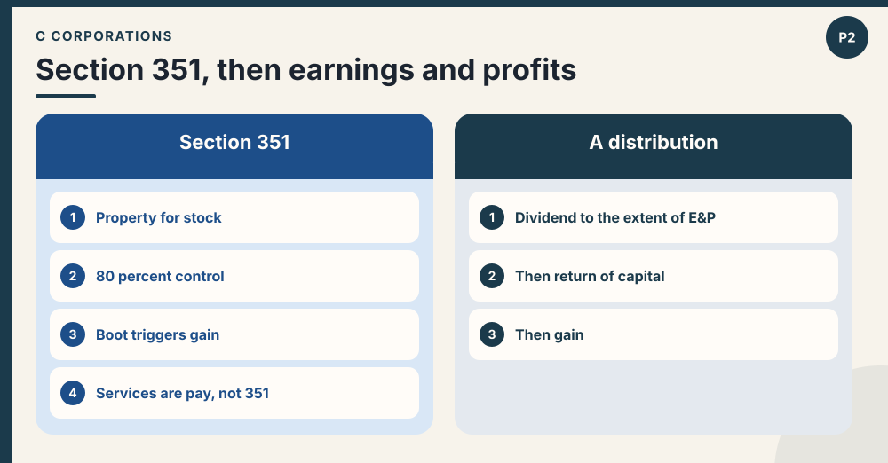

Publication 542 (Rev. January 2024) is the IRS corporation text used here. The exam’s law date is December 31, 2025. Where Publication 542 states a rate or a threshold, this guide quotes it and you should confirm the same sentence still appears in the 2025 Instructions for Form 1120.

**Filing.** A calendar-year C corporation files Form 1120 by the 15th day of the fourth month (April 15, 2026 for tax year 2025). Publication 542 states that a corporation with a fiscal year ending June 30 files by the 15th day of the third month, and that a short year ending in June is treated the same way. Form 7004 extends the time to file. Estimated tax is required when the corporation expects its tax for the year to be $500 or more (Publication 542). Installments are due on the 15th day of the 4th, 6th, 9th, and 12th months of the tax year. For a calendar year those dates are April 15, June 15, September 15, and December 15, moved to the next business day when needed. Each installment is generally 25% of the current-year tax, with a prior-year safe harbor that large corporations may use only for the first installment. Publication 542 explains both methods. Pay through EFTPS.

Late-filing penalty in Publication 542: 5% of the unpaid tax for each month or part of a month, up to 25%. The minimum penalty for a return more than 60 days late is inflation-adjusted. Use the dollar amount printed in the 2025 Instructions for Form 1120.

**Tax.** Publication 542: corporations, including qualified personal service corporations, figure tax by multiplying taxable income by 21%. Members of a controlled group file Schedule O (Form 1120) to apportion certain benefits. The outline also names the corporate minimum tax credit. For 2025 that credit is claimed on Form 8827 when the instructions say the corporation has a prior-year minimum tax credit. Large corporations may also have the corporate alternative minimum tax on Form 4626, and the base-erosion minimum tax on Form 8991 when gross receipts meet the test in Publication 542 (at least $500 million in any one of the three preceding tax years). Confirm which of those forms a question is pointing at before you compute. Do not import a rate from a commercial outline unless it matches the 2025 form instructions.

**Forming the corporation: section 351.** No gain or loss if property is transferred solely in exchange for stock and the transferors of property control the corporation immediately after. Control means at least 80% of the total combined voting power and at least 80% of each other class of stock. Several people can transfer property as a group and count together.

- Services are not property. Stock issued for services is compensation income to the recipient. Its fair market value is wages or ordinary income. That person does not count toward the 80% control group unless they also transfer property. Property of nominal value next to the services is disregarded. Publication 542 covers services rendered for stock.
- Boot (money or other property) causes the transferor to recognize gain equal to the lesser of realized gain or the fair market value of the boot. Loss is not recognized.
- Assumption of liability is not boot under section 357(a). It is boot if the principal purpose is tax avoidance, or if there is no bona fide business purpose (section 357(b)). If liabilities exceed the adjusted basis of property transferred, the excess is gain (section 357(c)).
- Shareholder’s stock basis: basis of property transferred, minus money and the fair market value of other boot received, minus liabilities assumed, plus gain recognized.
- Corporation’s basis in the property: transferor’s basis plus gain recognized to the transferor.

**Earnings and profits and distributions.** A corporate distribution of money plus the fair market value of other property, reduced by liabilities the shareholder assumes, is (Publication 542 and section 301):

1. A dividend to the extent of earnings and profits.
2. Then a return of capital that reduces stock basis.
3. Then gain, treated as gain from the sale of the stock.

Current earnings and profits for the year are allocated ratably to every distribution during the year. Accumulated earnings and profits are drawn in chronological order as of the date of each distribution. Learn that split. It decides which of two distributions in one year is a dividend.

The corporation recognizes gain when it distributes appreciated property, as if it sold the property for fair market value (use the greater of fair market value or liabilities, when liabilities are higher). It does not recognize loss on a nonliquidating distribution of property that has declined in value. The shareholder’s basis in received property is its fair market value.

Constructive dividends include personal expenses paid by the corporation, excessive compensation, and shareholder use of corporate property without fair rent. The outline’s “recognition requirements” point here.

**Special deductions.**

- Dividends-received deduction, Publication 542. From a domestic corporation: 50% if the recipient owns less than 20%; 65% if it owns 20% or more. Ownership is by vote and value. A 100% deduction applies to qualifying dividends from an affiliated group and to small business investment companies. A 100% foreign-source dividends-received deduction can apply to the foreign-source portion of dividends from a 10%-owned foreign corporation when the holding period is met. No deduction for dividends from a REIT, from a corporation exempt under section 501 or 521, or when the stock was held less than 46 days during the 91-day period beginning 45 days before the stock became ex-dividend (91 days during a 181-day period for certain preferred stock). The taxable-income limitation is applied in the order Publication 542 prints: the 65% slice first, then the 50% slice. The limitation does not apply when the corporation has a net operating loss.
- Charitable contributions. Publication 542: a corporation’s deduction is limited to 10% of taxable income, computed with the modifications the publication lists. Excess carries forward five years. Current-year gifts are deducted before carryovers. Accrual-method corporations may deduct a contribution authorized by the board during the year if paid by the return due date, including extensions. Noncash gifts above the publication’s documentation thresholds need Form 8283 and, above those thresholds, a qualified appraisal. Use the dollar lines printed in Publication 542 and the 2025 Form 8283 instructions.

**Capital losses.** A corporation’s capital losses offset only capital gains. Unused capital loss carries back three years and forward five years. Publication 542 states that a capital-loss carryback cannot increase a net operating loss. Confirm the carry periods in the 2025 Form 1120 instructions.

**Net operating loss.** For a tax year beginning in 2025, a net operating loss arising in a year beginning after December 31, 2017 is carried forward indefinitely and is limited to 80% of taxable income computed without the net operating loss deduction and without the deductions under sections 199A and 250 (section 172). Carryback is generally unavailable. A farming loss has a two-year carryback; the Instructions for Form 1041 state that two-year farming carryback, and Form 172 is the form. Public Law 119-21 amended section 172 for tax years beginning after December 31, 2025. Those later-year changes are outside this exam’s 2025 questions.

**Liquidations and redemptions.**

- A nonsubsidiary liquidation: the shareholder treats the liquidation as a sale of the stock under section 331 (amount realized compared with stock basis). The corporation recognizes gain and loss as if it sold its assets at fair market value under section 336, with loss disallowance on certain related-party and tax-avoidance distributions.
- A subsidiary liquidation into a parent that owns 80% can be nonrecognition under section 332, with carryover basis under section 334.
- A redemption is treated as a sale of the stock when it meets section 302(b): it is not essentially equivalent to a dividend, it is substantially disproportionate, it completely terminates the shareholder’s interest, or it is a partial liquidation. Substantially disproportionate means that after the redemption the shareholder owns less than 50% of the voting power, and owns less than 80% of the percentage of voting stock and of common stock the shareholder owned before. Family attribution under section 318 applies. A redemption that fails those tests is a section 301 distribution, tested against earnings and profits. Section 303 can also treat a redemption as a sale when the proceeds pay death taxes and funeral and administration expenses, within the limits in that section.

**Accumulated earnings tax.** Publication 542: a 20% tax on accumulated taxable income when earnings are accumulated beyond the reasonable needs of the business to avoid shareholder-level tax. An accumulation of $250,000 or less is generally treated as within reasonable needs. For a business whose principal work is accounting, actuarial science, architecture, consulting, engineering, health (including veterinary), law, or the performing arts, the publication uses $150,000. Reasonable needs include specific, definite, and feasible plans, and a redemption to pay death taxes of a deceased shareholder within the limits the publication states. Interest on this tax runs from the original due date, without extensions.

**Controlled groups and closely held corporations.** A parent-subsidiary controlled group or a brother-sister controlled group shares limits, including the section 179 dollar limit. The ownership percentages that create each kind of group are in Publication 542. A closely held corporation is also the setting for the personal holding company tax when passive investment income and stock ownership meet section 542. The outline names closely held corporations and the accumulated earnings tax specifically. Confirm the personal holding company tests in Publication 542 if a question gives investment income and five or fewer shareholders.

**Estimated-tax and credit traps.** A large corporation generally cannot use the prior-year tax for every installment. A quick refund of estimated-tax overpayment uses Form 4466 and, under Publication 542, requires an overpayment of at least $500. File it after year end and before the return. An extension of the return does not extend Form 4466.

### S corporations

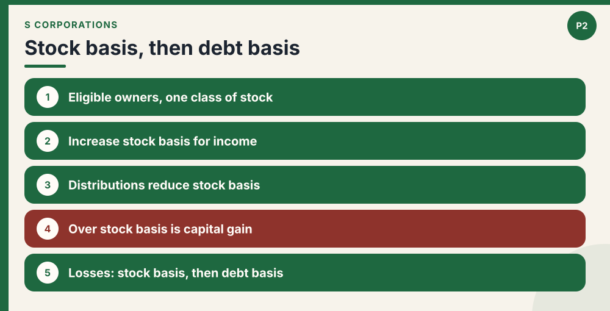

**Eligibility (section 1361).** Domestic corporation. No more than 100 shareholders. A family election can treat members of a family as one shareholder. Eligible shareholders are individuals who are U.S. citizens or residents, estates, and certain trusts (including qualifying subchapter S trusts and electing small business trusts). Partnerships, corporations, and nonresident aliens are not eligible shareholders. One class of stock: identical rights to distribution and liquidation proceeds. Differences in voting rights are allowed. Ineligible corporations include certain financial institutions, insurance companies, and domestic international sales corporations. Confirm the current ineligible list in the 2025 Instructions for Form 2553.

**Election.** Form 2553, with every shareholder’s consent. For the election to be effective for a given year it must be filed by the 15th day of the third month of that year, or at any time during the preceding year. A late election may qualify for relief described in the Form 2553 instructions. Do not invent a relief deadline; read the 2025 instructions.

**Return.** Form 1120-S, same unextended due date pattern as Form 1065 (15th day of the third month; March 16, 2026 for calendar year 2025). Separately stated items keep their character: interest, charitable contributions, section 179, capital gains, tax-exempt income, and credits. Ordinary business income is the residual. Shareholders report on Schedule E and related forms. The shareholder, not the corporation, claims the qualified business income deduction.

**Stock basis order.** The 2025 Shareholder’s Instructions for Schedule K-1 (Form 1120-S) require this order. Use Form 7203.

1. Increase for all income, including tax-exempt income, and for excess depletion other than oil and gas.
2. Decrease, not below zero, for non-dividend distributions. The amount of the distribution that exceeds stock basis is not a basis reduction; it is treated as gain from the sale of the stock.
3. Decrease, not below zero, for nondeductible expenses and for oil and gas depletion to the extent of the shareholder’s share of basis in the property.
4. Decrease, not below zero, for losses and deductions.

The shareholder may elect to take losses (step 4) before nondeductible expenses (step 3). The election is a statement on a timely return, it is permanent for that S corporation unless the IRS agrees to revoke it, and excess nondeductible expenses carry forward. Default order is nondeductible expenses first.

Income the shareholder is required to report increases basis only if it is reported on a return the shareholder is required to file.

**Loan basis.** After stock basis is zero, unused nondeductible expenses and losses reduce the basis of direct loans from the shareholder to the corporation. Two rules from those same 2025 instructions:

- Distributions do not reduce loan basis.
- A guarantee or co-signature is not loan basis. Basis arises when the shareholder pays under the guarantee.

Open-account debt and formal notes are tracked on Form 7203. When later income restores basis, reduced loan basis is restored before stock basis is increased. Confirm the line order on the 2025 Form 7203; that is the form the instructions tell you to use.

**Distributions and C-corporation earnings and profits.** If the S corporation has no accumulated earnings and profits from C years, a distribution is tax-free to the extent of stock basis and then gain from a sale of the stock. Loan basis does not absorb the distribution.

If the corporation has accumulated earnings and profits, the corporation maintains an accumulated adjustments account (AAA). The distribution order is:

1. Tax-free reduction of AAA, limited also by stock basis.
2. Dividend to the extent of accumulated earnings and profits.
3. Tax-free reduction of any stock basis that remains.
4. Gain from the sale of the stock.

AAA is increased by income other than tax-exempt income and is decreased by losses and by distributions that are sourced from AAA. A distribution cannot drive AAA negative. Losses can. Tax-exempt income increases stock basis and the other adjustments account. It does not increase AAA. A distribution can be a dividend out of old C-corporation earnings and profits even though tax-exempt income raised stock basis.

**Services for stock.** The shareholder includes the value of stock received for services in income. That inclusion increases stock basis. It is compensation, and it can be wages subject to employment tax when the person is an employee.

**Revocation, termination, reinstatement.** The election ends when shareholders holding more than half the shares consent to a revocation, when the corporation ceases to be a small business corporation (ineligible shareholder, second class of stock, too many shareholders), or when it has accumulated earnings and profits and excess passive investment income for three consecutive years. A termination during the year splits the year into an S short year and a C short year. After termination, a new election generally waits five years unless the IRS consents to an earlier election. Confirm the five-year waiting language in the 2025 Instructions for Form 1120-S.

**Built-in gains.** A former C corporation recognizes corporate-level tax on net recognized built-in gain during the section 1374 recognition period. The recognition period in current section 1374 practice is five years. Confirm that the 2025 Instructions for Form 1120-S still describe a five-year period before you apply it to a fact pattern that straddles the conversion year.

**Debt discharge.** For an S corporation, section 108(d)(7) applies the exclusion at the corporate level. Excluded cancellation-of-debt income is not passed through and does not increase shareholder basis. Tax attributes are reduced at the corporate level. Confirm the shareholder-basis sentence in Publication 4681 and the 2025 Form 1120-S instructions. This is the reverse of the partnership rule.

**Decision points.** Is there old C-corporation earnings and profits? Is the shareholder’s direct loan real debt, or only a guarantee? Did a disproportionate distribution create a second class of stock?

**Traps.**

- Using loan basis to make a cash distribution tax-free.
- Increasing AAA by tax-exempt income.
- Letting a partnership buy one share.
- Treating voting and nonvoting shares as two classes when distribution rights are identical.
- Claiming losses in excess of stock basis while a personal guarantee is the only “debt.”

### Domain 1 sample questions

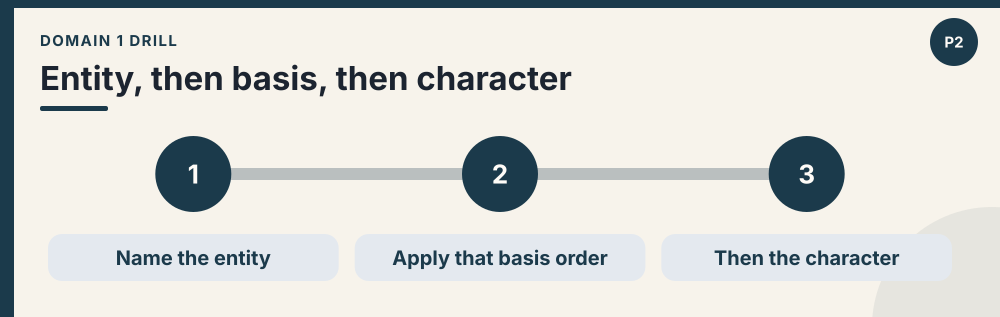

**1.** A domestic LLC has two members. It has never filed Form 8832 or Form 2553. For federal income tax it is classified as:

A. A disregarded entity

B. A partnership

C. A C corporation

D. An S corporation

**Answer: B.** A domestic eligible entity with two or more owners is a partnership unless it elects to be a corporation. **IRS basis:** Treasury Regulation 301.7701-3; Instructions for Form 8832.

**2.** Which filing makes a qualifying corporation an S corporation for a tax year?

A. Form SS-4

B. Form 8832 only, with no other election

C. Form 2553, with the required shareholder consents

D. Schedule C

**Answer: C.** Form 2553 is the S election. Form 8832 elects corporate classification for an eligible entity. Form SS-4 requests an EIN. **IRS basis:** Instructions for Form 2553; Instructions for Form 8832.

**3.** In 2025, Nora transfers business equipment to a new corporation solely in exchange for stock. She and the other property transferors own 80% of the voting power and 80% of each other class of stock immediately afterward. Nora receives no money or other property. She realizes a gain because the stock is worth more than her basis in the equipment. How much of that gain does she recognize in 2025?

A. All of the realized gain

B. None of the realized gain

C. Half of the realized gain, because the corporate tax rate is 21%

D. The gain is ordinary income up to depreciation she claimed

**Answer: B.** Section 351 provides nonrecognition when property is transferred solely for stock and the control test is met. The 21% rate is the corporation’s tax rate on its own taxable income (Publication 542); it does not split a shareholder’s section 351 gain. Depreciation recapture is not triggered by a nonrecognition transfer of this kind. **IRS basis:** IRC section 351; Publication 542 (Rev. January 2024), property exchanged for stock.

**4.** Same corporation as question 3. Omar receives stock only for legal services he performs in forming the corporation. He transfers no property. For 2025, Omar has:

A. No income, because section 351 covers every issuance of stock

B. Ordinary compensation income equal to the fair market value of the stock

C. Capital gain equal to the par value of the stock

D. A dividend, because the corporation has no earnings and profits yet

**Answer: B.** Stock issued for services is compensation. Services are not property, so section 351 does not defer that income. **IRS basis:** Publication 542 (Rev. January 2024), services rendered to a corporation in return for stock.

**5.** In 2025, Priya contributes property with an adjusted basis of $20,000, subject to a $30,000 mortgage, for a 25% partnership interest. The partnership assumes the mortgage. The other partners are allocated 75% of that mortgage. Under the liability rule in Publication 541, Priya’s outside basis and gain are:

A. Basis $20,000, gain $0

B. Basis $0, and gain of $2,500 that does not increase her outside basis

C. Basis $30,000, gain $0

D. Basis $7,500, gain $0

**Answer: B.** The share of the mortgage allocated to the other partners is 75% of $30,000, or $22,500. That deemed cash distribution exceeds her $20,000 basis by $2,500. Basis is zero. Publication 541’s matching example states that this gain is treated as gain from the sale of the partnership interest and does not increase outside basis. These dollar amounts are the facts of the question, not a statutory limit. **IRS basis:** Publication 541 (Rev. December 2025), partner’s liabilities assumed by the partnership.

**6.** At the start of the partnership’s 2025 tax year, Luis’s outside basis is $5,000. His 2025 items are ordinary income of $3,000, a cash distribution of $6,000, and an ordinary loss of $4,000. There are no other adjustments. Under the K-1 basis worksheet order, what is his allowable 2025 loss?

A. $4,000

B. $2,000

C. $0, and he also has $6,000 of gain on the distribution

D. $8,000

**Answer: B.** Income is applied first: $5,000 + $3,000 = $8,000. The cash distribution of $6,000 does not exceed that basis, so it is tax-free and basis becomes $2,000. The loss is allowed only up to the remaining $2,000. The other $2,000 of loss carries forward. **IRS basis:** Publication 541 (Rev. December 2025); basis worksheet in the Partner’s Instructions for Schedule K-1 (Form 1065).

**7.** A partnership pays a partner a guaranteed payment for services in 2025. The payment is large enough that the partnership has an ordinary loss. The partner’s outside basis is large enough to absorb the partner’s share of that loss. How does the partner report the items?

A. The partner ignores the guaranteed payment and reports only the loss

B. The partner reports the full guaranteed payment as ordinary income and separately reports the allowable share of the loss

C. The partner reports the guaranteed payment as a capital gain

D. The partnership withholds income tax on the guaranteed payment as if it were wages on Form W-2 in every case

**Answer: B.** Publication 541 states that the partner reports the full guaranteed payment as ordinary income even when the payment produces a partnership loss, and separately takes the loss subject to basis. Guaranteed payments are not subject to income-tax withholding. **IRS basis:** Publication 541 (Rev. December 2025), guaranteed payments.

**8.** For 2025, an S corporation has no accumulated earnings and profits from C-corporation years. It distributes $7,000 cash to its only shareholder. Stock basis before the distribution is $4,000. The shareholder also has a $10,000 basis in a loan the shareholder made directly to the corporation. There is no 2025 income. The distribution is treated as:

A. A $7,000 dividend

B. $4,000 tax-free and $3,000 gain from the sale of stock; loan basis stays $10,000

C. $7,000 tax-free, because loan basis can absorb a distribution

D. A $3,000 reduction of loan basis and a $4,000 tax-free distribution

**Answer: B.** Non-dividend distributions are tested against stock basis only. The excess is gain from the sale of the stock. Distributions do not reduce loan basis. **IRS basis:** 2025 Shareholder’s Instructions for Schedule K-1 (Form 1120-S), basis limitations.

**9.** Which new owner causes an S corporation to cease to be a small business corporation?

A. A U.S. resident individual

B. The estate of a deceased shareholder

C. A partnership

D. A shareholder who receives nonvoting stock with the same distribution and liquidation rights as the voting stock

**Answer: C.** A partnership is not an eligible S-corporation shareholder. Nonvoting stock is permitted when distribution and liquidation rights are identical. Estates are eligible shareholders. Confirm the full eligible-shareholder list in the 2025 Instructions for Form 2553. **IRS basis:** IRC section 1361; Instructions for Form 2553.

**10.** For tax year 2025, the unextended due date of a calendar-year Form 1120 is the 15th day of the fourth month, and the unextended due date of a calendar-year Form 1065 is the 15th day of the third month. Those dates fall on:

A. April 15, 2026 for Form 1120, and March 16, 2026 for Form 1065, because March 15, 2026 is a Sunday

B. March 15, 2026 for both returns

C. April 15, 2026 for both returns

D. January 31, 2026 for Form 1065 and February 2, 2026 for Form 1120

**Answer: A.** Publication 542 places a C corporation’s unextended return on the 15th day of the fourth month (with the June 30 fiscal-year exception the publication states). A partnership files by the 15th day of the third month. When the statutory date is a Sunday, the due date is the next business day. **IRS basis:** Publication 542 (Rev. January 2024), filing; 2025 Instructions for Form 1065, due date.

## Domain 2 — Business Tax Preparation

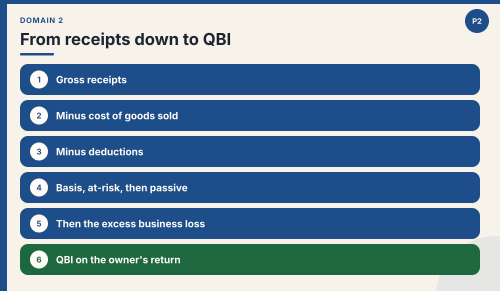

37 scored questions.

This is the largest domain. It covers income, cost of goods sold, loss limits, deductions and credits, cost recovery, asset dispositions, the books, and the advice you give the owner. Entity returns from Domain 1 reappear here as Schedule K-1 items, Schedule M-1, and employment-tax deposits.

### Income, inventory, debt cancellation, and loss limits

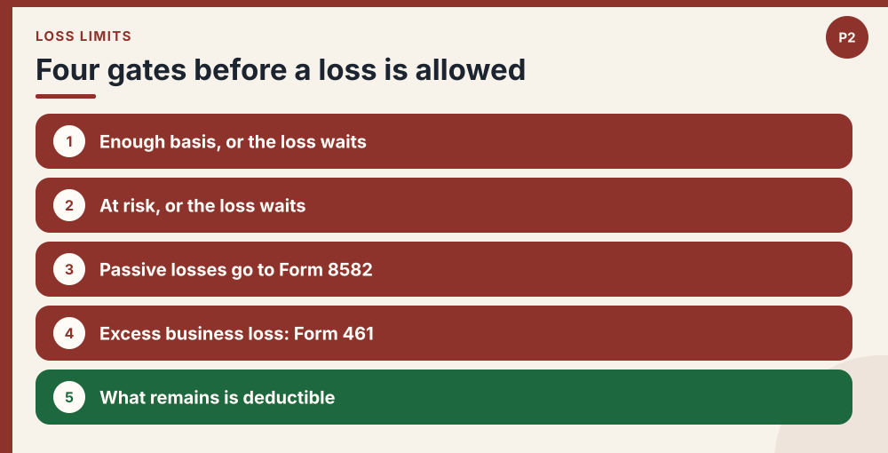

**Gross receipts.** All income from the business: sales, services, barter at fair market value, rents, and other income such as scrap sales and certain fuel tax credits that the form instructions tell you to include. Constructive receipt applies to cash-method taxpayers. A cash-method taxpayer includes income when it is received or made available.

**Cost of goods sold and uniform capitalization.** Inventory is not a deduction when purchased. It becomes cost of goods sold as items are sold. Beginning inventory, plus purchases and production costs, minus ending inventory, is cost of goods sold. Section 263A requires producers and resellers to capitalize direct costs and a proper share of indirect costs into inventory. A small-business exception uses the gross-receipts test. Confirm the 2025 gross-receipts dollar threshold in the instructions for Form 1125-A or Publication 538 before you memorize it. Acceptable inventory methods include cost and lower of cost or market, subject to the form instructions. A method change, including many inventory-method changes, uses Form 3115.

**At-risk and the stack of limits.** The 2025 Shareholder’s Instructions for Schedule K-1 (Form 1120-S), and Publication 925 (2025), use this order for an owner’s loss: basis, then at-risk (Form 6198), then passive activity (Form 8582), then the excess business loss limit (Form 461) for a noncorporate taxpayer. A specific limit such as the section 179 taxable-income limit is applied before at-risk and passive limits.

At-risk amounts are money and the adjusted basis of property contributed, plus amounts borrowed for use in the activity for which the taxpayer is personally liable, plus the taxpayer’s pledges of property not used in the activity. Nonrecourse borrowing is generally not at risk. Qualified nonrecourse financing on real property can be at risk under section 465(b)(6). A loss stopped by the at-risk rules carries forward and stays with that activity.

Passive activities are trades or businesses in which the taxpayer does not materially participate, and rental activities. Publication 925 (2025) lists the material-participation tests. Rental real estate stays passive even when the taxpayer materially participates, unless the taxpayer is a real estate professional who materially participates. Passive losses offset passive income. They carry forward. They are allowed in full when the taxpayer disposes of the entire interest in a fully taxable transaction to an unrelated person.

The special $25,000 rental allowance is Domain 3. The ordering rule lives here: you cannot reach that allowance with a loss that basis or at-risk already disallowed.

**Cancellation of business debt.** Cancellation is income unless an exclusion applies: bankruptcy, insolvency, qualified farm indebtedness, qualified real property business indebtedness, or a purchase-price adjustment. Exclusions reduce tax attributes in the order in section 108(b). Form 982 reports the exclusion. Publication 4681 is the guide. Partnership and S-corporation differences are in Domain 1: partner-level exclusions for partnerships; corporate-level exclusions for S corporations, with no basis increase for the excluded income.

**Decision point.** A loss that “exists” on the K-1 is not yet a deduction. Walk basis, at-risk, passive, and excess business loss, in that order, on the owner’s return.

**Traps.**

- Deducting inventory purchases as supplies when the goods are still on hand and the taxpayer is required to keep inventory.
- Treating qualified nonrecourse real-estate financing and a partner’s personal credit-card debt the same way for at-risk purposes.
- Applying the passive-loss rules before the at-risk rules.

**Yearly item.** The excess business loss threshold is inflation-adjusted. Confirm the 2025 amount in the Instructions for Form 461. This guide does not print that dollar amount.

### Expenses, cost recovery, employment tax, and credits

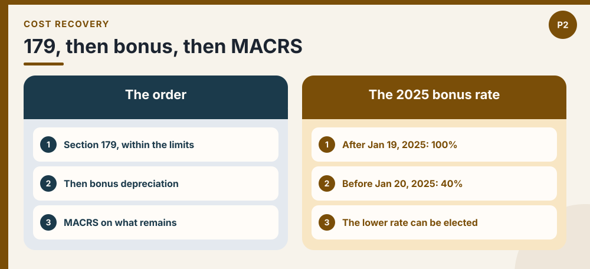

**Compensation.** Wages, bonuses, and commissions are deductible when they are ordinary and necessary and the amount is reasonable. The employer deducts the full wage, including amounts withheld for income tax and the employee’s share of social security and Medicare. The employer also deducts the employer’s own share of social security and Medicare. Fringe benefits are deductible by the employer to the extent they are ordinary and necessary; some are excluded from the employee’s income (see Publication 15-B) and some are wages. A statutory employee’s wage is reported on Form W-2 with the statutory-employee box checked, is subject to social security and Medicare, is not subject to income-tax withholding, and the worker may have business expenses on Schedule C. Confirm the four statutory-employee categories in Publication 15-A.

**Family employment, tax year 2025, Publication 15 (2025).**

- A child under age 18 who works for a parent in a trade or business that is a sole proprietorship, or a partnership in which each partner is a parent of the child, is not subject to social security and Medicare on those wages. A child under age 21 in that setting is not subject to FUTA. Income-tax withholding generally applies when the work is in the parent’s trade or business.
- The same child’s wages are subject to income-tax withholding, social security, Medicare, and FUTA when the employer is a corporation, even a corporation the parent owns, or a partnership that is not composed solely of the child’s parents, or an estate.
- Wages a person pays a spouse in a trade or business are subject to income-tax withholding and social security and Medicare, and are not subject to FUTA.
- Wages a child pays a parent in the child’s trade or business are subject to income-tax withholding and social security and Medicare, and are not subject to FUTA.

**Business rent.** Rent for property used in the business is deductible. Rent paid to a related person must be reasonable to be deductible in full. Self-rental: when a taxpayer rents property to a trade or business in which the taxpayer materially participates, the rental income is recharacterized as nonpassive under the self-rental rule. A loss from that rental can remain passive. Publication 925 (2025) is the passive-activity text; confirm the self-rental paragraph there before the exam.

**Depreciation and section 179, tax years beginning in 2025.** Instructions for Form 4562 (2025) and Publication 946 (2025):

- Maximum section 179 expense deduction: **$2,500,000**.
- That limit is reduced, dollar for dollar, by the cost of section 179 property placed in service during the tax year in excess of **$4,000,000**.
- Sport utility vehicles: the maximum section 179 deduction is **$31,300** for an SUV placed in service in a tax year beginning in 2025.
- The section 179 deduction cannot exceed taxable income from the active conduct of a trade or business. The disallowed amount carries forward. For partnerships and S corporations the dollar limit and the taxable-income limit apply at the entity and again at the owner.
- Section 179 property is tangible personal property and certain qualified real property the instructions list. Inventory, land, and property held only for investment do not qualify. Confirm the qualified-real-property list in the 2025 instructions.

**Bonus depreciation, Publication 946 (2025).** Placed-in-service year 2025 has a split acquisition date because of Public Law 119-21.

- Qualified property acquired after September 27, 2017, and before January 20, 2025, and placed in service in 2025, is limited to **40%**. Long-production-period property and certain aircraft in that acquisition window are limited to **60%**.
- Qualified property acquired and placed in service after January 19, 2025, qualifies for **100%**. The taxpayer may elect, for the first tax year ending after January 19, 2025, to take 40% (60% for long-production-period property and certain aircraft) instead of 100%.

Take section 179 first, then the special depreciation allowance on the remaining basis, then MACRS. Listed property that is not used more than 50% for business is not eligible for section 179 or bonus and uses the alternative depreciation system. Publication 946 states that more-than-50% test.

**Correcting depreciation.** A wrong life or a missed election is often an accounting-method change on Form 3115 with a section 481(a) adjustment. An adopted wrong asset, or a mathematical error, may be a Form 1040-X or an amended business return instead. The Instructions for Form 3115 draw that line. Do not amend several closed years for a method change that belongs on Form 3115.

**Startup and organizational costs.** The 2025 Instructions for Form 4562: for costs paid or incurred after September 8, 2008, the taxpayer may elect to deduct a limited amount in the year the business begins and must amortize the rest ratably over **180 months**, starting with the month business begins. The election does not require an attached statement and is irrevocable. The instructions point to Regulations sections 1.195-1, 1.248-1, and 1.709-1 for the dollar limit. Confirm that dollar limit in those regulations. This guide does not print it, because the 2025 instructions describe it only as a limited amount. Partnership syndication costs are not organizational costs and are not amortizable under that election (Publication 541).

**Depletion.** Cost depletion or percentage depletion, as Publication 535 and the form instructions allow for the mineral. Percentage depletion can exceed basis. The excess affects partner and shareholder basis under the rules in Domain 1.

**Bad debts.** An accrual-method business may deduct a wholly or partially worthless business bad debt as an ordinary deduction when worthlessness occurs. A cash-method taxpayer generally has no bad-debt deduction for fees never included in income, because those fees were never taxed. Nonbusiness bad debts are short-term capital losses and are a Part 1 topic; if they appear here, the character is the point.

**Travel, meals, and gifts, Publication 463 (2025).**

- Away-from-home travel requires a temporary assignment away from the tax home that is long enough to need sleep or rest. Lavish expenses are not deductible. Commuting between home and a regular work location is personal.
- Meals: the taxpayer may use actual cost or the standard meal allowance, and in either case may generally deduct **50%**. The cost must not be lavish, the taxpayer (or an employee) must be present, and the meal must be a business meal under the publication’s tests. People subject to Department of Transportation hours-of-service limits may deduct **80%**. Entertainment is not a deductible business expense.
- Gifts: no more than **$25** per person per tax year, directly or indirectly. A gift to a customer’s family is generally an indirect gift to the customer. Spouses are one taxpayer for the limit. Incidental engraving, packaging, insurance, and mailing are omitted from the $25 test when they do not add substantial value. An item that could be either a gift or entertainment is entertainment.

**Vehicles.** For 2025, the business standard mileage rate is **70 cents per mile** (Notice 2025-05). The taxpayer may use actual expenses instead, with a contemporaneous mileage record either way. The standard mileage rate cannot be used for a fleet of five or more vehicles used at the same time, and there are rules about using it in the year a vehicle is placed in service after actual expenses or after section 179. Confirm those switching rules in Publication 463 (2025). Luxury-automobile limits under section 280F are yearly. Confirm the 2025 caps in Publication 946 rather than using a prior-year table. Personal commuting is not deductible. An employer reimbursement is wages unless it is paid under an accountable plan: business connection, substantiation, and return of excess.

**Interest.** Business interest is deductible, subject to section 163(j) for taxpayers that do not meet the small-business gross-receipts exception. The limitation is computed on Form 8990. Confirm the 2025 percentage of adjusted taxable income and the gross-receipts threshold in the Form 8990 instructions. Prepaid interest is capitalized and deducted over the period to which it applies. Interest on debt used to buy tax-exempt bonds is not deductible. Tracing decides whether interest is business, investment, or personal.

**Insurance.** Premiums for fire, casualty, and liability coverage of the business are deductible. Premiums on a life insurance policy, or on a policy covering sickness or accidents, are not deductible when the business is directly or indirectly a beneficiary (section 264). A reserve for self-insurance is not deductible until claims are paid. Prepaid multi-year premiums are capitalized and deducted over the coverage period.

**Taxes.** Federal income tax is not a business deduction. The employer’s share of social security and Medicare is deductible. An employee’s withheld income tax is part of deductible wages, not a separate tax deduction. State income and franchise taxes are deductible. Sales tax on a depreciable asset is added to basis. Government penalties and fines are not deductible. Excise taxes are deductible when they are an ordinary business cost, and some fuel taxes produce a credit instead of a deduction. Confirm the credit-versus-deduction line for 2025 in the Instructions for Form 4136.

**Employment taxes.** Publication 15 (2025): social security tax is **6.2%** on the employer and **6.2%** on the employee, wage base **$176,100** for 2025. Medicare tax is **1.45%** on each, with no wage base. The employer withholds Additional Medicare Tax of **0.9%** on wages it pays an employee in excess of **$200,000** in the calendar year, without regard to the employee’s filing status. The employee computes the final Additional Medicare Tax on Form 8959. Confirm the filing-status thresholds in the 2025 Instructions for Form 8959. The employer does not pay the 0.9%.

FUTA, 2025 Instructions for Form 940 and IRS Topic 759: the rate is **6.0%** of the first **$7,000** of wages paid to each employee. A credit of up to **5.4%** is available for timely state unemployment contributions, including the additional credit when the state’s experience rate is lower than 5.4%. For 2025 there are credit-reduction states. Use Schedule A (Form 940) rather than assuming a net 0.6% in every state. Form 940 for 2025 is due February 2, 2026, or February 10, 2026 if all FUTA tax was deposited when due. Deposit FUTA when the undeposited amount is more than $500. Form 941 is the quarterly return for income-tax withholding and social security and Medicare. Deposits are electronic, generally through EFTPS. The lookback period decides monthly or semiweekly deposits. Publication 15 (2025), section 11, is the deposit chapter.

Self-employment tax is the self-employed person’s counterpart: both the employer and employee shares, computed on Schedule SE. The form multiplies net profit by 92.35% before the rates. Confirm that factor on the 2025 Schedule SE. One-half of the self-employment tax is an adjustment to income.

**Casualties, thefts, and condemnations.** A business or income-producing casualty or theft loss is an ordinary loss. The personal-casualty floor and the 10%-of-AGI reduction that apply to personal casualties do not apply to business property. The loss is the adjusted basis, reduced by insurance and by any salvage, and limited by a decline in fair market value when the property is not completely destroyed. A gain from insurance or a condemnation can be postponed under section 1033 when replacement property is acquired within the replacement period. Confirm the 2025 replacement period in Publication 547.

**Qualified business income, tax year 2025.** Instructions for Form 8995-A (2025) and the IRS qualified-business-income page:

- The deduction has two pieces: 20% of qualified business income from a domestic sole proprietorship, partnership, S corporation, trust, or estate, and 20% of qualified REIT dividends and qualified publicly traded partnership income.
- It cannot exceed 20% of taxable income minus net capital gain.
- C-corporation income and wages from being an employee are not qualified business income.
- Taxable-income thresholds before the QBI deduction, for 2025: **$394,600** if married filing jointly, and **$197,300** for all other returns. At or below the threshold, the W-2 wage and UBIA limits and the specified-service limit are not applied. Use Form 8995 unless the taxpayer is a patron of a specified agricultural or horticultural cooperative.
- Above the threshold, the reduction is phased in until taxable income reaches **$494,600** (married filing jointly) or **$247,300** (all other returns). Over that top of the phase-in range, each business is limited to the greater of 50% of W-2 wages, or 25% of W-2 wages plus 2.5% of the unadjusted basis immediately after acquisition of qualified property. A specified service trade or business (health, law, accounting, consulting, athletics, financial services, brokerage, investing, and the other fields the instructions list, plus the reputation or skill of employees or owners) produces no qualified business income once taxable income is above the top of the phase-in range.
- Specified service businesses below the threshold still qualify.
- A net loss from qualified businesses carries forward and reduces next year’s qualified business income.
- The minimum deduction for active qualified business income described on the IRS page applies to tax years beginning after 2025. Do not apply it on a 2025 return.

**General business credit.** The credit is a basket on Form 3800. The outline names the disabled-access credit (Form 8826), the research credit (Form 6765), the small-business health-care credit (Form 8941), and the foreign tax credit. Each credit has its own eligibility test in its form instructions. The foreign tax credit for a business can be a direct credit or a pass-through item on Schedule K-1; an individual computes it on Form 1116 unless an exception applies. Unused general business credit has a carryback and a carryforward stated in the 2025 Instructions for Form 3800. Confirm those years there. Do not memorize a credit percentage from a prior course unless it matches the 2025 form.

**Home office.** Publication 587. The space must be used regularly and exclusively as the principal place of business, as a place to meet clients in the normal course of business, or as a separate structure used in the business. A daycare and storage of inventory have specific exceptions to exclusive use. The deduction cannot create a loss from the business. The simplified method and the actual-expense method are both in Publication 587. Confirm the 2025 simplified rate per square foot and the area cap in that publication. This guide does not print them.

**Decision points.** Is the worker an employee, a statutory employee, or an independent contractor? Is the asset section 179 property, and was it acquired before or after January 20, 2025? Is taxable income above the 2025 QBI threshold?

**Traps.**

- Deducting 100% of 2025 business meals. The temporary restaurant rule for earlier years is over.
- Giving the parent’s corporation the family-employment exclusion that belongs only to a parent’s sole proprietorship or a parents-only partnership.
- Claiming bonus at 100% on property acquired on January 15, 2025.
- Claiming section 179 on the partnership return and again in full on the partner’s return without applying the partner’s own dollar limit and taxable-income limit.
- Putting an employee’s wages into the QBI deduction.

### Assets and dispositions

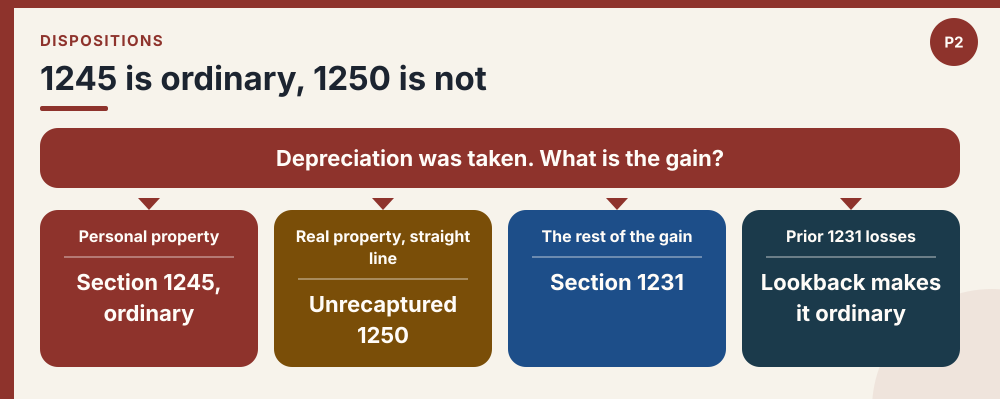

**Basis.** Cost includes cash, debt incurred to buy the asset, sales tax, and setup costs that are capitalized. Gifted property generally takes the donor’s basis for gain; for loss, basis is the lesser of the donor’s basis or fair market value at the gift. Inherited property is generally fair market value at the date of death (or the alternate valuation date if the estate uses it). Property converted from personal use to business use takes, for depreciation and for loss, the lesser of adjusted basis or fair market value on the conversion date. Gain basis remains adjusted basis. Publication 551 is the basis publication.

**Repairs and capitalization.** The tangible-property regulations distinguish a repair (deductible) from an improvement (capitalized). An improvement is a betterment, a restoration, or an adaptation to a new use. The de minimis safe harbor, the routine-maintenance safe harbor, the election to capitalize repairs, and partial-asset dispositions are elections with their own statements or Form 3115 requirements. Confirm the 2025 de minimis dollar ceilings (with and without an applicable financial statement) in the tangible-property regulations or the IRS tangible-property FAQ before you memorize them.

**Character of gain or loss.** Section 1231 applies to depreciable business property and real property used in a trade or business and held more than one year. Net section 1231 gain is long-term capital gain. Net section 1231 loss is ordinary. Section 1231(c) recharacterizes net section 1231 gain as ordinary to the extent of unrecaptured net section 1231 losses from the five preceding tax years. Look back before you call the gain capital.

Section 1245 recapture: gain on personal property is ordinary to the extent of all depreciation allowed or allowable, including section 179 and bonus, and not more than the gain. Section 1250 recapture on real property is the excess of accelerated depreciation over straight line, which is often zero for MACRS real property placed in service in later years. For an individual, the remaining gain attributable to straight-line depreciation on real property is unrecaptured section 1250 gain, taxed at a maximum capital-gain rate. Confirm that maximum rate in the 2025 Instructions for Schedule D. This guide does not print it.

Section 1239: gain on a sale of depreciable property between related persons (more than 50% ownership, with attribution) is ordinary income.

**Like-kind exchanges.** Section 1031, after the 2017 statutory change that is still the law for 2025, applies to real property held for productive use in a trade or business or for investment, exchanged for real property of the same kind. It does not apply to personal property, inventory, stocks, bonds, partnership interests, or property held primarily for sale. Boot (cash, other non-like-kind property, or net liability relief) causes recognized gain equal to the lesser of realized gain or boot. Loss is not recognized. Basis in the new property is the basis of the property given up, decreased by money received and by loss recognized, and increased by gain recognized and by additional costs. The 45-day identification period and the 180-day exchange period are statutory. Related-party exchanges can be reversed if either party disposes of the property within two years. Report on Form 8824.

**Converted property.** When a personal residence or other personal asset is placed in service in a business, depreciation starts at the conversion-date basis rule above. On a later sale, compute gain using adjusted basis (after depreciation) and compute loss using the lower conversion-date fair market value if that rule produced a lower starting point. A loss that arose before the conversion is personal and is not deducted.

**Decision point.** Hold the asset one more day and the character can move from ordinary short-term property to section 1231. Take the depreciation and you have created section 1245 ordinary income on the way out.

**Traps.**

- Treating a truck-for-truck trade as a like-kind exchange in 2025.
- Forgetting the five-year section 1231 lookback.
- Depreciating land, or depreciating a converted personal asset from a basis higher than fair market value on the conversion date.
- Reporting all gain on a building as ordinary section 1250 recapture when the only depreciation taken was straight line.

### Books, methods, and advice to the owner

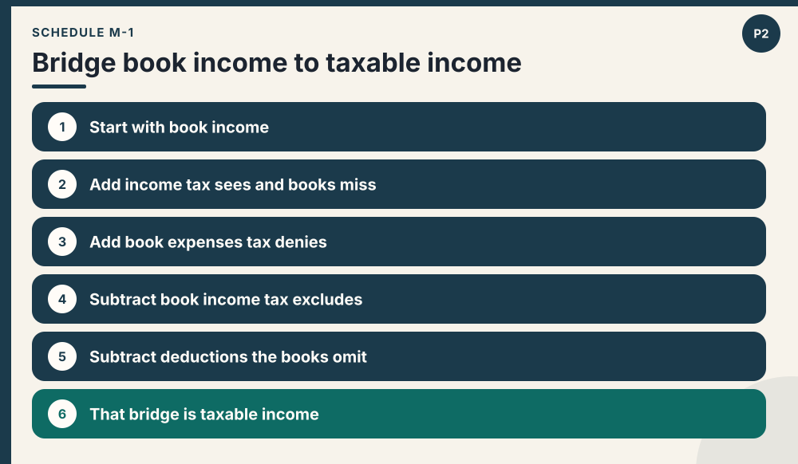

**Records and codes.** Choose the form that matches the entity (Domain 1). Use the principal business activity code the form instructions publish. Compare this year’s gross margin, officer pay, and ending inventory with last year. A ratio that moved without a business reason is an error or a classification change.

**Financial statements.** The income statement is book income. Schedule L is the balance sheet. Beginning-of-year Schedule L must equal last year’s ending Schedule L. Assets equal liabilities plus equity. Ending accumulated depreciation on Schedule L must tie to the depreciation rollforward and to Form 4562. Inventory on Schedule L must tie to cost of goods sold.

**Methods.** Cash, accrual, or a permitted hybrid. Inventory generally pulls a taxpayer toward accrual for purchases and sales. The small-business gross-receipts exception can allow the cash method. Confirm the 2025 threshold in Publication 538. A change of method is Form 3115, often with a section 481(a) adjustment spread over the number of years the instructions require. An automatic change and a non-automatic change use different procedures.

**Depreciation recovery and section 280F.** Listed property (passenger automobiles, and other property the instructions still list) needs business-use records. If business use drops to 50% or below, section 179 and bonus already taken are recaptured as ordinary income. Publication 946 covers the recapture computation.

**Pass-through items.** Schedule K-1 reports ordinary income and separately stated items. Nondeductible expenses reduce basis and do not reduce the owner’s taxable income. Tax-exempt income increases basis and is not taxed. Guaranteed payments, section 179, and charitable contributions do not belong inside ordinary income.

**Schedules M-1, M-2, and M-3.** Schedule M-1 reconciles book income to taxable income. Typical lines: federal income tax, excess tax depreciation, travel and entertainment disallowed (the 50% meals haircut), tax-exempt interest, and life insurance proceeds or premiums when the corporation is the beneficiary. Schedule M-2 reconciles unappropriated retained earnings (and, for an S corporation, the accumulated adjustments account). Schedule M-3 is the longer reconciliation. The asset-size threshold that forces Schedule M-3 is in the 2025 form instructions. Confirm it there.

**Related parties and owner loans.** Section 267 disallows a loss on a sale to a related person and defers an accrual-method deduction until the related cash-method payee includes the income. A loan from a corporation to a shareholder is a dividend if the facts show there was no intent to repay. A loan from a shareholder to an S corporation is debt basis only when it is the shareholder’s own loan. Below-market loans can create imputed interest under section 7872. Confirm the 2025 imputed-interest dollar exceptions in Publication 550 before you apply them.

**Advice the outline expects you to give.**

- Filing: which return, the due date, the extension, and the penalty for filing late or paying late. International information returns (Forms 5471, 5472, 8865, and others) when a foreign owner or a foreign entity is in the structure. Confirm which form fits in the 2025 instructions. Form 1099 series and Form 8300.
- Deposits: employment tax on the Publication 15 schedule, excise tax on the form that matches the excise (Form 720 for many excises).
- Records: mileage log, receipts, and an accountable plan if the business reimburses the owner or employees.
- Entity selection: a sole proprietorship is simple and the profit is self-employment income. A partnership offers special allocations and liability sharing, with self-employment tax on general partners. A C corporation offers a 21% rate on retained earnings and a second tax on dividends. An S corporation offers pass-through of income and, when compensation is reasonable, a split between wages and distributions that are not self-employment income. Reasonable compensation is required. A distribution that replaces wages is still wages.
- Commingling: personal use of the business account is a constructive dividend for a C corporation, a distribution for a partnership or S corporation, and a mess for basis. Separate accounts are the advice.
- Life cycle: formation (section 721 or 351), operation (basis each year), and exit (sale of interest, redemption, or liquidation).
- Industry: a specified service trade or business changes the QBI result once taxable income is above the 2025 threshold.
- Worker classification: Publication 15-A uses behavioral control, financial control, and the relationship of the parties. The IRS can reclassify on Form SS-8 facts. Statutory nonemployees (qualified real estate agents and direct sellers) are self-employed when the statutory tests are met.
- Planning: timing of income and expenses, the net operating loss rules for 2025, and the choice among section 179, bonus, and regular depreciation. Section 179 is limited by taxable income and can be recaptured if business use drops. Bonus at 100% applies only to property acquired after January 19, 2025, unless the taxpayer elects the lower percentage.
- ACA: an applicable large employer, generally an employer that averaged at least 50 full-time employees (including full-time equivalents) in the prior year, has offer-of-coverage duties and files Forms 1094-C and 1095-C. Confirm the 2025 measurement rules in the form instructions.

**Traps.**

- Schedule L out of balance, or a beginning balance that does not match last year’s ending balance.
- Book depreciation on the return without an M-1 adjustment.
- A shareholder “loan” with no note, no interest, and no repayments, reported as basis.

### Domain 2 sample questions

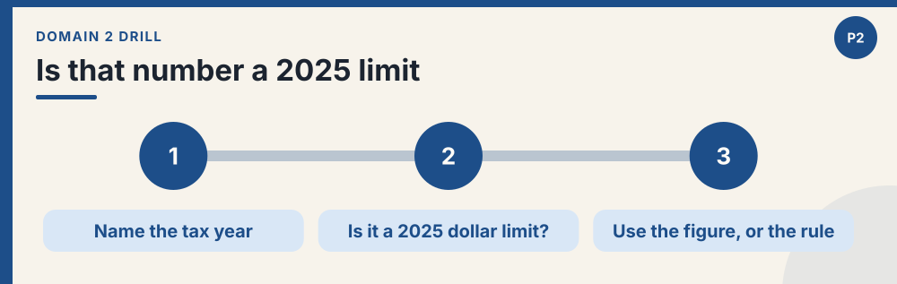

**1.** For a tax year beginning in 2025, the maximum section 179 expense deduction, before the investment limitation and the taxable-income limitation, is:

A. $1,160,000

B. $2,500,000

C. $4,000,000

D. $31,300

**Answer: B.** The 2025 instructions set the maximum at $2,500,000 and reduce it when the cost of section 179 property placed in service exceeds $4,000,000. The $31,300 figure is the separate SUV cap for a tax year beginning in 2025, not the general ceiling. **IRS basis:** Instructions for Form 4562 (2025); Publication 946 (2025).

**2.** A calendar-year business acquired qualified property on January 10, 2025, and placed it in service in June 2025. The property is not long-production-period property or an aircraft. The special depreciation allowance under Publication 946 (2025) is:

A. 20%

B. 40%

C. 60%

D. 100%

**Answer: B.** Property acquired before January 20, 2025, and placed in service during 2025 is in the phase-down. The allowance is 40% for this property. The 60% rate in that publication is for long-production-period property and certain aircraft acquired in the same window. **IRS basis:** Publication 946 (2025), what’s new for 2025.

**3.** The same business acquired different qualified property on March 1, 2025, and placed it in service on March 15, 2025. The taxpayer does not elect a reduced percentage. The special depreciation allowance is:

A. 40%

B. 60%

C. 80%

D. 100%

**Answer: D.** Publication 946 (2025) restores a 100% allowance for qualified property acquired and placed in service after January 19, 2025. The taxpayer may elect 40% instead for the first tax year ending after January 19, 2025. This taxpayer did not elect that reduction. **IRS basis:** Publication 946 (2025).

**4.** In 2025, a sole proprietor takes a client to a restaurant, discusses a current contract, is present for the meal, and pays a restaurant bill that is not lavish. There is no entertainment. The deductible portion of the meal is:

A. None of the cost

B. 50% of the cost

C. 80% of the cost

D. 100% of the cost

**Answer: B.** Publication 463 (2025) allows 50% of a qualifying business meal. The 80% rate is for taxpayers subject to Department of Transportation hours-of-service limits. Entertainment is not deductible. The temporary 100% restaurant rule applied to earlier years, not to 2025. **IRS basis:** Publication 463 (2025).

**5.** In 2025, a sole proprietor pays wages to their 16-year-old child for real work in the sole proprietorship. Under Publication 15 (2025), those wages are:

A. Subject to income-tax withholding, and not subject to social security, Medicare, or FUTA

B. Subject to social security, Medicare, and FUTA, and not subject to income-tax withholding

C. Free of all federal employment taxes and of income-tax withholding

D. Subject to FUTA only

**Answer: A.** Payments for services of a child under 18 who works for a parent in a sole proprietorship are not subject to social security and Medicare. Payments for a child under 21 in that setting are not subject to FUTA. Income-tax withholding applies to the child’s wages for work in the parent’s trade or business. **IRS basis:** Publication 15 (2025), family employees.

**6.** A shareholder has enough stock basis to absorb an S-corporation ordinary loss. Part of the shareholder’s investment in that activity is nonrecourse debt that is not qualified nonrecourse financing, and the activity is not one in which the shareholder materially participates. In what order do the limits apply?

A. Passive activity, then at-risk, then basis

B. Basis, then at-risk, then passive activity

C. At-risk, then basis, then the qualified business income deduction

D. Excess business loss first, then basis

**Answer: B.** The 2025 K-1 instructions and Publication 925 (2025) apply basis, then at-risk, then passive-activity limits. For a noncorporate taxpayer, the excess business loss limit comes after those three. The qualified business income deduction is computed after taxable income is determined; it is not a loss limitation. **IRS basis:** 2025 Shareholder’s Instructions for Schedule K-1 (Form 1120-S); Publication 925 (2025).

**7.** In 2025, a manufacturer exchanges a delivery truck used in the business for another delivery truck, plus cash to even out the values. The trucks are real personal property, not real estate. The exchange:

A. Qualifies as a like-kind exchange under section 1031, and gain is recognized only to the extent of the cash

B. Does not qualify as a like-kind exchange

C. Qualifies only if both trucks are held for more than one year

D. Qualifies if the trucks are exchanged within 180 days

**Answer: B.** For 2025, section 1031 applies to real property held for business or investment. An exchange of trucks is an exchange of personal property and is a taxable disposition. The 45-day and 180-day periods apply to deferred exchanges of real property that otherwise qualify. **IRS basis:** IRC section 1031; Instructions for Form 8824.

**8.** For 2025, a single taxpayer has taxable income of $100,000 before the qualified business income deduction. That income includes qualified business income from a specified service trade or business. The Form 8995-A threshold for a single filer is $197,300. The taxpayer:

A. May claim the qualified business income deduction, because taxable income is at or below the threshold

B. Is barred from the deduction because a specified service trade or business never qualifies

C. Must apply the W-2 wage limit in full

D. Must use Form 8995-A because every specified service business files that form

**Answer: A.** At or below the threshold, the wage and UBIA limits and the specified-service disallowance are not applied. Specified service income can be qualified business income in that range. Form 8995 is the simplified form when taxable income is at or below the threshold and the taxpayer is not a patron of a specified agricultural cooperative. **IRS basis:** Instructions for Form 8995-A (2025).

**9.** A C corporation’s 2025 tax depreciation is larger than its book depreciation. On Schedule M-1, that difference is:

A. An addition to book income

B. A subtraction from book income on the way to taxable income

C. Ignored, because depreciation is always the same for book and tax

D. A credit against the 21% tax

**Answer: B.** Schedule M-1 starts from book income. Tax depreciation in excess of book depreciation is a tax deduction the books did not take, so it is subtracted to reach taxable income. Federal income tax expensed on the books is an addition. The 21% rate, from Publication 542, is applied to taxable income after the reconciliation. **IRS basis:** 2025 Instructions for Form 1120, Schedule M-1; Publication 542 (Rev. January 2024), tax rate.

**10.** For 2025, the business standard mileage rate and the social security wage base are:

A. 70 cents per mile, and a social security wage base of $176,100

B. 67 cents per mile, and a social security wage base of $176,100

C. 70 cents per mile, and no social security wage base

D. 14 cents per mile, and a Medicare wage base of $176,100

**Answer: A.** Notice 2025-05 sets the 2025 business standard mileage rate at 70 cents per mile. Publication 15 (2025) sets the social security wage base at $176,100 and states that Medicare tax has no wage base. The 14-cent rate in that notice is the charitable rate, not the business rate. **IRS basis:** Notice 2025-05; Publication 15 (2025).

## Domain 3 — Specialized Returns and Taxpayers

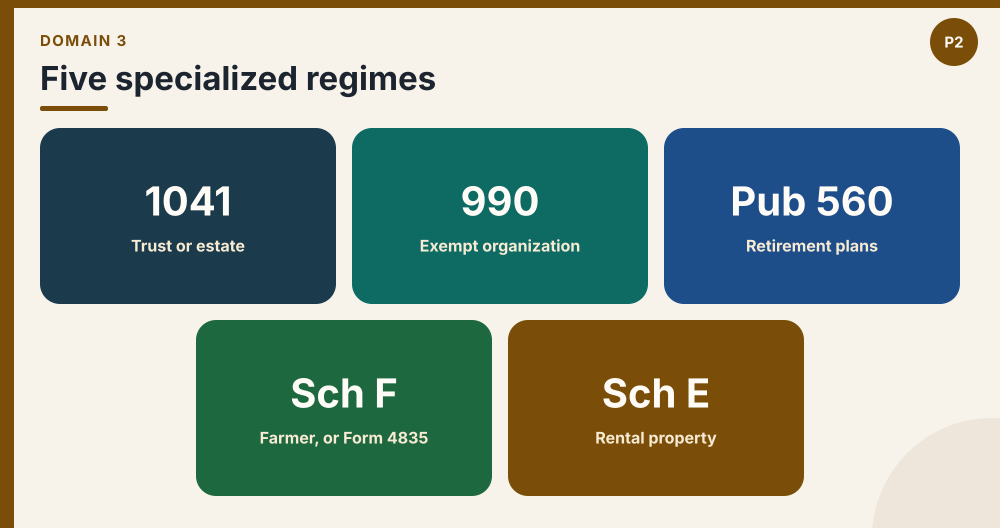

18 scored questions.

Eighteen questions cover five systems. Learn who files which form, the one limit that caps the deduction or the contribution, and the classification test that moves income from one schedule to another.

### Trusts and estates

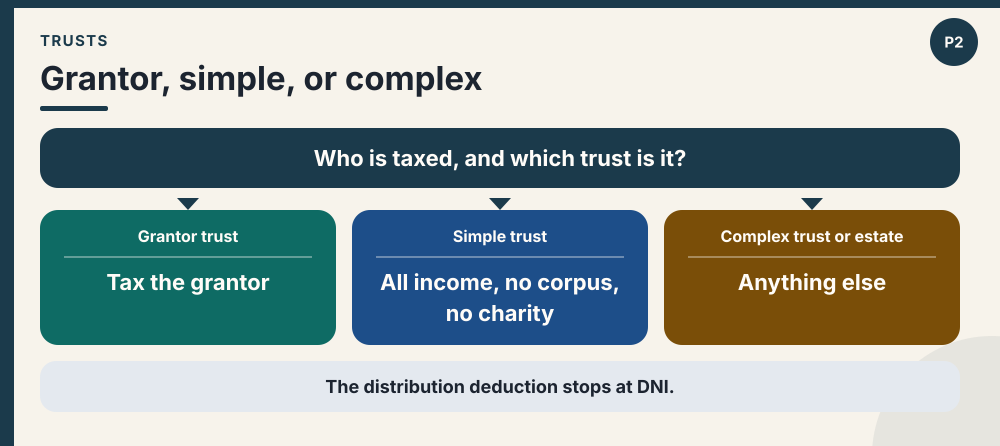

**Types.** The 2025 Instructions for Form 1041:

- A simple trust must distribute all fiduciary accounting income currently, makes no charitable distribution, and distributes no corpus.
- A complex trust is any trust that is not a simple trust.
- A grantor trust is taxed to the grantor (or another person treated as the owner) under sections 671 through 679. If the entire trust is a grantor trust, the fiduciary fills in the entity information on Form 1041 and reports dollar amounts on an attachment. The instructions say not to use Schedule K-1 as that attachment. If only part of the trust is a grantor trust, the rest of the trust is reported on Form 1041 under the normal rules.
- An irrevocable trust can still be a grantor trust when a power or a retained interest makes the grantor the owner.
- Foreign trusts and abusive arrangements are on the outline. A U.S. person who transfers property to a foreign trust, or who is treated as the owner, has Form 3520 reporting. Confirm the 2025 thresholds in the Form 3520 instructions. A fraudulent or abusive trust does not move taxation off the person who earns the income or who controls the property. Personal living expenses remain nondeductible. The IRS position is that paper trusts that assign income while the taxpayer keeps control are taxed to that taxpayer.

**Income versus corpus.** Fiduciary accounting income is defined by the instrument and local law. It is not taxable income. Capital gains are often allocated to corpus. They enter distributable net income only in the situations the instructions and section 643 describe (for example, when they are paid or required to be distributed, or when they are used to determine the amount distributed). Beneficiaries are taxed on the income character that distributable net income carries out to them. Separately stated items on Schedule K-1 (Form 1041) include items that keep a special character, such as qualified dividends, capital gains that are distributed, tax-exempt income, depreciation, and the qualified-business-income information the 2025 instructions tell the fiduciary to attach.

**Distributable net income.** DNI caps the income distribution deduction the estate or trust may claim, and it caps the amount the beneficiary includes. Compute DNI on Schedule B. Tax-exempt income is reflected in the computation so that a distribution of tax-exempt income stays tax-exempt in the beneficiary’s hands and the fiduciary does not deduct it. A simple trust deducts the income required to be distributed, limited to DNI. A complex trust or an estate also deducts other amounts properly paid or credited, still limited to DNI.

**Exemptions for 2025, Instructions for Form 1041, line 21.**

- Decedent’s estate: **$600**.
- Trust required to distribute all income currently: **$300**, even if it also distributed corpus (a distribution of corpus can make it a complex trust for classification purposes; the exemption instruction still keys the $300 to the instrument’s requirement to distribute income currently).
- Qualified disability trust: **$5,100**, and the instructions say this amount is not subject to phaseout.
- All other trusts: **$100**.

A qualified disability trust is defined in those instructions. It is a yearly figure; use the 2025 instructions.

**Deductions.** An estate or complex trust may deduct charitable amounts paid from gross income under section 642(c), on Schedule A of Form 1041. A simple trust that pays charity is no longer a simple trust. Depreciation is apportioned between the fiduciary and the beneficiaries under the instrument. Administration expenses that would not have been incurred if the property were not in the estate or trust are deductible. A double deduction of the same administration expense on Form 706 and Form 1041 is not allowed; the fiduciary waives one of them.

**Tax years, filing, penalties.** Trusts file on a calendar year, with narrow exceptions. An estate may choose a fiscal year. Form 1041 is due the 15th day of the fourth month after year end (April 15, 2026 for a calendar-year 2025 filer). A section 645 election can let a qualified revocable trust join the estate for a period and use the estate’s fiscal year; the 2025 instructions describe that election. The section 663(b) election treats distributions made in the first 65 days of the next tax year as paid on the last day of the current year. Make it on a timely filed return, including extensions.

An estate files Form 1041 if it has gross income of $600 or more, if it has a nonresident alien beneficiary, or if it holds a qualified opportunity fund investment, among the tests in the 2025 instructions. Penalties for late filing and late payment follow the Form 1041 instructions. Confirm any dollar minimum in the 2025 instructions.

**Decision point.** If the instrument requires all income to be distributed and the trustee also distributes principal, the trust is complex for that year. Recompute DNI and the exemption from the 2025 instructions rather than assuming the simple-trust result.

**Traps.**

- Taxing the beneficiary on corpus distributions in excess of DNI.
- Reporting a wholly grantor trust’s income on Schedule K-1.
- Deducting the full exemption of a complex trust at the simple-trust amount.

### Exempt organizations

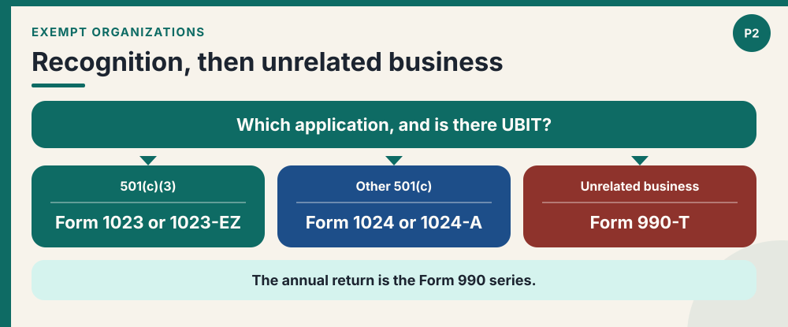

**Qualification.** Section 501(c) lists exempt categories. Section 501(c)(3) is charitable, religious, educational, scientific, and literary organizations, and a few others in that subsection. A 501(c)(3) organization must be organized and operated exclusively for those purposes. Net earnings may not inure to a private shareholder or individual. It may not intervene in a political campaign. Lobbying cannot be a substantial part of its activities unless a permitted election under section 501(h) applies. Other subsections cover social welfare (501(c)(4)), labor and agricultural groups (501(c)(5)), business leagues (501(c)(6)), social clubs (501(c)(7)), and the rest of the list. Read the subsection the question names.

**Applications.** Form 1023, or Form 1023-EZ when the organization fits the eligibility worksheet, is the application for recognition of 501(c)(3) status. Form 1024 is the application for recognition of exemption under other section 501(c) categories that use it. A section 501(c)(4) organization has a notice requirement on Form 1024-A. Confirm which form the 2025 instructions assign to the subsection in the question.

**Annual filing.** The Form 990 series is the annual information return. Which form (Form 990, 990-EZ, or 990-N) depends on gross receipts and assets. The dollar lines are inflation-sensitive in some years and fixed in others. Confirm the 2025 thresholds in the Instructions for Form 990. An organization that fails to file the required return for three consecutive years has its exemption automatically revoked under section 6033(j). Reinstatement is a separate application.

**Unrelated business taxable income.** A regularly carried on trade or business that is not substantially related to the exempt purpose produces unrelated business taxable income, reported on Form 990-T. Exclusions under section 512(b) include dividends, interest, annuities, royalties, certain rents from real property, and gains from property that is not inventory or stock in trade. Those exclusions do not shelter debt-financed income. Activities run mostly by volunteers, activities carried on for the convenience of members, and sales of donated merchandise are excluded from the definition of an unrelated trade or business under section 513(a). Publication 598 is the IRS text. Confirm the specific-deduction dollar amount in the 2025 Instructions for Form 990-T before you use it.

**Decision point.** A museum gift shop that sells items related to the collection, and a museum gift shop that sells unrelated consumer goods, can land on different sides of “substantially related.” The facts of the merchandise decide it, not the word “shop.”

**Traps.**

- Treating all rent as excluded when the property is debt-financed.
- Using Form 1024 to seek 501(c)(3) recognition.
- Assuming a new organization may solicit deductible contributions before it has the recognition the instructions require, or before a narrow statutory exception applies. Confirm the reliance rule in the Form 1023 instructions.

### Retirement plans

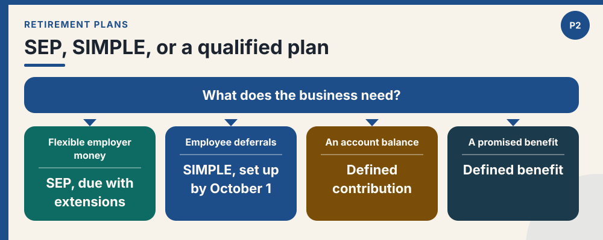

Publication 560 (2025) is the source for the dollar limits below. They are limits for **2025**. The 2026 amounts in the same publication are not the amounts for this exam.

**SEP.** Employer contributions to traditional IRAs. The plan can be set up as late as the due date of the employer’s return, including extensions. The maximum contribution for 2025 is the smaller of **$70,000** or **25%** of the participant’s compensation. Compensation taken into account is limited to **$350,000**. The deduction is 25% of compensation of participants, using that compensation cap. A self-employed owner’s percentage is computed on earned income after the deduction for one-half of self-employment tax and after the contribution itself. Use the rate worksheet in Publication 560 (2025). Do not apply 25% to the owner’s raw net profit.

**SIMPLE IRA.** Publication 560 (2025), Table 1: salary-reduction contributions up to **$16,500** for 2025. The table’s age-50 catch-up produces a **$20,000** total for a participant who is age 50 or over and who is not turning 60, 61, 62, or 63. A higher salary-reduction limit applies to certain SIMPLE plans, and a higher catch-up applies to participants who turn 60 through 63. Those higher figures are in Publication 560 (2025); use the table that matches the employer’s election rather than the general line. The employer either matches employee deferrals dollar for dollar up to 3% of compensation, or makes a 2% nonelective contribution. Additional nonelective contributions are allowed within the limits in that table (a uniform percentage up to 10%, not exceeding **$5,100** for 2025). Salary-reduction deposits are due 30 days after the end of the month to which they relate. The employer contribution is due with the return, including extensions. Set the plan up between January 1 and October 1 of the calendar year (a new employer that starts after October 1 sets it up as soon as administratively feasible). A SIMPLE is for employers that fit the employee-count test in Publication 560. Confirm that test in the 2025 publication before you quote a headcount.

**Qualified plans.** A defined contribution plan (profit-sharing, money-purchase, 401(k)) allocates contributions to accounts. For 2025, elective deferrals other than catch-up are limited to **$23,500**. The annual-addition limit is **$70,000**, not counting catch-up. The catch-up limit for defined contribution plans other than SIMPLE plans is **$7,500** for 2025. A defined benefit plan promises a benefit. The limit on annual benefits for 2025 is **$280,000**. Employer profit-sharing contributions are due by the return due date, including extensions. Money-purchase contributions are due 8½ months after the plan year ends. The plan must be in writing, maintained for the exclusive benefit of employees and their beneficiaries, and operated so that coverage and contributions do not discriminate in favor of highly compensated employees. 401(k) plans also apply the actual deferral percentage and actual contribution percentage tests unless a safe harbor applies.

**Nonqualified plans.** Deferred compensation that is not a qualified plan. There is no trust that locks the assets away from the employer’s creditors in the way a qualified trust does, unless the plan is funded in a way that triggers current taxation. The employer deducts the amount when the employee includes it, generally when it is paid or when it is no longer subject to a substantial risk of forfeiture. Section 409A governs the timing of elections and distributions. A violation of section 409A accelerates income and adds a penalty tax. Confirm the penalty rate in the 2025 guidance you are using before the exam; do not guess it from an older outline.

**Prohibited transactions.** Section 4975 taxes a sale, loan, or use of plan assets between the plan and a disqualified person. Disqualified persons include fiduciaries, the employer, owners above the statutory percentage, and certain family members. A participant loan is permitted only inside the statutory exceptions (repayment term, level payments, and a dollar limit). Confirm the 2025 loan ceiling in Publication 560. An IRA owner who engages in a prohibited transaction with the IRA is treated as receiving a distribution of the entire IRA at the start of the year. Confirm that timing sentence in the 2025 Publication 590-A.

**Reporting.** Form 5500, 5500-SF, or 5500-EZ, depending on plan size and whether the plan is a one-participant plan. Many SEP and SIMPLE IRA arrangements that use the model documents do not file Form 5500. Confirm the exception in the 2025 Form 5500 instructions. Distributions are reported on Form 1099-R. Elective deferrals appear on Form W-2.

**Decision point.** A SEP can be opened after year end. A SIMPLE generally cannot be opened after October 1 for a business that existed on January 1. That single date is a frequent exam fact, and it is in Publication 560 (2025), Table 1.

**Traps.**

- Using the common-law 25% rate on a sole proprietor’s Schedule C profit without the Publication 560 rate worksheet.
- Treating a shareholder’s personal guarantee, or a prohibited loan from the plan, as a harmless cash shortage.
- Applying 2026 cost-of-living limits to a 2025 question.

### Farmers

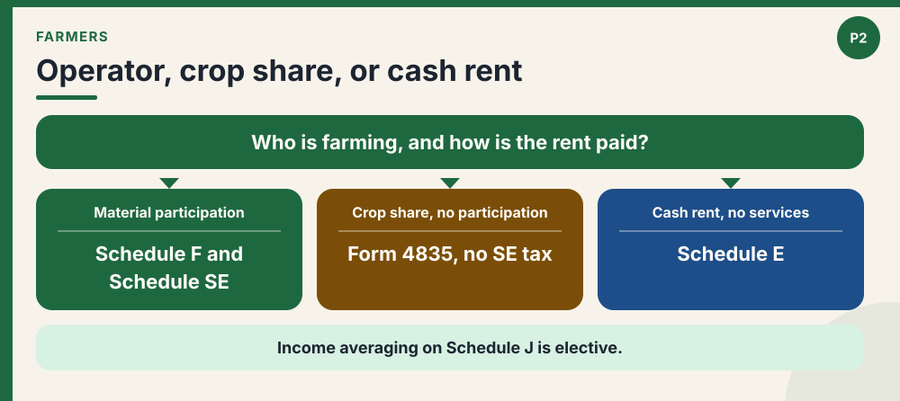

**Farm income, Publication 225 and the 2025 Instructions for Schedule F.** Report sales of livestock, produce, grains, and other products raised or bought for resale on Schedule F. Also include cooperative distributions (patronage dividends on Form 1099-PATR; a stated nontaxable portion is a return of capital), agricultural program payments, commodity credit loans if the farmer elects to treat them as income, crop insurance proceeds, and custom-hire income.

Crop insurance and certain disaster payments may be elected into the following year when the farmer can show that the damaged crop would have been sold in the following year under the normal business practice. The election is attached to the return for the year of receipt. Livestock sold because of drought, flood, or other weather-related conditions can qualify for postponement of gain or for involuntary-conversion treatment. Confirm the election deadlines and the replacement period in the 2025 Publication 225. Conservation cost-sharing payments can be excluded under section 126 when the program qualifies and the farmer does not deduct the related expenses.

**Depreciation.** Purchased breeding, dairy, and draft livestock are depreciable. Raised livestock that was expensed as the costs of raising it were incurred has a zero basis. Farm machinery uses the MACRS lives in Publication 946. Single-purpose agricultural and horticultural structures have a specific recovery period in the Publication 946 table; confirm the 2025 row before you memorize the years. The section 179 and bonus rules in Domain 2 apply, including the 2025 acquisition-date split for bonus and the higher section 179 limits.

**Prepaid farm supplies.** Publication 225 limits the current deduction for prepaid feed and other supplies. Confirm the percentage and the exceptions (farm-related taxpayer, and the exception when the prepaid amount does not exceed 50% of other deductible farm expenses, if the 2025 publication still states that test) in the 2025 edition before you apply a percentage.

**Form 4835 and Schedule E.** A farm landlord who does not materially participate in the operation or management, and who receives a crop share or livestock share, reports on Form 4835. That income is not self-employment income. It can be passive. A landlord who materially participates reports on Schedule F and computes self-employment tax. Cash rent of farmland, with no substantial services, is rental income on Schedule E, is not self-employment income, and is generally passive. Substantial services can turn the arrangement into a trade or business.

**Tax computation.** Schedule J lets a farmer or a fisherman elect to average elected farm income over the three prior base years. Income averaging is elective and is recomputed if the base years change on audit. Estimated tax: a taxpayer whose gross income is at least two-thirds from farming or fishing can avoid the underpayment penalty by paying the required installment by the 15th day of the first month after the tax year, or by filing the return and paying in full by the first day of the third month. For a calendar year those dates are January 15 and March 1. Confirm the two-thirds test and the dates in the 2025 Publication 225. January 15, 2026 is a Thursday. March 1, 2026 is a Sunday, so confirm in Publication 225 whether the filing date moves to the next business day.

**Disaster areas.** Drought, flood, and other federally declared disasters can extend replacement periods under section 1033, postpone gain on weather-related livestock sales, and extend filing dates. Use the IRS disaster page for the specific declaration rather than a general “all disaster payments are excluded” rule. Many payments are included, with an election to defer.

**Traps.**

- Reporting a non-material crop-share landlord on Schedule F and charging self-employment tax.
- Depreciating raised breeding cattle that have a zero basis.
- Including crop insurance in 2025 after a valid election to include it in 2026, or the reverse.

### Rental property

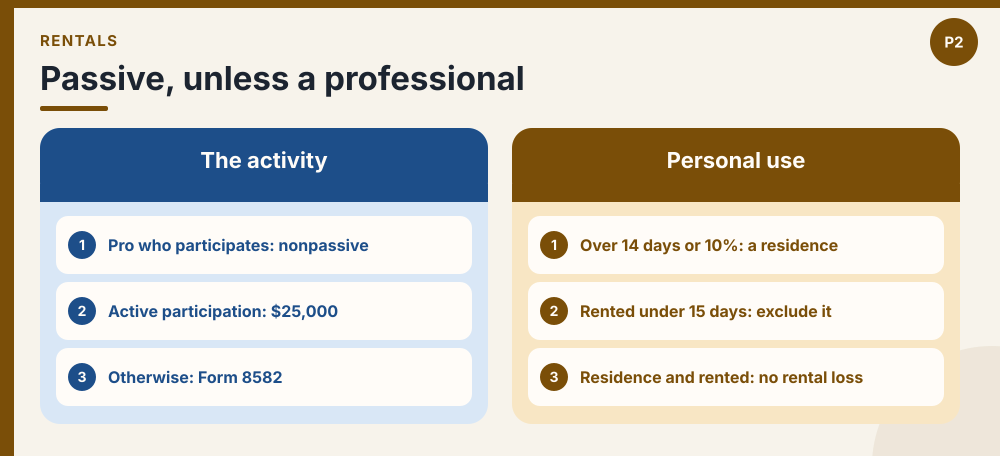

**Income.** Schedule E for a rental that is not a farm and not a business in which the taxpayer provides substantial services. A refundable security deposit is not income when received. It is income when the landlord applies it to unpaid rent or keeps it as damages. Advance rent is income when received by a cash-method landlord, even if it covers a later year. Amounts a tenant pays to cancel a lease are rent. Expenses the tenant pays and that are the landlord’s obligation are rental income, and they may also be deductible expenses.

If the property is not rented for profit, deductions are limited under section 183. Report using the not-for-profit rules in the Instructions for Schedule E.

**Vacation home and mixed use, section 280A.** If the taxpayer uses a dwelling unit as a residence and rents it fewer than 15 days during the year, the rental income is not included and the rental expenses (other than expenses that are deductible without regard to rental, such as qualified home mortgage interest and real estate taxes) are not deducted. The taxpayer uses a unit as a residence when personal use exceeds the greater of 14 days or 10% of the days the unit is rented at fair rental value. When that residence test is met and the unit is rented 15 days or more, expenses must be allocated between rental and personal use, and the rental deduction cannot create a loss. The allocation and the order (interest and taxes, then operating costs, then depreciation) are in Publication 527. Confirm the 2025 worksheet there.

**Repairs.** The same capitalization rules as Domain 2. A repair that keeps the property in ordinary efficient operating condition is deductible. A betterment, restoration, or adaptation is capitalized and depreciated.

**Residential versus commercial.** Publication 946: residential rental property is depreciated over **27.5 years**, straight line, mid-month convention. Nonresidential real property is depreciated over **39 years**, straight line, mid-month convention. Land is not depreciated. Qualified improvement property to the interior of nonresidential real property has its own recovery period and can be eligible for the special depreciation allowance. Confirm the 2025 recovery period and bonus eligibility for qualified improvement property in Publication 946. Section 179 is generally unavailable for buildings held for rental. Confirm any qualified-real-property exception in the 2025 Instructions for Form 4562.

**Passive loss and the $25,000 allowance, Publication 925 (2025).** Rental activities are passive even if the taxpayer materially participates, unless the real-estate-professional exception applies. A taxpayer who actively participates in a rental real estate activity may deduct up to **$25,000** of loss against nonpassive income. Active participation is a lower standard than material participation: the taxpayer participates in a significant and bona fide way, for example by making management decisions or arranging for others to do so, and owns at least 10% of the activity.

The maximum allowance is reduced by 50% of modified adjusted gross income over **$100,000**. It is fully phased out when modified adjusted gross income is **$150,000** or more. Married filing separately and living apart all year: the allowance is **$12,500**, the phaseout starts at **$50,000**, and it is gone at **$75,000**. Married filing separately and living together at any time during the year: no special allowance. Publication 925 defines modified adjusted gross income for this purpose by adding back specified items, including passive income or loss on Form 8582 and the deductible half of self-employment tax. Use that definition.

Publication 925’s 2025 illustration: MAGI of $120,000 and a $31,000 loss produce a $10,000 reduction (50% of the $20,000 over $100,000), an allowance of $15,000, and a $16,000 carryover. Work a new set of facts the same way. Carryovers stay passive.

**Real estate professional, Publication 925 (2025).** Both tests are required. More than half of the personal services the taxpayer performed in trades or businesses during the year are performed in real property trades or businesses in which the taxpayer materially participates. And the taxpayer performs more than **750 hours** of services during the year in those real property trades or businesses. On a joint return each spouse is tested separately. One spouse’s hours do not fill the other spouse’s 750-hour test. Services as an employee count only if the taxpayer owns more than 5% of the employer. Each rental is a separate activity for material participation unless the taxpayer elects to group all rental real estate as one activity. A closely held corporation qualifies under a gross-receipts test in Publication 925 (more than 50% of gross receipts from real property trades or businesses in which it materially participates).

**Short rentals.** An activity is not a rental activity under the passive-activity regulations when the average period of customer use is 7 days or less, or 30 days or less and significant personal services are provided. It can then be a trade or business in which material participation makes the income and loss nonpassive. Confirm the tests in Publication 925 (2025).

**Decision point.** Active participation unlocks the $25,000 allowance and nothing more. Real estate professional status, plus material participation, takes the activity out of the passive bucket entirely. They are different tests.

**Traps.**

- Adding spouses’ hours together to reach 750.
- Claiming the $25,000 allowance on a married-filing-separately return when the spouses lived together.
- Excluding a security deposit and also excluding nonrefundable advance rent. Only the refundable deposit is deferred.
- Depreciating a residential building over 39 years, or a commercial building over 27.5.

### Domain 3 sample questions

**1.** A trust instrument requires the trustee to distribute all fiduciary accounting income currently. In 2025 the trustee distributes that income and also distributes principal to a beneficiary. The trust makes no charitable payments. For 2025 the trust is:

A. A simple trust, because the instrument requires current distribution of income

B. A complex trust, because it distributed corpus

C. A grantor trust, because principal was paid

D. An estate, because principal was paid

**Answer: B.** A simple trust does not distribute corpus. A distribution of principal makes the trust a complex trust for the year. A distribution of principal does not, by itself, make the trust a grantor trust. **IRS basis:** 2025 Instructions for Form 1041, simple trust and complex trust definitions.

**2.** For 2025, the Form 1041 exemption of a decedent’s estate, and the exemption of a trust that is not required to distribute all income currently and is not a qualified disability trust, are:

A. $600 for the estate and $100 for that trust

B. $300 for the estate and $300 for that trust

C. $100 for the estate and $600 for that trust

D. $5,100 for each

**Answer: A.** The 2025 Form 1041 instructions allow a decedent’s estate a $600 exemption. A trust required to distribute all income currently gets $300 even if it also distributed corpus. A qualified disability trust gets $5,100. A trust that fits none of those descriptions gets $100. **IRS basis:** 2025 Instructions for Form 1041, line 21.

**3.** For 2025, an estate’s distributable net income is $12,000. The executor properly pays $20,000 to the sole beneficiary. The income distribution deduction and the amount of that distribution included in the beneficiary’s gross income are limited to:

A. $20,000

B. $12,000

C. $600

D. $0, because distributions of money are always tax-free

**Answer: B.** Distributable net income caps the income distribution deduction and caps the amount included by the beneficiary. The $600 figure is the estate’s exemption, not the distribution cap. **IRS basis:** 2025 Instructions for Form 1041, definition of distributable net income and Schedule B.

**4.** A trust is a wholly grantor trust for 2025. The trustee files Form 1041. How is the income reported?

A. On Schedule K-1 (Form 1041), and the grantor reports nothing

B. Dollar amounts are shown only on an attachment to Form 1041, and the grantor reports the income

C. The trust pays the tax and the grantor excludes the income

D. On Form 990

**Answer: B.** The 2025 instructions tell the fiduciary of a wholly grantor trust to complete the entity portion of Form 1041, to put dollar amounts on an attachment, and not to use Schedule K-1 as that attachment. The grantor is taxed as the owner. **IRS basis:** 2025 Instructions for Form 1041, grantor type trusts.

**5.** A section 501(c)(3) organization applies for recognition of exemption. The form used for that recognition is:

A. Form 1023, or Form 1023-EZ if the organization meets the eligibility requirements

B. Form 1024 only

C. Form 990-T only

D. Form 1120

**Answer: A.** Form 1023 is the application for recognition under section 501(c)(3). Form 1023-EZ is available when the eligibility worksheet is met. Form 1024 is used for other section 501(c) categories. Form 990-T reports unrelated business taxable income after the organization is operating. **IRS basis:** Instructions for Form 1023; Instructions for Form 1024.

**6.** Which item is excluded from unrelated business taxable income under the usual section 512(b) exclusions, assuming the property is not debt-financed?

A. Profit from a store the organization runs regularly, selling goods unrelated to its exempt purpose

B. Dividends from a stock portfolio

C. Income from a parking lot operated as a business for the general public, unrelated to the exempt purpose

D. Fees from a regularly carried on consulting practice that is not substantially related to the exempt purpose

**Answer: B.** Dividends are excluded by section 512(b) when they are not debt-financed income. A regularly carried on unrelated trade or business is unrelated business taxable income. **IRS basis:** IRC section 512(b); Publication 598; Instructions for Form 990-T.

**7.** For 2025, a SEP contribution for a common-law employee whose compensation is $400,000 cannot exceed:

A. $70,000

B. $100,000, which is 25% of $400,000

C. $350,000

D. $23,500

**Answer: A.** Publication 560 (2025) limits a SEP contribution to the smaller of $70,000 or 25% of compensation, and it caps the compensation taken into account at $350,000. Twenty-five percent of $350,000 is more than $70,000, so the dollar cap controls. The $23,500 figure is the 2025 elective-deferral limit for a 401(k)-type plan, not the SEP cap. **IRS basis:** Publication 560 (2025), compensation limits and Table 1.

**8.** A farmer in 2025 receives a share of the crop from farmland the farmer owns. The farmer does not materially participate in operating or managing the farm. The share rent is reported on:

A. Schedule F, and it is subject to self-employment tax

B. Form 4835, and it is not self-employment income

C. Form 1041

D. Schedule J only, with no income schedule

**Answer: B.** Crop-share rent without material participation is reported on Form 4835 and is not subject to self-employment tax. Material participation would move the activity to Schedule F and Schedule SE. Schedule J is the income-averaging schedule, used after farm income is computed. **IRS basis:** 2025 Instructions for Schedule F (Form 1040); Form 4835 instructions; Publication 225.

**9.** For 2025, an unmarried taxpayer who is not a real estate professional actively participates in a rental real estate activity and owns 100% of it. Modified adjusted gross income, as Publication 925 defines it for this allowance, is $130,000. The rental loss is $40,000. The deductible loss under the special allowance is:

A. $0

B. $10,000

C. $25,000

D. $40,000

**Answer: B.** The allowance starts at $25,000 and is reduced by 50% of MAGI over $100,000. The excess is $30,000. Half of that is $15,000. The remaining allowance is $10,000. The other $30,000 of the loss carries forward. These amounts are the question’s facts plus the Publication 925 phaseout. **IRS basis:** Publication 925 (2025), special $25,000 allowance and phaseout rule.

**10.** A married couple files jointly for 2025. One spouse performs 800 hours in a real property trade or business in which that spouse materially participates, and those hours are more than half of that spouse’s personal services in trades or businesses. The other spouse performs 100 hours in a different rental and has a full-time job elsewhere that is more than half of that spouse’s services. For the spouse with 100 hours, the real-estate-professional test is:

A. Met, because the couple together has 900 hours

B. Met, because either spouse’s 750 hours covers both spouses

C. Not met, because each spouse must separately meet both the half-of-services test and the more-than-750-hours test

D. Met, because active participation is enough

**Answer: C.** Publication 925 (2025) requires each spouse to meet both tests separately on a joint return. Hours are not combined. Active participation is the standard for the $25,000 allowance, not the standard for real estate professional status. **IRS basis:** Publication 925 (2025), real estate professional.

## One-page quick review

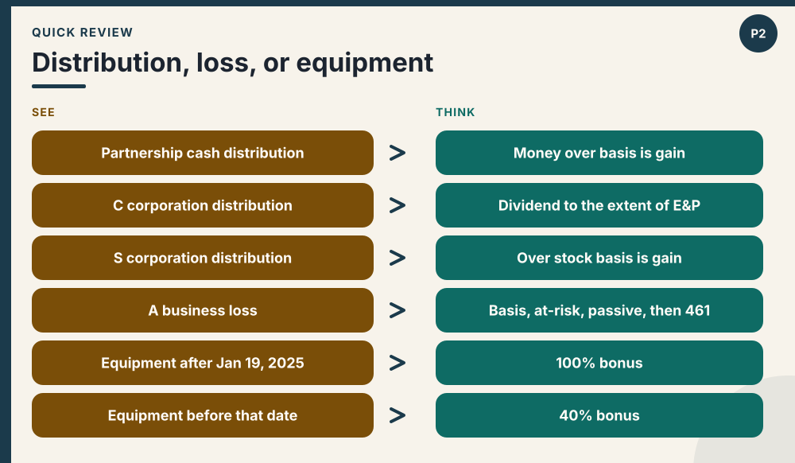

**Forms.**

| If you are filing | The return |
| --- | --- |
| Sole proprietor | Schedule C, Schedule SE, Form 4562 |
| Farm operator | Schedule F, Schedule SE, Schedule J if averaging |
| Farm landlord, no material participation, crop share | Form 4835 |
| Partnership | Form 1065, Schedule K-1, Form 8832 only if a corporate election was made |
| C corporation | Form 1120, Schedule M-1, Form 4562 |
| S corporation | Form 1120-S, Schedule K-1, Form 7203 on the shareholder return |
| Employment taxes | Forms 941, 940, W-2, W-3, W-4 |
| Information returns | 1099 series, Form 8300 for cash over $10,000 |
| Extension of a business return | Form 7004 |
| Accounting-method change | Form 3115 |
| Like-kind exchange of real property | Form 8824 |
| Sale of business property | Form 4797 |
| QBI | Form 8995 or Form 8995-A |
| Passive and at-risk | Forms 8582 and 6198 |
| Debt discharge exclusion | Form 982 |
| Estate or trust | Form 1041 and Schedule K-1 |
| Exempt organization | Form 1023 or 1024 to apply; Form 990 series to report; Form 990-T for UBTI |
| Retirement | Publication 560 limits; Form 5500 series when the instructions require it; Form 1099-R for distributions |

**Basis order, one screen.**

| Entity | Order that decides the deduction |
| --- | --- |
| Partnership outside basis | Income and contributions, then distributions (money over basis is gain), then nondeductible items, then losses. Worksheet in the Form 1065 K-1 instructions. |
| S corporation stock | Income including tax-exempt income, then distributions, then nondeductible expenses, then losses. Form 7203. Elective flip of the last two steps only. |
| S corporation loan | Losses and nondeductible items that stock basis cannot absorb. Distributions never reduce loan basis. A guarantee is not basis until paid. Restore loan basis before stock basis when income returns. |
| C corporation shareholder | Stock basis is what the shareholder paid or the section 358 basis after a section 351 exchange. A distribution does not use an “inside” corporate account on the shareholder’s return. It uses earnings and profits, then basis, then gain. |
| Asset basis | Cost, plus improvements, minus depreciation allowed or allowable. Gift, inheritance, and conversion each have their own starting rule in Publication 551. |

**If you see this, think this.**

| You see | Think |
| --- | --- |
| Multi-member LLC, no election | Partnership, Form 1065 |
| Single-member LLC, no election | Disregarded, Schedule C, E, or F |
| Form 2553 | S election, not the check-the-box form |
| 80% control and property for stock | Section 351 |
| Stock for services | Compensation income |
| Liabilities in excess of basis on a contribution | Gain |
| Guaranteed payment | Ordinary income to the partner, deduction to the partnership, not withholding |
| Sale of a partnership interest | Capital, except hot assets, which are ordinary |
| Money distributed by a partnership | Gain only when money exceeds outside basis |
| C corporation distribution | Dividend to the extent of earnings and profits, then basis, then gain |
| Current versus accumulated E&P | Current E&P is ratable; accumulated E&P is chronological |
| 50% and 65% | Dividends-received deduction percentages in Publication 542 |
| 21% | C corporation tax rate in Publication 542 |
| S corporation cash distribution | Stock basis, not loan basis |
| AAA and tax-exempt income | Tax-exempt income raises stock basis and the other adjustments account, not AAA |
| Old C-corporation E&P inside an S corporation | Dividend slice after AAA |
| Ineligible S shareholder | Termination |
| Loss on a K-1 | Basis, then at-risk, then passive, then excess business loss |
| Section 179 for a tax year beginning in 2025 | $2,500,000, phaseout after $4,000,000, SUV $31,300 |
| Equipment acquired before January 20, 2025 | 40% bonus (60% if long-production-period or certain aircraft) |
| Equipment acquired after January 19, 2025 | 100% bonus, unless the taxpayer elects the lower percentage |
| Business meal in 2025 | 50% |
| Business gift | $25 per person |
| 2025 mileage | 70 cents per business mile |
| Child under 18, parent’s sole proprietorship | No social security or Medicare; no FUTA if under 21 |
| Same child, parent’s corporation | All employment taxes |
| Social security wage base 2025 | $176,100; Medicare has no wage base |
| Additional Medicare withholding | 0.9% after $200,000 of wages from that employer |
| QBI thresholds 2025 | $197,300 and $394,600; tops of the phase-in $247,300 and $494,600 |
| Specified service business below the threshold | Still eligible for QBI |
| Like-kind exchange in 2025 | Real property only |
| Section 1245 | Ordinary income up to depreciation taken |
| Section 1231 lookback | Five preceding years |
| Schedule M-1 | Book income to taxable income |
| Form 1041 DNI | Cap on the distribution deduction and on the beneficiary’s inclusion |
| Estate exemption 2025 | $600; simple-trust rule $300; other trusts $100 |
| Form 1023 | 501(c)(3) recognition |
| Dividends received by a charity | Usually excluded from UBTI if not debt-financed |
| SEP for 2025 | Smaller of $70,000 or 25% of compensation; compensation cap $350,000 |
| SIMPLE setup | January 1 through October 1 for an existing employer |
| Form 4835 | Farm rental without material participation |
| $25,000 rental allowance | Active participation; phaseout from $100,000 to $150,000 of MAGI |
| 750 hours | One half of the real-estate-professional test; the spouse’s hours do not count |
| 27.5 years and 39 years | Residential rental and nonresidential real property |

**A last pass before you sit.** Domain 2 has 37 of the 85 scored questions. If time is short, drill cost recovery, loss limits, employment tax, QBI, and Schedule M-1, then partnership and S-corporation basis. Domain 3 is 18 questions: know the form, the classification test, and the 2025 dollar limit, and do not spend Domain 2 time rebuilding Form 1041 from scratch.

Confirm any penalty dollar amount, gross-receipts threshold, information-return threshold, or simplified home-office rate in the 2025 IRS publication named in that topic. Those amounts move, and this guide omits them on purpose when the 2025 instruction did not state a single figure in the sources used here.
