# SEE Part 3: Representation, Practices, and Procedures

Study guide for Nepal Singh.

This guide follows the **PSI Candidate Information Bulletin, Internal Revenue Service Enrolled Agent Special Enrollment Examination, revised October 9, 2026**. PSI administers the exam. The IRS enrolled-agent FAQ (scheduling answer updated August 26, 2026) points to that bulletin. A May 1, 2026 start is the old general pattern. For this cycle the bulletin sets a different window: **July 1, 2026, through February 28, 2027**, for domestic candidates. International testing was delayed when the bulletin was revised. Older Prometric outline PDFs are not the bulletin for this window.

Law on the exam is the Internal Revenue Code, the Code of Federal Regulations, and IRS forms, instructions, and publications **as amended through December 31, 2025**. Unless a question says otherwise, it is about **calendar year 2025**. “Current tax year” means 2025. Do not use legislation, court decisions, or penalty amounts that took effect after December 31, 2025.

A percent or dollar amount written into the statute is marked **statutory**. A figure the IRS adjusts is marked with the **filing year** or **calendar year**. If a dollar amount is missing here, the section tells you which official source to read. Do not fill the gap from memory.

## Exam facts for this window


| Item | What the bulletin states |
| --- | --- |
| Part | Part 3, Representation, Practices and Procedures |
| Length | 3.5 hours of exam time. The appointment is longer because of the tutorial and the survey. |
| Questions | 100 multiple choice. **85 are scored. 15 are experimental and are not scored.** |
| Experimental items | Mixed through the exam and not marked. They do not help or hurt the score. |
| Passing standard | Scaled score from 200 to 800. The IRS set the scaled passing score at **500**. |
| Pass report | Shows a pass. It does not show a number above 500. |
| Fail report | Shows a scaled score from 200 to 499, plus diagnostic information. |
| Materials | Closed book. An on-screen calculator is provided. |
| Attempts | Up to four attempts for each part in the window. After a fail, wait 24 hours before scheduling that same part again. |
| Carryover | A passed part carries for three years from the date you passed it. |
| Enrollment application | After all three parts, file Form 23 within one year of the date you passed the third part. |

The bulletin gives **scored-question counts**, not official percentages. The shares below are 26/85, 25/85, 20/85, and 14/85, rounded to the nearest percent. They match the public Fast Forward Academy domain chart. The counts are the specification.

| Domain in the bulletin | Scored questions | Share of the 85 |
| --- | --- | --- |
| 1. Practices and Procedures | 26 | about 31% |
| 2. Representation before the IRS | 25 | about 29% |
| 3. Specific Areas of Representation | 20 | about 24% |
| 4. Filing Process | 14 | about 16% |

Fast Forward Academy’s public chart titles domain 2 “Representations before the IRS.” It is the same domain as the bulletin’s “Representation before the IRS.”

## How to use this with Fast Forward Academy

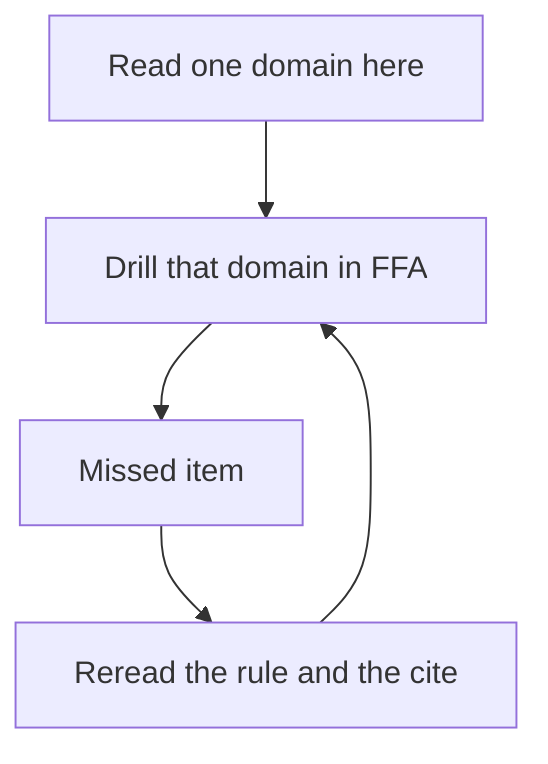

Read one domain in this guide, including the diagram under each heading. Then drill that same domain in Fast Forward Academy. The public FFA domain list lines up with the four rows in the table above.

This guide does not give login steps. The questions at the end of each domain are original. They are not FFA items, and they are not IRS sample items. When a drill question turns on a dollar penalty, match the **filing year** in the question to the yearly table in Domain 1 before you pick a number.

Primary sources for the rules below are Circular 230 (31 CFR Part 10), issued under 31 USC 330; the Code sections named in the outline; and the IRS forms and publications the outline names.

# 1. Practices and procedures

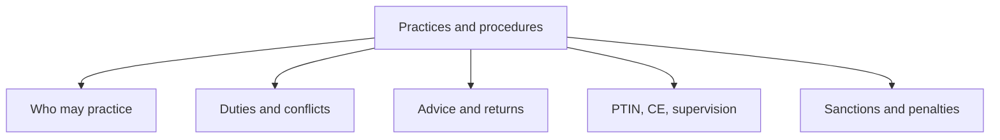

This is the largest domain: 26 of the 85 scored questions. It tests Circular 230 duties, who may practice and how far, PTIN and enrollment, OPR sanctions, and the preparer and accuracy penalties the outline names.

## Who may practice

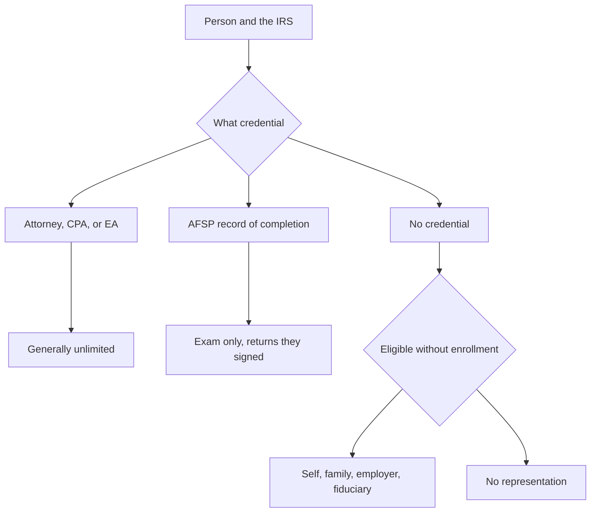

**What is tested.** What “practice before the IRS” means, who may do it, and where each category stops.

**Rules.** Practice before the IRS, in Circular 230 §10.2, covers matters connected with a presentation to the IRS about a taxpayer’s rights, privileges, or liabilities under laws the IRS administers. That includes preparing and filing documents in that representation, corresponding with the IRS, giving written advice on a plan or arrangement, and appearing at conferences and hearings.

*Loving v. IRS*, 742 F.3d 1013 (D.C. Cir. 2014), held that preparing and filing a tax return, by itself, is not practice before the IRS that Treasury can license under 31 USC 330. Preparer penalties in the Code, and the PTIN rules, still apply to paid preparers. Appearing or writing to the IRS for a client is practice.

Who may practice, Circular 230 §10.3 and §10.7:

- **Attorneys, certified public accountants, and enrolled agents** may practice generally. An enrolled agent’s authority is not limited to one tax, one year, or one IRS office.
- **Enrolled retirement plan agents** practice on employee-plan matters. **Enrolled actuaries** practice on the actuarial provisions assigned to them.
- **Annual Filing Season Program** participants have a narrow right. The IRS describes it this way: they may represent taxpayers whose returns they prepared and signed, and only before revenue agents, customer service representatives, and similar IRS employees, including the Taxpayer Advocate Service, during an examination of that return. They may not represent before appeals officers, revenue officers, Counsel, or similar officers. They need a valid PTIN and the Record of Completion for the year of that return.
- A person who only prepares returns, and who does not have attorney, CPA, EA, or AFSP authority, does not represent the taxpayer.
- Without enrollment, a person may still represent in the limited cases in §10.7: representing oneself; a member of one’s immediate family; a regular full-time employee representing the employer; a general partner or regular full-time employee representing the partnership; a bona fide officer or regular full-time employee representing a corporation, association, or organized group; a fiduciary or regular full-time employee representing a trust, estate, receivership, or guardianship; and an officer or regular employee of a governmental unit in the course of official duties. The IRS may also allow a special appearance for a particular matter.

**Decision point.** Ask two questions. Is this person communicating with the IRS about someone else’s liability? If yes, it is practice, and the person needs a category that covers that forum. Is the person only preparing a return and never contacting the IRS? Paid-preparer rules can still apply. Representation rules do not.

**Common traps.** An AFSP credential does not reach Appeals or collection. A CAF number, a PTIN, and an EFIN are three different identifiers. Family, employee, and fiduciary authority is real and limited to that relationship. “Certified” is not a lawful way for an enrolled agent to describe the credential (§10.30).

**Requirements for enrolled agents.** Pass all three SEE parts, or qualify for the former-IRS-employee exam exemption in Circular 230. File Form 23 within one year of passing the third part. Pass a suitability check: personal tax compliance and a background review. The IRS enrolled-agent FAQ reviewed April 21, 2026 points to Circular 230 §§10.5(d) and 10.51 for the suitability rules, including unfiled returns, unpaid tax without an acceptable arrangement, and certain criminal convictions. Read those sections for the full list.

## Duties, conflicts, and confidentiality

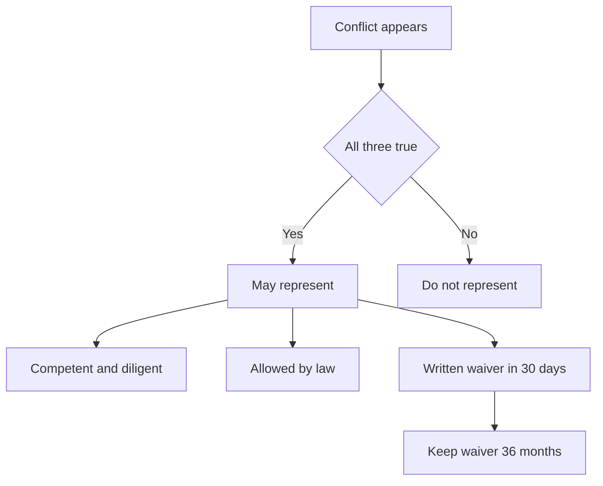

**What is tested.** The mandatory duties in Circular 230 Subpart B: furnish information, advise the client of an error, be diligent, move the case, refuse help from a disbarred person, handle former-employee conflicts, return records, and clear conflicts. Confidentiality shows up here and again under IRC 7216 and 6713 in Domain 2.

**Rules you must be able to apply.**

- **§10.20 Information to the IRS.** On a proper and lawful request, submit the requested records or information, unless you believe in good faith and on reasonable grounds that the material is privileged. If you do not have it, tell the IRS promptly and, after a reasonable inquiry of the client, identify any person you believe has possession or control. You do not have to ask other people or verify the client’s answer about who has the records.
- **§10.21 Omission or error.** If you know the client has not complied with the revenue laws, or has made an error or omission on a return or other paper, promptly advise the client of that fact and of the consequences. Section 10.21 requires advice to the client. It does not require you to call the IRS. You also may not disclose return information to the IRS without authority (IRC 7216 and 6103). Do not prepare or sign a later document you know is false (§10.34 and §10.51).
- **§10.22 Diligence.** Exercise due diligence in preparing, approving, and filing papers; in oral and written statements to Treasury; and in statements to the client about an IRS matter. You may rely on another person’s work if you used reasonable care in engaging, supervising, training, and evaluating that person.
- **§10.23 Prompt disposition.** Do not unreasonably delay any matter before the IRS.
- **§10.24 Disbarred or suspended persons.** Do not knowingly accept assistance from, or assist, a person who is disbarred or suspended from practice before the IRS, if the assistance relates to practice. Do not accept assistance from a former government employee where §10.25 or another federal law would be violated.
- **§10.25 Former government employees.**
  - No representation that would violate 18 USC 207 or another federal law.
  - **Personal and substantial participation** in a particular matter involving specific parties: after leaving, the former employee may not represent or knowingly assist any person who is or was a specific party in that same matter. This bar does not expire.
  - **Official responsibility** for that kind of matter during the one year before government employment ended: the former employee may not represent a specific party in that matter for **two years** after employment ends.
  - **Rules work:** for one year after leaving, the former employee may not, with intent to influence, communicate with a Treasury employee about a rule the employee worked on or had official responsibility for during the last year. The person may still represent a taxpayer on a specific case that applies the rule, if the other bans do not apply and confidential rule-development information is not used.
  - **The firm.** If the personal-and-substantial ban applies, other members of the firm may represent the party only if the firm isolates the former employee so that person cannot assist, and the firm keeps the sworn isolation statement §10.25(c) requires. Provide it to the IRS on request.
- **§10.26 Notary.** Do not take an acknowledgment, administer an oath, or otherwise act as a notary on an IRS matter in which you are the counsel, attorney, or agent, or in which you are interested.
- **§10.28 Client records.** On request, promptly return any records of the client that the client needs to comply with federal tax obligations. You may keep copies. A fee dispute does not, by itself, let you hold those records. If state law allows a retaining lien, you still must return records that must be attached to the return, and you must give reasonable access to review and copy the rest. “Records of the client” include documents the client or a third party provided, including documents that existed before the engagement, and prior work product the client needs for a current federal tax obligation. Your own work product on the unpaid current engagement may be withheld until the fee for that document is paid.
- **§10.29 Conflicts.** Do not represent a client if the representation involves a conflict. A conflict exists if one client’s representation is directly adverse to another client, or if there is a significant risk the representation will be materially limited by a duty to another client, a former client, a third person, or your own interest. You may continue only when all three of these are true: you reasonably believe you can give competent and diligent representation to each affected client; the law does not prohibit the representation; and each affected client gives informed consent, confirmed in writing. The writing may come within a reasonable time after the consent, and no later than **30 days** after you know the conflict exists. Keep the consents for at least **36 months** after the representation of the affected clients ends, and give them to the IRS on request.
- **§10.33 Best practices** (clear communication, establishing the facts, advising the client of the importance of the conclusions, and acting fairly) are the professional target. A sanction under §10.50 is for incompetence, disreputable conduct, a regulatory violation under the §10.52 standards, or willfully misleading or threatening a client. Read §10.33 as the standard to meet, and §§10.50 through 10.52 as the discipline rules.

**Decision point.** On a conflict, stop and test the three conditions. One missing condition means you do not represent. On an error in a prior return, tell the client promptly and describe the consequences. Then decide whether you can still sign the next paper.

**Common traps.** A verbal waiver is not the written confirmation §10.29 requires. The 36 months run from the end of the representation, not from the day the waiver was signed. The two-year former-employee ban is for official responsibility. Personal and substantial participation is a lasting ban on both representation and knowing assistance. Holding a W-2 hostage over an unpaid bill violates §10.28. Holding your own unpaid draft schedule is a different question under the same section.

**Confidentiality, in one line you will reuse in Domain 2.** A paid preparer who knowingly or recklessly discloses or uses tax return information, other than as the Code allows, commits a misdemeanor under IRC 7216. The statute sets a fine of not more than $1,000, or imprisonment of not more than one year, or both. IRC 6713 sets a civil penalty of $250 for each unauthorized disclosure or use, with a calendar-year cap of $10,000. Those dollar figures are the amounts written in the statutes. Consent to disclose must meet Treas. Reg. 301.7216-3. Do not bury it, and do not condition preparation of the return on a consent to use the information for a purpose other than preparing the return, except as that regulation allows.

## Fees, solicitation, and refund checks

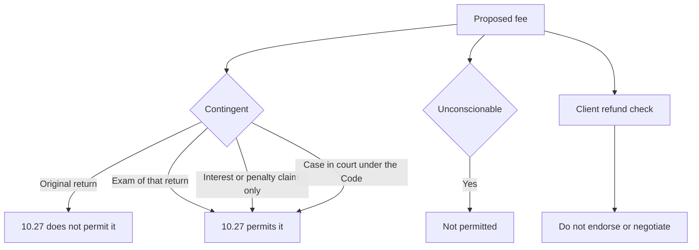

**Rules.**

- **§10.27(a).** Do not charge an unconscionable fee for any matter before the IRS.
- **§10.27(b) and (c).** A contingent fee depends on whether a position avoids challenge or is sustained, and it includes a percentage of the refund or of the taxes saved, and a promise to give the fee back if the IRS challenges the position. Section 10.27 bars a contingent fee except in these cases:
  - services in the IRS examination of, or challenge to, an original return;
  - services for an amended return or refund claim filed within **120 days** after the taxpayer receives a written notice of examination or a written challenge to the original return;
  - a claim for credit or refund filed solely about statutory interest or penalties the IRS assessed;
  - services in any judicial proceeding arising under the Code.
- *Ridgely v. Lew*, 55 F. Supp. 3d 89 (D.D.C. 2014), held that preparing and filing an ordinary refund claim is not practice before the IRS, so Treasury could not use 31 USC 330 to ban a contingent fee for that work. Know §10.27’s categories cold. Use the regulation when the question asks what Circular 230 says. Use *Ridgely* when the question asks about Treasury’s authority over an ordinary refund claim.
- **§10.30 Solicitation.** No false, fraudulent, coercive, misleading, or deceptive public communication or private solicitation about an IRS matter. An enrolled agent, enrolled retirement plan agent, or registered tax return preparer may not use “certified,” and may not imply an employer-employee relationship with the IRS. Acceptable descriptions in the regulation include “enrolled to represent taxpayers before the Internal Revenue Service,” “enrolled to practice before the Internal Revenue Service,” and “admitted to practice before the Internal Revenue Service.”
- **Published fees.** You may publish fixed fees for specific routine services, hourly rates, ranges, and the fee for an initial consultation. If costs may be incurred, say whether the client is responsible for them. You may charge no more than the published rates for at least **30 calendar days** after the last date the schedule was published.
- **§10.31 Refund checks.** A practitioner may not endorse or otherwise negotiate any check issued to a client by the government in respect of a federal tax liability. IRC 6695(f) is the preparer penalty for the same conduct. The yearly amount is in the table below.

**Decision point.** If the fee is a percentage of the refund on an original return you are preparing, §10.27 does not permit it. If the fee is for defending that return in an examination, §10.27 permits a contingent fee. If the paper in your hand is the client’s refund check, do not endorse it and do not deposit it.

## Return positions, written advice, and competence

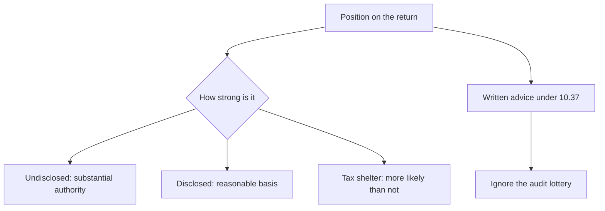

**The outline still says “covered opinions.”** Treasury removed the old covered-opinion rules in 2014. Section 10.35 is now **competence**. Written advice is **§10.37**. Do not study a repealed checklist. If a question uses the old phrase, answer with §§10.34, 10.35, and 10.37.

**§10.34 Tax returns.** You may not willfully, recklessly, or through gross incompetence sign a return or claim, or advise a position, that lacks a reasonable basis, that is an unreasonable position under IRC 6694(a)(2), or that is willful or reckless understatement conduct under IRC 6694(b)(2). A pattern of conduct matters.

On a document, affidavit, or other paper submitted to the IRS, do not advise a position that is frivolous, and do not advise a submission whose purpose is to delay or impede administration. A challenge to a regulation must be paired with advice to submit a document that shows a good-faith challenge.

Tell the client about penalties that are reasonably likely to apply to a position you advised or to a return you prepared or signed, and about the chance to avoid a penalty by disclosure, including what adequate disclosure requires. This advice duty applies even when you yourself are not the person who would owe the penalty.

You may generally rely in good faith on information the client furnishes, without verification. You may not ignore the implications of information you have, and you must make reasonable inquiries if the information appears incorrect, inconsistent, or incomplete.

**The strength ladder, from the Code and regulations, without invented percentages.**

| Standard | Where it sits | Where the exam uses it |
| --- | --- | --- |
| Not frivolous | Lowest reporting standard in §10.34 for a document other than a return position | Papers submitted to the IRS |
| Reasonable basis | Higher than not frivolous. A merely arguable claim is not enough. Treas. Reg. 1.6662-3 | Disclosed return positions; the disregard penalty |
| Substantial authority | Weight of authorities is substantial relative to contrary authorities. An objective standard, less strict than more likely than not. Treas. Reg. 1.6662-4 | Undisclosed return positions for IRC 6662(d) and 6694(a) |
| More likely than not | A greater-than-50-percent likelihood of being sustained on the merits | Tax shelters under 6662(d)(2)(C); tax shelters and reportable transactions under 6694(a)(2) |

**IRC 6694(a)(2), the preparer’s unreasonable-position test.** A position is unreasonable unless: there is substantial authority; or the position is disclosed and has a reasonable basis; or, for a tax shelter or a reportable transaction to which 6662A applies, it is reasonable to believe the position would more likely than not be sustained. There is a reasonable-cause and good-faith exception in 6694(a)(3).

**§10.35 Competence.** You must have the knowledge, skill, thoroughness, and preparation the matter requires. You may become competent by study or by consulting an expert.

**§10.37 Written advice.** Base it on reasonable factual and legal assumptions. Consider the facts you know or reasonably should know. Make reasonable efforts to identify the facts. Do not rely on a representation if reliance would be unreasonable. Relate the law to the facts. In evaluating the tax matter, do not take into account the possibility that a return will not be audited or that an issue will not be raised. You may rely on another person’s advice only if the advice was reasonable and the reliance is in good faith. Reliance is not reasonable if you know the person is not competent or has a conflict. Government submissions on general policy, and continuing-education teaching that is not promoting a transaction, are not “written advice” under this section. Advice that will be used to promote a tax-avoidance arrangement is judged with extra weight on the risk that you do not know the taxpayer’s circumstances.

**Disclosure forms.** Form 8275 discloses a position that is contrary to a revenue ruling or other guidance. Form 8275-R discloses a position contrary to a regulation. Disclosure does not cure a position that lacks a reasonable basis, and it does not cure a tax shelter.

**Decision point.** Before you sign: reasonable basis at a minimum; substantial authority if the position will not be disclosed; more likely than not if it is a tax shelter or a 6662A reportable transaction. Then tell the client about reasonably likely penalties. In any written opinion, delete any sentence that says “this will not be caught on audit.”

## PTIN, enrollment, and supervision

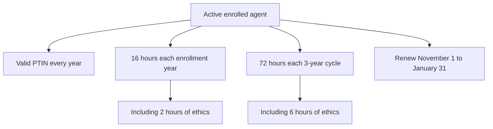

**PTIN.** Under IRC 6109(a)(4) and Treas. Reg. 1.6109-2, anyone who for compensation prepares, or assists in preparing, all or substantially all of a federal tax return or claim for refund must have a preparer tax identification number. Renew it by **December 31** for the following year (the bulletin states this renewal date). The paper application is Form W-12. A PTIN is not a CAF number and not an EFIN. Willfully preparing returns without a valid PTIN is disreputable conduct under §10.51. Failing to put the required identifying number on a return is the IRC 6695(c) penalty.

**Enrollment cycle, Circular 230 §10.6.** The cycle is three years. The renewal group depends on the last digit of the Social Security number or tax identification number: 0, 1, 2, or 3; then 4, 5, or 6; then 7, 8, or 9. Each group renews every third year. The application window is **November 1 through January 31**. The effective date of renewal is **April 1**, the first day of the fourth month after the window closes. A person who receives initial enrollment after November 1 and before April 2 of the applicable renewal period does not renew before the first full cycle that follows. Confirm your own year on the IRS renewal page.

**Continuing education, §10.6(e).** These hours are in the regulation, not an inflation table:

- **72 hours** of qualifying credit in each enrollment cycle, including **6 hours** of ethics or professional conduct.
- **16 hours** in each enrollment year (January 1 through December 31), including **2 hours** of ethics or professional conduct.
- A new enrollee during a cycle: **2 hours for each month** enrolled in the cycle. Any part of a month counts as the whole month. Also **2 hours of ethics for each enrollment year** in which the person is enrolled. Any part of an enrollment year counts as the whole year.
- Providers must be IRS-approved. Credit for teaching the same material more than once in a cycle is limited. The regulation also caps instructor credit at **6 hours** a year for an enrolled agent.
- The regulation allows renewal by a prescribed examination plus 16 hours in the last year of the cycle. Confirm whether the IRS is currently offering that examination before you rely on it. The hour rules are what the exam expects you to know.
- A waiver of hours is available for health, extended active military duty, extended absence from the United States during which the person does not practice, or another compelling reason. File the request, with documentation, no later than the last day of the renewal window. If the waiver is denied, the person is placed in inactive status and may protest under the IRS instructions. Inactive status is not a license to practice. Inactive retirement status is available to someone who has stopped practicing and is not in a pending disciplinary matter (§10.6(k)).

**Supervision, §10.36.** The person with principal authority for the firm’s practice must take reasonable steps so the firm has adequate procedures for members, associates, and employees to comply with Circular 230. That person can be sanctioned for a willful, reckless, or grossly incompetent failure when there is a pattern of noncompliance, or when the person knows or should know of a pattern and fails to take prompt action to correct it. If the firm names no one, the IRS may identify the responsible person.

**IRC 6060.** A person who employs other preparers must make an information return naming them. IRC 6695(e) penalizes a failure, unless the failure is due to reasonable cause and not willful neglect. Confirm the current submission method in IRS instructions. Do not memorize a form number for this return unless the current instructions still use one.

**Preparer copy and signature duties, IRC 6107 and 6695.** Give the taxpayer a copy of the return or claim (6695(a)). Sign the return when the preparer’s signature is required (6695(b)). Furnish your identifying number (6695(c)). Keep a completed copy, or a list of names and taxpayer identification numbers, and make it available (6107(b) and 6695(d)). The retention period is **3 years after the close of the return period**. The return period is the 12-month period beginning **July 1** of each year.

## Sanctions and disreputable conduct

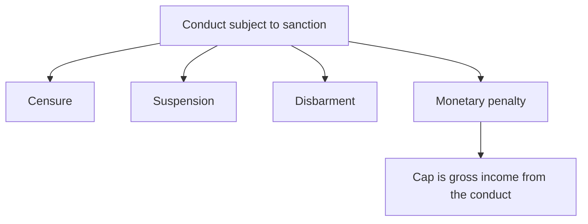

**§10.50.** After notice and an opportunity for a proceeding, the Secretary may censure, suspend, or disbar a practitioner who is incompetent or disreputable (§10.51), who violates a Circular 230 regulation under the standards in §10.52, or who with intent to defraud willfully and knowingly misleads or threatens a client or prospective client. Censure is a public reprimand.

A monetary penalty may be imposed on the practitioner, and on the employer, firm, or other entity if the entity knew or reasonably should have known of the conduct. The penalty may not exceed the **gross income derived, or to be derived, from the conduct**. It may be in addition to, or instead of, censure, suspension, or disbarment. The IRS may accept a consent to sanction.

**§10.51, the list the exam draws from.** Incompetence and disreputable conduct includes: conviction of a criminal offense under the revenue laws, or of any offense involving dishonesty or breach of trust; giving false or misleading information to the Treasury or to a tribunal that hears federal tax matters; willful failure to file a federal return, or willful evasion; misappropriation of, or failure to remit, client funds received for payment of taxes; trying to influence an IRS employee by threats, false accusations, duress, gifts, or promises; loss of a professional license by disbarment or suspension; knowingly helping a suspended or disbarred person practice; contemptuous conduct, including abusive language and knowing false accusations; knowingly, recklessly, or through gross incompetence giving a false opinion, or a pattern of incompetent opinions; willfully failing to sign a return when the signature is required; willful unauthorized disclosure or use of return information; willfully failing to file electronically when required; willfully preparing a return or claim without a valid PTIN; and willfully representing a taxpayer before the IRS without authority to do so.

**Frivolous submissions.** IRC 6702 imposes a penalty for filing a frivolous return and a penalty for a specified frivolous submission. The statute states **$5,000** for each. Rev. Proc. 2024-40’s inflation list does not restate a different 6702 amount. Confirm section 6702 before you use any larger figure. A frivolous position is also a Circular 230 problem under §§10.34 and 10.51. The IRS publishes a list of frivolous positions. Do not advise one.

**Badges of fraud.** Fraud is proved by conduct, not by a single large understatement. Badges include a pattern of understatement, hiding income or assets, false entries, destroying records, dealing in cash to avoid reporting, failing to file, and explanations that do not fit the records. Civil fraud is the IRC 6663 penalty: **75 percent**, statutory, of the portion of the underpayment attributable to fraud. The IRS has the burden of proving fraud by clear and convincing evidence. Criminal evasion is IRC 7201. If you see badges, reassess competence (§10.35), do not help conceal anything (§10.51), advise the client of the consequences (§10.21), and consider whether counsel is required. Domain 2 returns to this at the start of a representation.

**Expedited suspension.** Section 10.82 allows a faster suspension in narrow cases, including certain convictions and loss of a professional license. Read that section if a question says the practitioner was already convicted or disbarred by a state authority.

## Penalties the outline tests

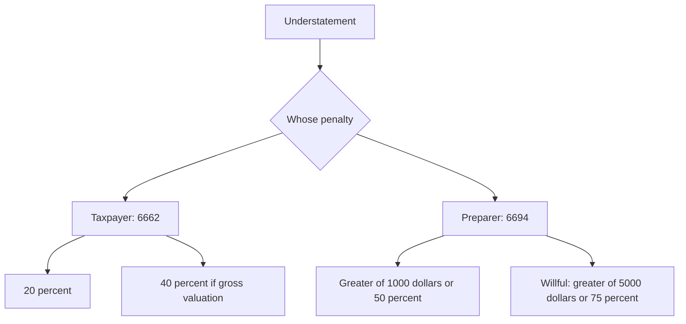

**Accuracy-related penalty, IRC 6662.** Statutory rate: **20 percent** of the portion of the underpayment. The section does not apply to any portion on which the civil fraud penalty of section 6663 is imposed.

The outline’s examples:

- **Negligence or disregard.** Negligence is any failure to make a reasonable attempt to comply. Disregard is careless, reckless, or intentional. Keeping no books is negligence. A disclosed position with a reasonable basis can address a disregard penalty under Treas. Reg. 1.6662-3. Disclosure does not fix a failure to keep records.
- **Substantial understatement of income tax, §6662(d).** Under the general rule, the understatement exceeds the greater of **10 percent** of the tax required to be shown or **$5,000**. If the taxpayer claims any deduction under section 199A, substitute **5 percent** for 10 percent (§6662(d)(1)(C)). The $5,000 floor stays. For a corporation other than an S corporation or a personal holding company, the understatement exceeds the lesser of 10 percent of the tax required to be shown (or, if greater, **$10,000**) or **$10,000,000**. These thresholds are statutory. The understatement is reduced for an item that has substantial authority, or that is adequately disclosed and has a reasonable basis. A tax shelter does not get the disclosure reduction. It needs substantial authority and a reasonable belief that the position was more likely than not correct (§6662(d)(2)(C)).
- **Substantial valuation misstatement, §6662(e).** The value or adjusted basis claimed is **150 percent or more** of the correct amount. No penalty unless that portion of the underpayment exceeds **$5,000** (**$10,000** for a corporation other than an S corporation or a personal holding company). A **gross** valuation misstatement is **200 percent or more**, and §6662(h) raises the rate to **40 percent**.

The same 20 percent rate also covers other categories in §6662(b), including a transaction lacking economic substance and an undisclosed foreign financial asset understatement. The rate is 40 percent for a nondisclosed noneconomic-substance transaction (§6662(i)) and for an undisclosed foreign financial asset understatement (§6662(j)). Reasonable cause and good faith under §6664(c) can remove the accuracy-related penalty. That exception does not apply to a noneconomic-substance transaction.

**Preparer understatement penalty, IRC 6694.** These amounts are statutory. They are not the inflation-adjusted 6695 amounts.

| Conduct | Amount in the statute |
| --- | --- |
| Unreasonable position, §6694(a) | The greater of **$1,000** or **50 percent** of the income the preparer derived, or will derive, from the return or claim |
| Willful or reckless conduct, §6694(b) | The greater of **$5,000** or **75 percent** of that income |

**How a 6694 penalty is fought, §6694(c).** These penalties are assessable. Within **30 days** after notice and demand, the preparer may pay at least **15 percent** of the penalty and file a claim for refund of the amount paid. Collection of the rest is then stopped until a district-court case is finally resolved. The preparer must file that case within **30 days** after the claim is denied or, if earlier, within **30 days** after the end of the **6 months** following the day the claim was filed. If the preparer misses that window, the stay ends. The preparer may instead pay the penalty in full and use an ordinary refund claim. The 15 percent procedure is in section 6694. It is not the procedure for a section 6695 penalty.

**Section 6695 yearly amounts.** Rev. Proc. 2023-34 states the amounts for a return or claim for refund **filed in 2025**. Rev. Proc. 2024-40 states the amounts for a return or claim **filed in 2026**. A calendar-year 2025 return is normally filed in 2026, so the second row is the one that matches the exam’s “current tax year,” unless the question says the return was filed in 2025.

| Failure | Filed in 2025 (Rev. Proc. 2023-34) | Filed in 2026 (Rev. Proc. 2024-40) |
| --- | --- | --- |
| 6695(a) copy to the taxpayer | $60 each, maximum $31,500 | $65 each, maximum $32,500 |
| 6695(b) signature | $60 each, maximum $31,500 | $65 each, maximum $32,500 |
| 6695(c) identifying number | $60 each, maximum $31,500 | $65 each, maximum $32,500 |
| 6695(d) copy or list | $60 each, maximum $31,500 | $65 each, maximum $32,500 |
| 6695(e) information return under 6060 | $60 per return and per item, maximum $31,500 | $65 per return and per item, maximum $32,500 |
| 6695(f) negotiating a check | $635 per check, no maximum stated | $650 per check, no maximum stated |
| 6695(g) due diligence | $635 per failure, no maximum stated | $650 per failure, no maximum stated |

Reasonable cause and no willful neglect is a defense to the 6695(a) through (e) penalties. It is not a license to endorse a refund check.

**Due diligence penalty, §6695(g) and Treas. Reg. 1.6695-2.** It applies to eligibility for the earned income credit, the child tax credit (including the additional child tax credit and the credit for other dependents, as Form 8867 covers them), the American opportunity tax credit, and head of household filing status. It does not apply to the lifetime learning credit. The preparer must meet, for each credit or status: the computation and eligibility steps, completion and submission of Form 8867, the knowledge standard (no ignoring inconsistent information; reasonable inquiries), and record retention. A return with three of these benefits can draw three penalties if diligence fails for each. Keep the Form 8867 file for **three years** from the latest of the dates listed in Treas. Reg. 1.6695-2(b)(4). That regulation uses the return due date, determined without regard to extensions, and the filing or submission date. Read the “latest of” list before you start the three years from a different day.

**Failure-to-file and failure-to-pay, because abatement questions assume them.** Statutory rates in §6651: failure to file is **5 percent** of the tax per month or part of a month, maximum **25 percent**; failure to pay is **0.5 percent** per month or part of a month, maximum **25 percent**. In a month when both apply, the failure-to-file rate is reduced by the failure-to-pay rate. Fraudulent failure to file is **15 percent** per month, maximum **75 percent** (§6651(f)). For a return required to be filed in **2026**, which is the filing year for a calendar-year 2025 income tax return, Rev. Proc. 2024-40 sets the minimum addition for a return more than 60 days late at the lesser of **$525** or 100 percent of the tax required to be shown. Do not reuse $525 for a return required to be filed in an earlier year. Use that year’s revenue procedure.

**Yearly items to mark in your notes.** The 6695 table. The $525 minimum for returns required to be filed in 2026. The $5,000 statutory figure in section 6702, which you should confirm in the statute before substituting an indexed amount. CE hours and the 30-day and 36-month conflict periods are regulatory, not inflation-adjusted.

**Questions**

**1.** *Application.* Which person is practicing before the IRS?

- A. A VITA volunteer who prepares a free return and does not contact the IRS
- B. An enrolled agent who calls a revenue officer about a client’s levy
- C. A payroll clerk who types wage figures on the employer’s Form 941 as assigned clerical work, does not sign as preparer, and does not contact the IRS
- D. A friend who sorts a taxpayer’s receipts and never contacts the IRS

**Answer: B.** Communicating with the IRS about a client’s liability is practice before the IRS. Preparing a return, with no presentation to the IRS, is not practice under *Loving v. IRS*. Clerical help and unpaid organizing are not practice. **Basis:** 31 USC 330; 31 CFR 10.2 and 10.3; *Loving v. IRS*, 742 F.3d 1013 (D.C. Cir. 2014).

**2.** *Distinction.* An enrolled agent learns on March 1 that representing both spouses will be directly adverse. Each spouse says on the phone that the dual representation is fine. Only one spouse later signs a waiver. The agent keeps no copy. May the agent represent both?

- A. Yes, because both spouses consented on the phone
- B. Yes, because a conflict can be waived by either affected client
- C. No, because each affected client must give informed consent confirmed in writing, and the agent must be able to represent each one competently and diligently
- D. No, because Circular 230 prohibits every representation of two spouses

**Answer: C.** A conflict may be waived only when the agent reasonably believes the representation of each client can be competent and diligent, the law allows it, and each affected client confirms informed consent in writing. The writing is due no later than 30 days after the agent knows of the conflict, and the consents are kept for at least 36 months after the representation ends. **Basis:** 31 CFR 10.29.

**3.** *Application.* An enrolled agent wants a fee equal to 25 percent of the refund shown on an original Form 1040 the agent will prepare. The return is not under examination. Under the text of Circular 230 §10.27, this fee is:

- A. Permitted, because the client agrees in writing
- B. Permitted, because any percentage fee is allowed if it is not unconscionable
- C. Not a contingent fee, because it is calculated before the IRS acts
- D. Not permitted by §10.27 for preparation of an original return

**Answer: D.** Section 10.27 defines a contingent fee to include a percentage of the refund. The section permits a contingent fee for an examination of an original return, for an amended return or refund claim filed within 120 days after a written exam notice or written challenge, for a claim solely about assessed interest or penalties, and for a judicial proceeding under the Code. Preparation of an original return is not one of those categories. **Basis:** 31 CFR 10.27.

**4.** *Application.* While at the IRS, an employee had official responsibility for a taxpayer’s case during the last year of employment and did not personally work the case. Employment ended July 1, 2025. In March 2027 the former employee wants to represent that taxpayer in that same matter. Which rule applies?

- A. No limit applies, because the employee did not personally work the case
- B. A permanent ban applies, because official responsibility is treated as personal and substantial participation
- C. The former employee may not represent that party in that matter until two years after government employment ended
- D. The ban expired on January 1, 2026, because it lasts only through the calendar year of separation

**Answer: C.** Official responsibility during the one year before separation bars representation of a specific party in that matter for two years after employment ends. July 1, 2025 plus two years is July 1, 2027, so March 2027 is still inside the ban. Personal and substantial participation is the rule that also bars knowing assistance and does not expire with the two years. **Basis:** 31 CFR 10.25(b)(2) and (b)(3).

**5.** *Distinction.* A client’s bill is unpaid. The client asks for the Form W-2 the client provided and for the agent’s draft worksheets on this unpaid engagement. What does §10.28 require?

- A. Return nothing until the bill is paid
- B. Return the Form W-2. The draft worksheets prepared for this unpaid engagement may be withheld. Copies of anything returned may be kept
- C. Return the worksheets and keep the Form W-2 as security for the fee
- D. Return both, and also destroy the firm’s copies

**Answer: B.** Records of the client, including documents the client provided, must be returned promptly when the client needs them for a federal tax obligation. A fee dispute does not change that duty. The practitioner’s own work product on the unpaid current engagement is not in the category that must be turned over while the fee for that document is unpaid. **Basis:** 31 CFR 10.28.

**6.** *Application.* An enrolled agent discovers that a return the agent prepared last year omitted $20,000 of income. The client does not want the IRS told. What does Circular 230 require the agent to do?

- A. Promptly advise the client of the omission and of the consequences, and do not sign a later document the agent knows is false
- B. Immediately telephone the revenue agent and disclose the omission, with or without the client’s consent
- C. Do nothing, because §10.21 applies only to errors on a document that has not yet been filed
- D. File an amended return under the agent’s own signature and pay the tax from the firm’s account

**Answer: A.** Section 10.21 requires prompt advice to the client about the noncompliance, error, or omission and about the consequences. It does not require a call to the IRS. Unauthorized disclosure of return information is itself prohibited. Signing a false document is prohibited. **Basis:** 31 CFR 10.21 and 10.34; IRC 7216.

**7.** *Recall.* What is the continuing-education minimum for an enrolled agent in a full enrollment cycle?

- A. 72 hours in the cycle, including 6 hours of ethics, and 16 hours in each enrollment year, including 2 hours of ethics
- B. 72 hours in the cycle, including 2 hours of ethics in the whole cycle, with no annual minimum
- C. 16 hours in the cycle, including 6 hours of ethics
- D. 72 hours each enrollment year, including 6 hours of ethics

**Answer: A.** Section 10.6(e) sets both the cycle minimum and the enrollment-year minimum. Ethics hours are part of those totals: 6 in the cycle and 2 in each year. **Basis:** 31 CFR 10.6(e).

**8.** *Distinction.* The IRS issues notice and demand for an IRC 6694(a) preparer penalty. Which statement describes the special collection rule in section 6694(c)?

- A. The preparer pays at least 15 percent and files a refund claim within 30 days after notice and demand, and then files a timely case in United States district court, in order to stop collection of the rest
- B. The preparer pays 15 percent within 90 days and has no further filing duty
- C. The same 15 percent procedure applies to an IRC 6695 failure-to-sign penalty
- D. The preparer must pay 50 percent of the penalty within 15 days, and the case is filed in the Tax Court

**Answer: A.** Section 6694(c) stops collection of the unpaid balance only when, within 30 days after notice and demand, the preparer pays at least 15 percent and files a refund claim, and then begins a district-court case within 30 days after the claim is denied or, if earlier, within 30 days after the six months following the claim. The procedure is in section 6694, not section 6695, and the forum named in the statute is district court. **Basis:** IRC 6694(c).

# 2. Representation before the IRS

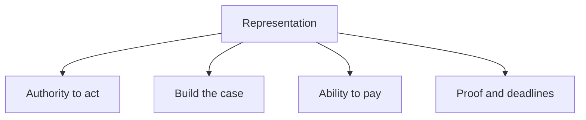

This domain is 25 of the 85 scored questions. It tests whether you have authority to act, how you build a file, how you read the taxpayer’s finances, and which source and which clock actually control.

## Power of attorney, Form 8821, and the CAF

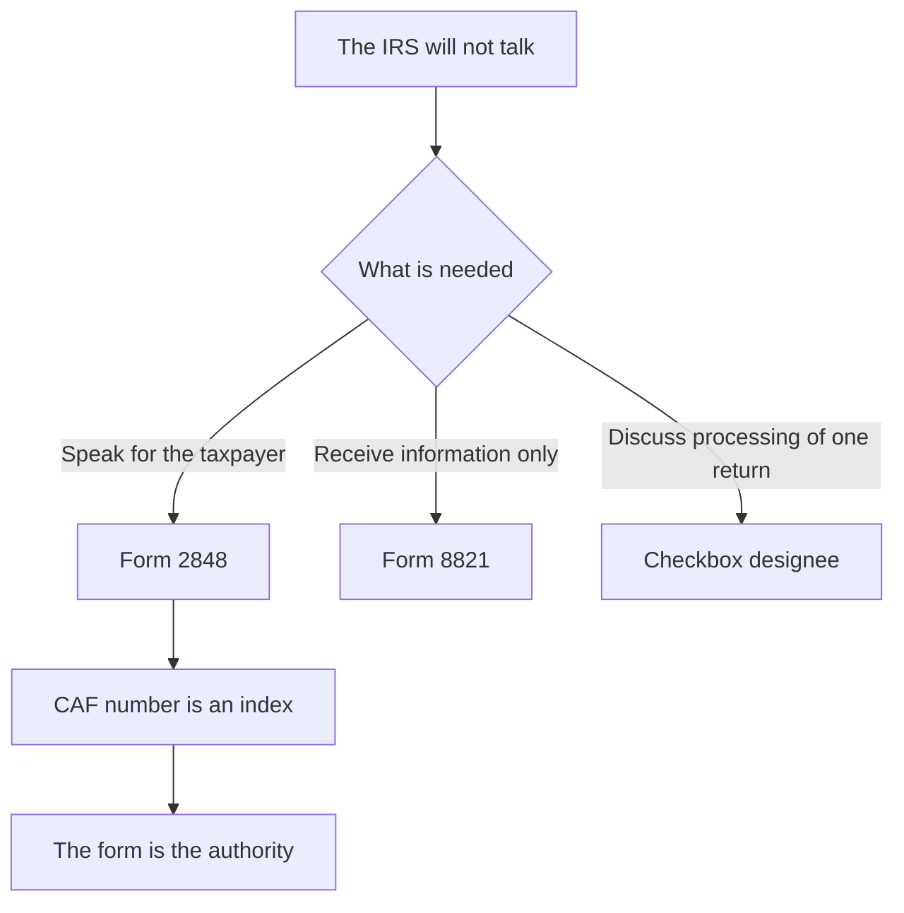

**What is tested.** Why a power of attorney exists, what Form 2848 grants, what it does not grant, how it differs from Form 8821, how a representative is changed or withdrawn, what a CAF number is, and the conference rules the outline still calls Publication 216.

**Purpose.** A power of attorney authorizes a person to represent the taxpayer before the IRS for the tax matters listed on the form. Representation means receiving confidential information and performing the acts the taxpayer may perform for those matters, within the limits on the form and in the instructions.

**Form 2848, Power of Attorney and Declaration of Representative.** Complete the taxpayer’s name, address, and identification number; each representative’s name, address, CAF number if one has already been assigned, PTIN, and designation (attorney, CPA, enrolled agent, officer, employee, family member, enrolled actuary, unenrolled return preparer, student attorney or CPA, or enrolled retirement plan agent, using the letters the current form uses); the tax form, the tax periods, and the specific tax; and the acts authorized. The taxpayer signs. Each representative signs the declaration, including jurisdiction and designation. For a joint return, get the signature of each spouse you will represent.

**Line for extra acts and limits.** The current form uses a specific-acts line for authority you are adding or taking away. Do not assume every act is included. In particular:

- **Signing a return** for the taxpayer must be specifically authorized. The Form 2848 instructions allow it only in narrow cases: disease or injury, continuous absence from the United States (including Puerto Rico) for at least **60 days** before the date the return is due, or other permission the IRS grants for good cause. A busy client who is in the country and in good health does not meet that test.
- **A refund check.** Section 10.31 and IRC 6695(f) prohibit endorsing or negotiating the client’s refund check. Do not treat a power of attorney as permission to cash one. If the form instructions allow the taxpayer to authorize receipt of a refund check, that authority is still not authority to endorse or negotiate it.
- **An extension of the assessment period and a closing agreement** are the outline’s examples of signature authority the taxpayer can grant. A consent to extend the statute is Form 872. A closing agreement under IRC 7121 (Form 866) is final except in case of fraud, malfeasance, or misrepresentation of a material fact. Put the authority on the power of attorney if the representative will sign those documents. Form 870, a waiver of the restrictions on assessment, is not a closing agreement. The taxpayer who signs Form 870 can still pay and file a refund claim.

**Changing, revoking, and withdrawing.** A new Form 2848 for the same tax matters revokes earlier powers unless the taxpayer checks the box to retain a prior representative. A taxpayer revokes a power by following the form instructions, including a copy marked “REVOKE,” signed and dated, filed with the IRS office identified in the instructions. A representative withdraws by filing the notice the instructions describe, commonly a copy marked “WITHDRAW,” signed and dated. Tell the client, and keep a copy.

**Durable and other non-IRS powers.** A durable power of attorney under state law can be used for IRS representation only if it meets the Form 2848 instructions. The representative still completes the declaration on Form 2848 and attaches the durable power. A general state-law power that never mentions federal tax matters is not enough. “Durable” means the state-law document survives the taxpayer’s incapacity when it says so. It does not skip the declaration.

**Form 8821, Tax Information Authorization.** This form lets the appointee inspect or receive confidential information for the matters listed. It does not authorize representation, and it does not authorize the appointee to advocate, to sign agreements, or to bind the taxpayer. The appointee does not have to be eligible to practice. Use 8821 for an accountant, a lender, or a family member who needs transcripts and does not represent.

**Checkbox designee.** The third-party designee checkbox on a return authorizes discussion of that return’s processing. It is not a power of attorney and not a Form 8821. The Form 1040 instructions for the year under exam state the expiration. For the returns this exam covers, read the 2025 Form 1040 instructions: the usual rule is that the designation ends one year from the due date of the return. Confirm that sentence in the instructions before you use a different expiration.

**CAF number.** The Centralized Authorization File number identifies the representative in the IRS authorization system. The IRS assigns it when the first Form 2848 or Form 8821 is processed. It does not, by itself, authorize a new year, a new tax, or a new taxpayer. Each authorization is the form. A CAF number is not a PTIN and not an EFIN.

**Publication 216.** The content outline still names Publication 216, Conference and Practice Requirements. The operative rules are Circular 230 and the conference and practice regulations at **26 CFR 601.501 through 601.509**. Check irs.gov to see whether Publication 216 is still the current pamphlet. Use the regulations if the pamphlet has been retired.

**Decision point.** If the person will speak for the taxpayer, complete Form 2848 and list the years and forms. If the person will only receive information, complete Form 8821. If you need a transcript for a year that is not on file, a CAF number from an old form does not cover it.

**Common traps.** An unenrolled preparer designation on Form 2848 does not create AFSP authority the person does not have. A joint return still needs the right spouse’s signature for that spouse’s representation. Checking “retain” matters: forget it, and a new Form 2848 drops the prior representative for the same matters.

## Building the case

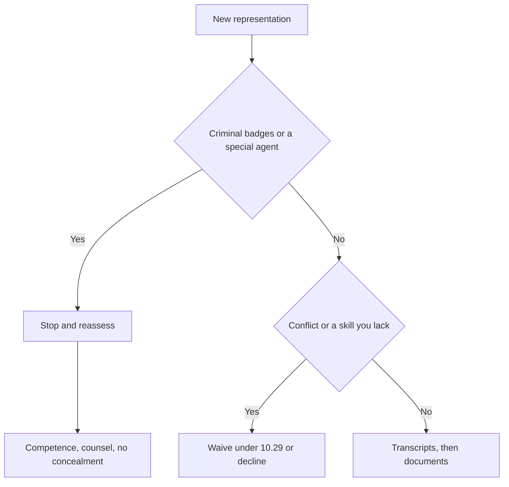

**What is tested.** Preliminary work before you argue the merits: identify the issue, notice criminal exposure, decide whether you are competent and free of a conflict, and get the IRS transcripts.

**Steps.**

1. Identify each issue and the years, and separate what the IRS has proposed from what is still only a mismatch notice.
2. Look for badges of fraud and for Criminal Investigation involvement. Tax avoidance is lawful planning. Tax evasion is a willful attempt to evade or defeat tax (IRC 7201). If the case may be criminal, section 7525 privilege will not protect the communications in a criminal matter, and you may be outside your competence. Advise the client of the exposure, do not destroy or backdate records, and bring in counsel when the matter calls for it. Withdraw if you cannot provide competent and diligent representation.
3. Apply §10.35 and §10.29 before you accept the engagement. Decline, or limit the engagement in writing, when the issue is outside your skill and you will not become competent. Get the written conflict waivers when §10.29 applies.
4. Request transcripts once a Form 2848 is on file. With e-Services access, an authorized representative can obtain account transcripts, wage and income transcripts, and a record of account. The transcript tells you assessments, payments, penalties, and which notices were issued. It is the map for the statutes of limitation.

**Identity theft.** If the transcript shows wages the client never earned, or a return the client did not file, treat it as possible identity theft. Form 14039 is the affidavit. An Identity Protection PIN blocks a repeat filing under that number. Domain 4 covers the reject that an IP PIN causes on an e-filed return.

## The taxpayer’s financial picture

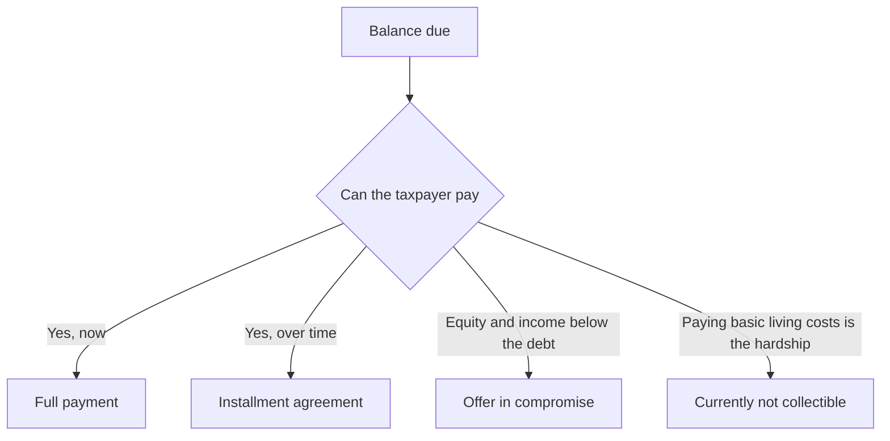

**What is tested.** At this stage you are deciding which collection path fits. Domain 3 is where the forms, the levy bans, and the appeal rights live. Here you learn to read ability to pay.

**Ability to pay.** Match the path to the facts. Full payment ends the collection problem. An installment agreement fits a taxpayer who can pay over time. An offer in compromise fits when the IRS’s reasonable collection potential is less than the debt, when liability itself is in doubt, or when collecting in full would be inequitable for an exceptional reason. Currently not collectible status fits a taxpayer who cannot pay even basic allowable living expenses. It does not forgive the tax. The collection statute keeps running, and the IRS can revisit the account if finances improve.

**General financial health.** Look at bankruptcy, lawsuits, garnishments, cash flow, assets, and insolvency. A pending bankruptcy changes both collectibility and discharge. Income taxes can be dischargeable in bankruptcy only when the Bankruptcy Code tests are met. The usual conditions, in 11 USC 507(a)(8) and 523(a)(1), are: the return was due, including extensions, at least **three years** before the petition; the return was filed at least **two years** before the petition; the tax was assessed at least **240 days** before the petition, plus any tolling the statute adds; the return was not fraudulent; and the taxpayer did not willfully attempt to evade the tax. Trust-fund taxes are not dischargeable. Confirm the tolling rules in those Bankruptcy Code sections before you apply the 240-day period to a case that had a prior offer or a prior bankruptcy.

**Collection financial standards.** The IRS uses national standards for food, clothing, and miscellaneous items; local standards for housing, utilities, and transportation; and a national out-of-pocket health care amount. Expenses above the standard need an explanation. These dollar tables change. Use the IRS collection-financial-standards page for the year of the case. Do not memorize a housing allowance from this guide.

**Third-party research.** Property-tax assessments, asset values, and state and local tax records test what the taxpayer told you about equity. They also support an offer or a currently-not-collectible determination.

**Documents the outline expects you to ask for.** Cancelled checks or the equivalent, bank statements, credit-card statements, receipts, and brokerage records. Legal papers: birth certificates when a credit or filing status depends on them, divorce decrees, and lawsuit settlements. Prior and later returns. Contemporaneous records such as corporate minutes. Entity documents: a partnership agreement or corporate bylaws. A number with no document is a position you should not sign.

## Proof, authority, and timing

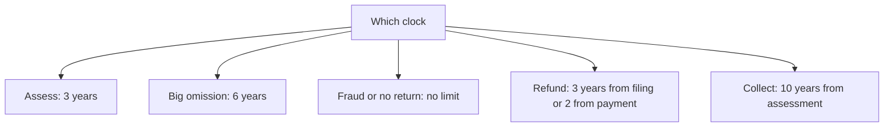

**Legal authority, in the order you should trust it.**

- The Internal Revenue Code controls. Treasury regulations interpret it. A regulation that goes beyond the statute does not outrank the statute.
- Revenue rulings and revenue procedures are the IRS’s published positions. IRS employees follow them. A court can disagree.
- Case law interprets the Code. The Tax Court follows a square holding of the court of appeals to which the case can be appealed.
- IRS forms, instructions, and publications explain administration. They are not statutes.
- A private letter ruling may not be used or cited as precedent (IRC 6110(k)(3)). It binds the IRS for that taxpayer’s request. A revenue ruling is the published item with broader IRS effect.
- The Internal Revenue Manual instructs IRS employees. It does not bind taxpayers or courts.
- A tax treaty can change the Code result for a taxpayer the treaty covers (IRC 894). Read the treaty article and any later Code amendment together. Neither a pamphlet nor a blog post is authority.

**Statutes of limitation. All of these periods are statutory.**

- **Assessment, IRC 6501(a).** Three years from the date the return was filed, or from the due date if that is later.
- **Substantial omission, IRC 6501(e).** Six years if the taxpayer omits gross income that is more than **25 percent** of the gross income stated on the return. An overstated deduction, by itself, does not extend the three years. An overstatement of basis that understates gross income from a sale of property is treated as an omission of gross income (§6501(e)(1)(B)).
- **No limit, IRC 6501(c).** A false or fraudulent return filed with intent to evade tax, a willful attempt to evade tax, or no return at all.
- **Extension.** Form 872, signed before the period ends, extends assessment. Filing Form 1040-X does not, by itself, extend the assessment period.
- **Refund claim, IRC 6511(a).** The later of three years from the time the return was filed or two years from the time the tax was paid. If no return was filed, two years from payment.
- **Refund lookback, IRC 6511(b).** A claim filed within three years of the return reaches tax paid within the three years before the claim, plus any extension of time to file. A claim that relies on the two-year payment rule reaches tax paid within the two years before the claim.
- **Bad debts and worthless securities, IRC 6511(d)(1).** Seven years from the due date of the return for the year the loss was sustained.
- **Collection, IRC 6502.** Ten years from the assessment. Domain 3 covers the events that suspend that ten years. A written extension is allowed only in the narrow case section 6502(a)(2) describes, tied to an installment agreement. Read that subsection before you assume every installment agreement adds years.

**Post-filing correspondence.** A math-error notice is a summary assessment under IRC 6213(b). It is not a statutory notice of deficiency. The taxpayer has **60 days** after the notice to request abatement. If the request is timely, the IRS must use deficiency procedures before it can assess that increase. A CP2000 underreporter notice proposes changes from information returns. The response date is the date printed on the notice. A CP2000 is not the 90-day letter. An underreporter case becomes a deficiency case only if the IRS later issues a statutory notice.

**Third-party correspondence and FOIA.** Wage information can come from the taxpayer, from a wage and income transcript, or from the employer. A summons to a third party has its own notice rules, covered in Domain 3. A Freedom of Information Act request seeks agency records. It is the wrong first tool for the taxpayer’s own account transcript. Use a transcript request, Form 4506-T, or e-Services once Form 2848 or Form 8821 is on file. Use FOIA when you need IRS records a transcript does not contain. Form 4506 requests a copy of a filed return and is slower than a transcript.

**Disclosure statements.** Form 8275 and Form 8275-R are how a taxpayer discloses a return position. See Domain 1 for the standard that disclosure can satisfy.

**Taxpayer Advocate Service.** IRC 7803(c) and 7811. File Form 911 when the taxpayer is suffering or about to suffer a significant hardship. The statute’s examples include an immediate threat of adverse action, a delay of more than **30 days** in resolving an account problem, significant costs if relief is not granted, and irreparable injury or a long-term adverse impact. TAS is not a substitute for a timely Tax Court petition and not a second Appeals office.

**Courts an enrolled agent does not enter by virtue of the credential.** Enrollment authorizes practice before the IRS, including Appeals. It does not admit you to the United States Tax Court, a district court, the Court of Federal Claims, a court of appeals, or the Supreme Court. A taxpayer can petition the Tax Court without paying the deficiency first. A refund suit in district court or the Court of Federal Claims requires full payment of the tax first (*Flora v. United States*). An enrolled agent appears in those courts only by a separate admission, such as the Tax Court bar, or when another rule allows it. The taxpayer may appear without counsel where the court’s rules permit.

**Decision point.** Write down three dates before you draft a protest: the date the return was filed, the date of assessment, and the date of the letter in your hand. Most “which form” mistakes are really “which clock” mistakes.

**Common traps.** Treating a private letter ruling as if it were a regulation. Treating the Internal Revenue Manual as law. Calling a CP2000 a 90-day letter. Counting an overstated deduction as a 25 percent omission. Thinking a CAF number renews itself each year.

**Questions**

**1.** *Distinction.* A client wants a bookkeeper to receive transcripts and does not want the bookkeeper to speak at the Appeals conference. Which form fits?

- A. Form 2848, because any authorization lets the holder appear at Appeals
- B. Form 8821, because it authorizes receipt of information and does not authorize representation
- C. The third-party designee checkbox on next year’s return, because it covers every open year
- D. Form 8821, because it lets the bookkeeper sign a closing agreement

**Answer: B.** Form 8821 is a tax information authorization. Representation, including an appearance at Appeals, requires Form 2848 and a representative who is eligible to practice. The checkbox designee is limited to processing of that return. **Basis:** Form 2848 instructions; Form 8821 instructions; 26 CFR 601.501 through 601.509.

**2.** *Application.* An enrolled agent was issued a CAF number in 2022 for one taxpayer’s 2021 Form 1040. A new client asks the agent to call about the client’s 2024 employment-tax balance. What is true?

- A. The CAF number alone authorizes the call
- B. The agent must have a Form 2848 for the new client, the employment-tax form, and the periods at issue. The CAF number does not create that authority
- C. A PTIN is enough, because the CAF number and the PTIN are the same identifier
- D. Form 8821 is enough to bind the new client to an installment agreement

**Answer: B.** The CAF number indexes the representative on the Centralized Authorization File. Authority comes from a power of attorney that lists the taxpayer, the tax, and the periods. **Basis:** Form 2848 instructions; IRS Centralized Authorization File description in the form instructions.

**3.** *Application.* A healthy client who is in the United States asks an enrolled agent to sign the client’s Form 1040 because the client is busy at work. The Form 2848 specifically says the agent may sign the return. May the agent sign?

- A. Yes, because the Form 2848 mentions signing
- B. Yes, because an enrolled agent may always sign a client’s original return
- C. No, because the instructions allow a representative to sign a return only for disease or injury, continuous absence from the United States for at least 60 days before the due date, or other IRS permission for good cause
- D. No, because a representative may never be authorized to sign any document

**Answer: C.** Specific language on Form 2848 is required, and it is not sufficient by itself. The Form 2848 instructions limit return-signing authority to those situations. A busy client in the United States does not qualify. **Basis:** Form 2848 instructions; Treas. Reg. 1.6012-1(a)(5).

**4.** *Distinction.* An enrolled agent gave a client written tax-planning advice. Criminal Investigation has now opened a case. Which limit on the IRC 7525 privilege applies?

- A. The privilege applies in a criminal tax investigation with the same scope as in an ordinary audit
- B. The privilege does not apply in a criminal matter. It also does not apply to written communications in connection with promoting a tax shelter
- C. The privilege applies only to return preparation and never to planning advice
- D. The privilege lets the agent refuse to identify the client in any civil or criminal case

**Answer: B.** Section 7525 gives a federally authorized tax practitioner a privilege, in noncriminal tax matters before the IRS and in noncriminal tax proceedings in federal court, for tax advice that would be privileged between a taxpayer and an attorney. It does not apply to criminal matters, and it does not apply to written communications promoting participation in a tax shelter. Return preparation is not tax advice covered by the attorney-client privilege either. **Basis:** IRC 7525.

**5.** *Distinction.* While researching a penalty position, the agent finds a private letter ruling issued to another taxpayer and a revenue ruling on the same statute. Which statement is correct?

- A. The private letter ruling may be cited as precedent for every taxpayer with similar facts
- B. The private letter ruling may not be used or cited as precedent. A revenue ruling is the IRS’s published position and still is not a statute
- C. The private letter ruling overrides the Code
- D. The Internal Revenue Manual section that mentions the ruling binds the court

**Answer: B.** IRC 6110(k)(3) says a written determination may not be used or cited as precedent. A revenue ruling states the IRS position for IRS employees and does not amend the Code. The Manual does not bind a court. **Basis:** IRC 6110(k)(3).

**6.** *Application.* A taxpayer filed the 2022 Form 1040 on April 15, 2023, and paid the tax in full that day. There was no later payment and no extension. Which refund claim is timely under IRC 6511(a)?

- A. A claim filed July 1, 2026
- B. A claim filed April 1, 2026
- C. A claim filed April 15, 2027
- D. A claim filed December 31, 2026

**Answer: B.** The claim period is the later of three years from filing or two years from payment. Three years from April 15, 2023 ends April 15, 2026, which is later than two years from the payment. April 1, 2026 falls inside that period. The other dates fall after April 15, 2026. **Basis:** IRC 6511(a).

**7.** *Application.* A return filed on time omits gross receipts equal to 40 percent of the gross income reported on the return. There is no fraud. How long does the IRS have to assess?

- A. Three years, because the omission is of income and the six-year rule applies only to overstated deductions
- B. Six years, because the omitted gross income is more than 25 percent of the gross income stated on the return
- C. Unlimited, because any omission of more than 25 percent is treated as fraud
- D. Two years from the date the IRS discovers the omission

**Answer: B.** Section 6501(e) extends assessment to six years when gross income omitted from the return is more than 25 percent of the gross income stated on the return. An overstated deduction, standing alone, does not trigger that extension. Fraud is a separate unlimited period and is not presumed from the 25 percent test. **Basis:** IRC 6501(a) and 6501(e).

**8.** *Application.* A taxpayer’s legitimate refund has been frozen for 45 days after the return posted, the taxpayer cannot reach a resolution through normal channels, and the delay is about to cause eviction. Which request fits?

- A. Form 911 with the Taxpayer Advocate Service, because a delay of more than 30 days and a significant hardship are criteria in section 7811
- B. A Freedom of Information Act request, because FOIA is the remedy for a frozen refund
- C. Form 1040-X, because an amended return is required whenever a refund is delayed
- D. A Tax Court petition, because enrollment includes the right to file one without a statutory notice

**Answer: A.** Section 7811 includes, as significant hardship, a delay of more than 30 days in resolving an account problem and an immediate threat of adverse action. Form 911 is the application for a Taxpayer Assistance Order. FOIA seeks agency records. An amended return is for changing the return. A Tax Court petition requires a ticket to court, such as a statutory notice, and enrollment alone is not that ticket. **Basis:** IRC 7811; Form 911.

# 3. Specific areas of representation

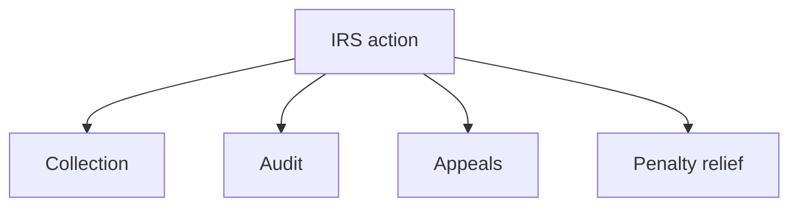

This domain is 20 of the 85 scored questions. It is the procedure domain: which notice starts which clock, which form requests which hearing, and which remedy actually changes the balance.

## Collection: lien, levy, and currently not collectible

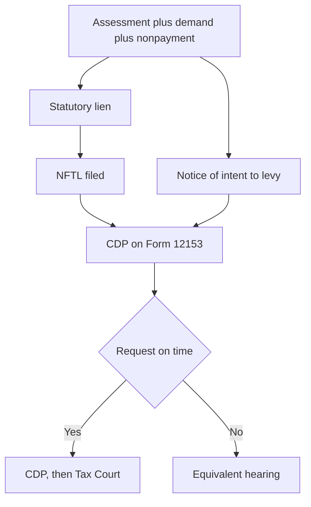

**The lien.** Under IRC 6321, a lien arises when the tax is assessed, demand is made, and the taxpayer neglects or refuses to pay. IRC 6322 dates the lien from the assessment. The lien exists before anyone files a public notice. A **Notice of Federal Tax Lien** is the public filing. Under IRC 6323, the lien is not valid against a purchaser, a holder of a security interest, a mechanic’s lienor, or a judgment lien creditor until the notice is filed in the right office. The IRS must send the taxpayer written notice of that filing not more than **5 business days** after the filing (IRC 6320).

For calendar year 2025, Rev. Proc. 2024-40 sets two small superpriority amounts in section 6323(b): a casual-sale purchaser below **$1,960**, and a mechanic’s lienor who repaired a residence under a contract of not more than **$9,790**. Those amounts change each calendar year. Use the revenue procedure for the year in the question.

**The levy.** IRC 6331 allows levy after notice and demand and a failure to pay. A separate notice of intent to levy and of the right to a hearing must be given at least **30 days** before the levy, except in the narrow cases the statute exempts, such as jeopardy. Levy reaches property of the taxpayer in the hands of the taxpayer or a third party. A wage levy continues until the debt is paid or the levy is released.

**Property the levy does not take, IRC 6334.** Exempt categories include certain wearing apparel and school books, undelivered mail, certain unemployment and workers’ compensation benefits, certain public assistance, and the tools and household goods up to the inflation-adjusted caps. For **calendar year 2025**, Rev. Proc. 2024-40 sets the cap for fuel, provisions, furniture, and other household personal effects at **$11,710**, and the cap for books and tools of the trade at **$5,860**. The wage exemption is a formula. For taxable years beginning in 2025, that revenue procedure sets the dollar amount in section 6334(d)(4)(B) at **$5,100**. Read the formula before you treat $5,100 as the amount of wages that cannot be levied. A levy on a principal residence needs the judicial approval section 6334(e) requires.

**Currently not collectible.** Hardship status is an administrative determination that collection would prevent the taxpayer from meeting basic living expenses under the collection financial standards. The debt remains. The 10-year collection statute keeps running. A lien can still be filed. The IRS can reopen the account if income or assets change. There is no single IRS form that “forgives” the balance; the determination is documented on the collection information statements the IRS requests, commonly the 433 series.

**Collection summons.** IRC 7602 authorizes a summons to determine or collect a liability, including locating assets and taking testimony. It is not a criminal search warrant. When the summons is served on a third-party recordkeeper, IRC 7609 requires notice to the taxpayer, and the taxpayer may begin a proceeding to quash no later than the **20th day** after the day the notice is given.

**Collection statute.** Ten years from assessment, IRC 6502. Suspensions you should be able to name:

- While a timely collection-due-process hearing and any appeal are pending (IRC 6330(e)). Read section 6330(e) for the rule on how much time must remain after the determination. Do not memorize an extra number of days unless you have just read that sentence.
- While an offer in compromise is pending, for 30 days after rejection, and during a timely appeal of the rejection (IRC 6331(k)).
- During a bankruptcy case, plus **6 months** (IRC 6503(h)).
- A written extension of the collection statute is limited by IRC 6502(a)(2) and is tied to an installment agreement. Read that subsection for the permitted length.

## Time to pay, installment agreements, and offers

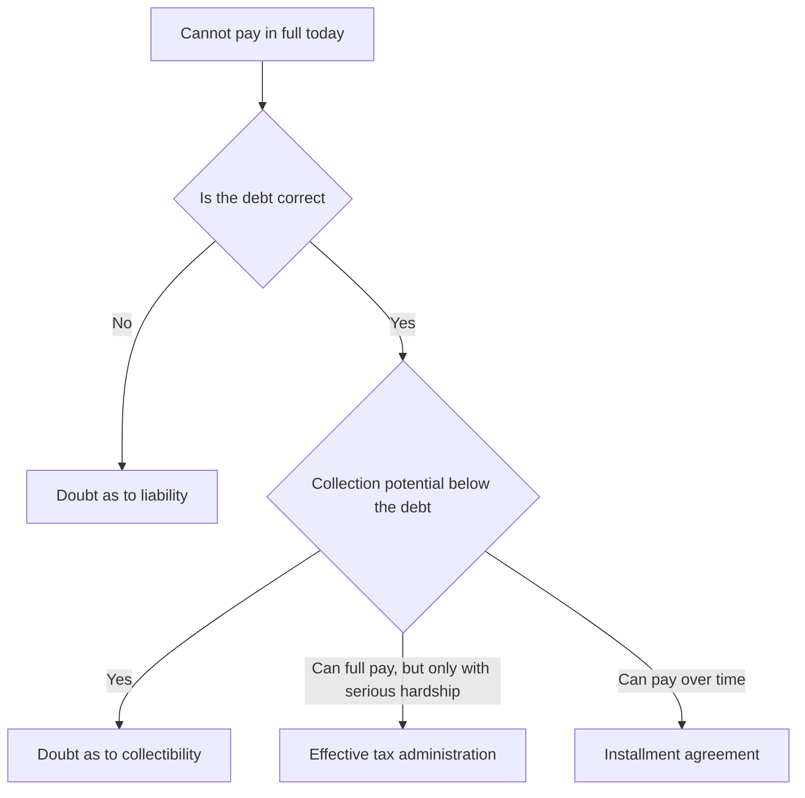

**Extension of time to pay, Form 1127.** This is undue hardship under IRC 6161. It is not an extension of time to file. For the tax shown on the return, the extension is for a period not exceeding **6 months**. For a deficiency, the period is not to exceed **18 months**, and the IRS may grant up to **12 additional months** in an exceptional case. Security can be required under the bond rules. A Form 4868 extends the time to file. It does not, by itself, extend the time to pay.

**Installment agreements, IRC 6159.** The IRS may accept monthly payments. A **guaranteed** agreement for an individual, which the IRS shall enter, has all of these statutory conditions: the liability, determined without regard to interest, penalties, additions to tax, and additional amounts, does not exceed **$10,000**; during the preceding **5 taxable years** the taxpayer has not failed to file, failed to pay tax required to be shown, or entered another installment agreement; the taxpayer is financially unable to pay in full and submits the required information; the agreement full-pays the liability within **3 years**; and the taxpayer agrees to comply while the agreement is in effect. A taxpayer who fails one of those tests can still be granted a discretionary agreement. The IRS also offers short-term plans and “simple” or streamlined plans below administrative dollar thresholds, sometimes without a full financial statement. Those thresholds and the user fees change. Confirm the 2025 figures on the IRS payment-plan page. Do not substitute them for the $10,000 statutory guarantee.

While a proposed installment agreement is pending, while one is in effect, for **30 days** after a rejection or termination, and during an appeal of that rejection or termination, the IRS generally may not levy (IRC 6331(k)). A jeopardy determination is the statutory exception to know.

**Offer in compromise, IRC 7122.** Three grounds:

- **Doubt as to collectibility.** The IRS cannot collect the full amount within the collection period. Reasonable collection potential is asset equity plus a multiple of monthly disposable income. The Form 656-B booklet states the multiples. Confirm the 12-month and 24-month multiples in the booklet edition for this exam before you rely on a figure from an older edition.
- **Doubt as to liability.** The tax is not owed, or not owed in the amount assessed. The form is Form 656-L. Check that form’s instructions for the fee. Do not assume the collectibility fee applies.
- **Effective tax administration.** The taxpayer could full-pay, and collection would cause economic hardship or would be inequitable for an exceptional public-policy or equity reason.

**Payments with the offer, statutory, IRC 7122(c).** A lump-sum offer, defined as an offer payable in **5 or fewer** installments, must include **20 percent** of the offer with the submission. A periodic offer must include the first proposed installment, and the taxpayer continues paying while the offer is considered. Low-income taxpayers can be waived from these payment rules. IRS Tax Tip 2025-35 (June 3, 2025) and the IRS offer-in-compromise page state a **$205** application fee, waived for a low-income individual, along with the initial payment. Only individuals qualify for that low-income waiver. Confirm the fee on the Form 656-B instructions in effect on December 31, 2025, before you treat a later webpage as the exam figure.

The IRS will not consider an offer from a taxpayer in an open bankruptcy, or from a taxpayer who is not in filing and payment compliance, including required estimated taxes and, for an employer, required deposits. If the offer is rejected, the rejection letter gives a right to appeal to the Independent Office of Appeals. Use the deadline on the letter. Form 13711 is the appeal form used for a rejected offer. Acceptance is a contract. Read the future-compliance term on the Form 656 you submit, including the number of years the taxpayer must stay in compliance, before you memorize a number from a secondary source.

**Amended returns and refund claims.** Form 1040-X amends an income tax return and is the claim for refund of income tax. Form 843 is the claim for refund and request for abatement of certain penalties, interest, and taxes that are not claimed on Form 1040-X. Filing Form 1040-X does not extend the assessment statute. A refund claim must still be timely under IRC 6511. A superseding return, filed by the original due date including extensions, takes the place of the original return. After that date, the correction is an amended return.

**Refund offsets.** IRC 6402 allows the IRS to apply an overpayment to another federal tax debt and, in the order the statute and regulations set, to certain nontax debts such as past-due child support. An **injured spouse** claim, Form 8379, asks for the injured spouse’s share of a joint refund that was or will be taken for the other spouse’s separate debt. That is different from innocent-spouse relief from the tax itself.

## Hearings and collection appeals

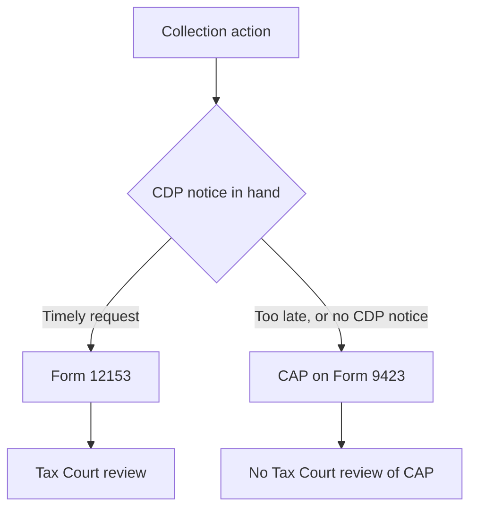

**Collection due process.** Use Form 12153.

- **Lien, IRC 6320.** The hearing request period is the **30-day** period that begins the day after the end of the 5-business-day notice period.
- **Levy, IRC 6330.** The request must be made within the **30 days** the notice gives before levy.
- A timely request generally stops levy on the periods listed and suspends the collection statute. The taxpayer can go to Tax Court if the determination is still unfavorable.
- At the hearing the taxpayer can raise spousal relief, challenge the appropriateness of collection, and offer a collection alternative. The existence or amount of the liability can be raised only if the taxpayer did not receive a statutory notice or did not otherwise have an opportunity to dispute it.
- **Equivalent hearing.** If the request is late, Form 12153 still allows an equivalent hearing: for a lien notice, within **one year plus five business days** from the filing date of the lien; for a levy notice, within **one year** from the date of the CDP levy notice (Form 12153 instructions). An equivalent hearing does not stop levy, does not suspend the 10-year collection statute, and does not give a Tax Court appeal.

**Collection Appeals Program.** Form 9423. CAP is the faster administrative review for actions such as a filed lien, a levy, a seizure, a rejected or terminated installment agreement, and certain other collection decisions described in Publication 1660. A CAP decision is not reviewable in the Tax Court. If both CAP and a CDP notice are available, read the notice before you choose. Missing the CDP window to try a faster CAP conference can cost the Tax Court ticket.

## Innocent spouse, trust fund, decedent, and passport

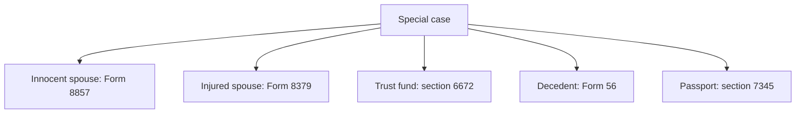

**Innocent spouse, IRC 6015 and Form 8857.** Three paths:

- **Section 6015(b).** A joint return, an understatement due to erroneous items of the other spouse, no knowledge or reason to know, inequitable to hold the requesting spouse liable, and a request within **two years** of the first collection activity against the requesting spouse.
- **Section 6015(c), separation of liability.** The spouses are divorced, legally separated, or have lived apart for the 12 months before the request. The understatement is allocated. Actual knowledge of the item defeats relief, with a duress exception. The same two-year collection-activity deadline applies.
- **Section 6015(f), equitable relief.** Used when (b) and (c) do not apply, including an underpayment of tax that was shown on the return and not paid. Rev. Proc. 2013-34 lists the factors, including marital status, economic hardship, knowledge, a legal obligation of the other spouse, significant benefit, compliance, and health. The IRM states that a request is timely for section 6015(f) when the collection statute or the refund statute is still open. The two-year limit remains the rule for sections 6015(b) and 6015(c).

**What starts the two-year clock.** The IRM treats a levy, an offset of the requesting spouse’s separate overpayment, and a collection suit as collection activity. It states that a notice of deficiency, a notice and demand for payment, and the filing of a Notice of Federal Tax Lien do **not** start that two-year period. Read IRM 25.15.3 before you tell a client that a lien notice started the innocent-spouse clock.

Both spouses can appeal the preliminary determination. The IRS innocent-spouse appeals page says the appeal is due within **30 days** from the date of the preliminary determination letter.

**Trust fund recovery penalty, IRC 6672.** The penalty equals the unpaid trust-fund tax: withheld income tax and the employee’s share of FICA. It does not include the employer’s share of FICA. It applies to a responsible person who willfully failed to collect, account for, or pay over the tax. The proposed assessment is Letter 1153. Use the appeal deadline printed on that letter. The familiar period is 60 days, and longer if the letter is addressed outside the United States. The letter controls.

**Decedent.** The personal representative with authority files Form 56, Notice Concerning Fiduciary Relationship, and signs Form 2848. Form 1310 is the statement of a person claiming a refund for a decedent when no court-appointed representative is required. Publication 559 covers the final return and the estate’s Form 1041. A family member without fiduciary authority does not automatically become the representative.

**Passport, IRC 7345.** For **calendar year 2025**, Rev. Proc. 2024-40 sets the serious-delinquent-debt amount at **$64,000**. The statute requires a debt greater than that inflation-adjusted amount, and it requires a lien as to which remedies have lapsed or been exhausted, or a levy. The IRS certifies the debt to the State Department, which can deny or revoke a passport. The IRS page on passport certification states that the certified debt does not include a debt being paid timely under an installment agreement or an accepted offer, a debt with a timely levy CDP request, or a debt suspended because of an innocent-spouse request. The IRS also states that it will not certify a taxpayer whose account is currently not collectible due to hardship, who has a pending installment agreement or offer, who is in bankruptcy, or who is a victim of tax-related identity theft. The same page states that certification is not reversed merely because later payments or a statute expiration drop the debt below the threshold. The certified debt has to be resolved.

**Audit reconsideration.** Publication 3598. It is a request to reopen an assessment when the taxpayer has new information and did not have a real prior chance to present it, such as a substitute-for-return assessment or an audit the taxpayer did not attend. It is not a way around a Tax Court decision, and it is not a substitute for a timely petition. Send the new documents with the request.

## Audits and the notice path

```mermaid
flowchart TD
  A["Exam result"] --> B["30-day letter and RAR"]
  B --> C{"Agree"}
  C -->|"Yes"| D["Form 870"]
  C -->|"No"| E["Protest to Appeals"]
  E --> F{"Settled"}
  F -->|"No"| G["90-day letter"]
  G --> H["Tax Court in 90 or 150 days"]
```

**IRS authority.** IRC 7602 authorizes examination of books, testimony, and summonses. IRC 7605(a) lets the IRS set the time and place, which must be reasonable under the circumstances. IRC 7605(b) limits the IRS to one inspection of the taxpayer’s books for a year unless the taxpayer requests another or the IRS gives written notice that an additional inspection is necessary. IRC 7521 gives the taxpayer the right to be represented and, with advance notice, to record an in-person interview.

**Privilege at the audit.** IRC 7525 applies to tax advice in a noncriminal matter before the IRS. It does not apply to criminal matters, to written tax-shelter promotion communications, or to return-preparation work. It does not apply in a state-tax proceeding.

**Substantiation.** The taxpayer must verify entries. At the examination, the practical burden is on the taxpayer to produce records. In a later court case, IRC 7491 can shift the burden of proof on a factual issue to the IRS if the taxpayer produces credible evidence, has substantiated the item, has kept required records, and has cooperated. Partnerships, corporations, and trusts also must meet the **$7 million** net-worth condition in section 7491(a)(2). In court, the IRS has the burden of production on penalties (IRC 7491(c)). The taxpayer still has the burden on reasonable cause. Do not tell a client that section 7491 applies inside the revenue agent’s office.

**The path of the notices.**

- Correspondence, office, or field examination. Cooperate, extend the response date in writing when you need it, and do not ignore the information-document request.
- The revenue agent report explains the changes. The **30-day letter** that comes with it, or after it, is the chance to agree or to appeal. The letter states the deadline. IRS Appeals describes that period as generally 30 days from the date of the letter.
- Agreeing at this stage is commonly done on **Form 870**, a waiver of the restrictions on assessment. It is not a closing agreement under IRC 7121.
- A **CP2000** is an underreporter proposal. Respond by the date on the notice with agreement or with documents. It is not a statutory notice of deficiency.
- If the taxpayer does not agree and does not appeal, or if Appeals does not settle the case, the IRS issues the **statutory notice of deficiency**, the 90-day letter. Under IRC 6213, the taxpayer has **90 days** to petition the Tax Court, or **150 days** if the notice is addressed to a person outside the United States. A timely petition bars assessment of that deficiency until the decision is final. Missing the 90 or 150 days allows the IRS to assess. The later path is full payment, a refund claim, and a suit in district court or the Court of Federal Claims. IRC 6532 bars that suit until 6 months after the claim unless the IRS disallows it sooner, and it requires the suit within **2 years** of a mailed notice of disallowance.

**Taxpayer choices at the 30-day letter.** Agree, appeal, or take no action and wait for the statutory notice. Signing Form 870 closes the prepayment route for the items covered, subject to later refund procedures. It does not admit fraud.

## Appeals

```mermaid
flowchart TD
  A["Appeals conference"] --> B["Hazards of litigation"]
  B --> C["Settle"]
  B --> D["No agreement"]
  D --> E["90-day letter"]
  E --> F["Tax Court, prepayment"]
  E --> G["Pay, claim, then refund suit"]
```

**Right to appeal.** A taxpayer who receives a 30-day letter may request Appeals. An enrolled agent may appear at the conference under a Form 2848 that covers the tax and the periods.

**What to put in the request.** Publication 5 (Rev. 4-2021) and the IRS “Preparing a Request for Appeals” page distinguish a small case request from a formal protest.

- **Small case request.** Available when the total additional tax and penalties for each period is **$25,000 or less**. For a doubt-as-to-liability offer, the page and Publication 5 count the unpaid tax, penalty, and interest. A short statement of the items you disagree with, and why, is enough. Form 12203 can be used. Employee plans, exempt organizations, S corporations, and partnerships are not eligible for the small-case request, as the IRS page states.
- **Formal written protest.** Publication 5 asks for your name, address, and a daytime phone number; a statement that you want to appeal; a copy of the letter with the proposed changes, or the date and symbols on that letter; the periods; the changes you disagree with and why; the facts; the law or authority you rely on; and a signed penalties-of-perjury declaration.

**Settlement.** Appeals evaluates hazards of litigation. It is not required to start the audit over. A settled Appeals case is often closed with Form 870-AD, which is still a waiver, not an IRC 7121 closing agreement. If you need a document that is final except for fraud, malfeasance, or misrepresentation of a material fact, that document is a closing agreement.

**The 90-day letter after Appeals.** If the case is not settled, the statutory notice is the route to Tax Court. A case already docketed in the Tax Court can still be settled with Appeals. Filing the petition does not prevent settlement. Letting the 90 days pass does prevent a prepayment petition.

## Penalty and interest abatement

```mermaid
flowchart TD
  A["Penalty charged"] --> B{"Failure to file, pay, or deposit"}
  B -->|"Clean recent history"| C["First time abate, administrative"]
  B -->|"Reasonable cause"| D["Statutory relief"]
  A --> E["Interest"]
  E --> F{"IRS ministerial or managerial delay"}
  F -->|"Yes, and the taxpayer did not cause it"| G["Possible abatement under 6404 e"]
  F -->|"Ordinary underpayment interest"| H["Interest remains"]
```

**Penalties that can be removed.** Failure to file, failure to pay, and failure to deposit have a reasonable-cause exception in section 6651 and section 6656: the taxpayer exercised ordinary business care and prudence and was nevertheless unable to file or to pay. Facts that can meet that test include serious illness, a casualty that destroyed records, and the inability to get records despite timely efforts. A mistake that ordinary care would have caught does not.

**First time abate** is administrative relief in the Internal Revenue Manual for failure-to-file, failure-to-pay, and failure-to-deposit penalties when the taxpayer has a clean compliance history for the prior three years, has filed required returns, and has paid or arranged to pay. It is not the reasonable-cause statute, and it is not available for the accuracy-related penalty or the fraud penalty. Because it lives in the Manual, confirm the current IRM criteria before you promise it.

**How to request.** For a penalty that has been paid, or for certain interest, use Form 843 with a statement of facts. For a penalty that has not been paid, a written request or the phone request the notice describes can be enough. If the request is denied, appeal under the rights in the denial letter.

**Interest.** Reasonable cause that removes a penalty does not, by itself, remove underpayment interest. Interest is the time value of the tax. IRC 6621 sets the rate quarterly from the federal short-term rate. IRC 6622 requires daily compounding. Do not memorize a quarterly percentage from a prior year.

**Abatement of interest, IRC 6404(e).** The IRS may abate interest attributable to an unreasonable error or delay by an IRS officer or employee in performing a ministerial or managerial act, but only if no significant aspect of the error or delay is attributable to the taxpayer, and only in the circumstances that subsection describes, including that the IRS has contacted the taxpayer in writing. Ordinary processing time does not qualify. IRC 6404(a) abates an assessment that is excessive in amount, assessed after the statute, or erroneously or illegally assessed. IRC 6404(g) suspends interest in a different situation: the IRS fails to provide a timely notice of liability to an individual who filed a timely return. Read the 36-month rule and its exceptions in section 6404(g) before you apply it. The suspension is not the same thing as a reasonable-cause abatement.

**Questions**

**1.** *Distinction.* The IRS assessed income tax, sent notice and demand, and the taxpayer did not pay. No Notice of Federal Tax Lien has been filed. Which statement is correct?

- A. No lien exists until the Notice of Federal Tax Lien is filed
- B. A statutory lien exists. Filing the notice is what establishes priority against the purchasers and creditors described in section 6323
- C. A lien exists only after a levy
- D. Filing the notice is optional and has no effect on priority

**Answer: B.** The lien in section 6321 arises after assessment, demand, and neglect or refusal to pay, and section 6322 relates it back to the assessment. Section 6323 protects specified third parties until notice of the lien is filed. **Basis:** IRC 6321, 6322, and 6323.

**2.** *Distinction.* A taxpayer receives a notice of intent to levy and a right to a hearing, and does not request a hearing until after the 30 days on the notice. Which statement is correct?

- A. The taxpayer may request an equivalent hearing on Form 12153 within one year of the levy notice, and that hearing preserves a Tax Court appeal
- B. The taxpayer may request an equivalent hearing within one year of the levy notice. An equivalent hearing does not suspend the collection statute and does not give Tax Court review
- C. The taxpayer has 150 days because every collection notice uses the foreign statutory-notice period
- D. The taxpayer’s only remaining request is Form 911, and CDP is no longer relevant

**Answer: B.** A timely Form 12153 request is a CDP hearing, with the levy suspension and Tax Court review that sections 6320 and 6330 provide. A late request can still be an equivalent hearing within the one-year period the Form 12153 instructions state for a levy notice. The instructions state that an equivalent hearing does not prohibit levy, does not suspend the 10-year collection period, and cannot be taken to Tax Court. **Basis:** IRC 6330; Form 12153 instructions.

**3.** *Application.* Which individual has the statutory right to a guaranteed installment agreement under IRC 6159(c)?

- A. Tax of $9,000, ignoring penalties and interest, with a failure to file in one of the preceding five years
- B. Tax of $9,000, ignoring penalties and interest, filed and paid for the preceding five years, no prior installment agreement in those years, unable to pay in full now, and the agreement will full-pay within three years
- C. Tax of $40,000, because every balance under an administrative streamlined threshold is guaranteed by the statute
- D. Tax of $9,000, with a prior installment agreement two years ago and a proposed five-year payout

**Answer: B.** Section 6159(c) requires each listed condition, including the $10,000 cap computed without interest, penalties, and additions, the five-year compliance history, no installment agreement in those five years, and full payment within three years. A larger balance may still qualify for a discretionary agreement. It is not the statutory guarantee. **Basis:** IRC 6159(c).

**4.** *Application.* A low-income individual, not in bankruptcy, wants to submit a doubt-as-to-collectibility offer and qualifies for the low-income waiver. Which payment rule applies?

- A. The individual must include the $205 fee and 20 percent of the offer, and the waiver applies only to businesses
- B. The fee and the initial payment are waived for a qualifying low-income individual. A lump-sum offer that is not waived must include 20 percent and is payable in five or fewer installments
- C. Every offer must include 50 percent of the offer with the application
- D. An open bankruptcy is the preferred time to submit the offer

**Answer: B.** Section 7122(c) requires 20 percent with a lump-sum offer, or the first installment of a periodic offer, and it allows a waiver for low-income taxpayers. IRS Tax Tip 2025-35 states the $205 fee and states that low-income taxpayers do not have to pay the fee or the initial payment. The IRS offer page states that only individuals qualify for the low-income waiver and that a taxpayer in open bankruptcy is not eligible. **Basis:** IRC 7122(c); IRS Tax Tip 2025-35.

**5.** *Application.* Appeals issues a statutory notice of deficiency addressed to a taxpayer who lives in Texas. The taxpayer wants Tax Court review without paying first. How long does the taxpayer have to petition?

- A. 30 days, because the 30-day letter and the statutory notice use the same period
- B. 90 days, because the notice is not addressed to a person outside the United States
- C. 150 days, because every statutory notice uses the foreign period
- D. 60 days, because that is the math-error abatement period

**Answer: B.** Section 6213 gives 90 days to petition the Tax Court, and 150 days if the notice is addressed to a person outside the United States. The 30-day letter is the earlier administrative appeal right. The 60-day period is the request for abatement of a math-error assessment. **Basis:** IRC 6213(a) and 6213(b).

**6.** *Distinction.* A joint refund was offset to one spouse’s defaulted federal student loan. The other spouse wants that spouse’s portion of the refund and does not claim the joint tax was wrong. Which form fits?

- A. Form 8857, because every refund offset is an innocent-spouse case
- B. Form 8379, because an injured-spouse claim asks for the injured spouse’s share of a joint refund taken for the other spouse’s debt
- C. Form 8857, and the two-year clock started when the Notice of Federal Tax Lien was filed
- D. Form 656-L, because a refund offset is doubt as to liability

**Answer: B.** Form 8379 is the injured-spouse claim under the offset rules. Form 8857 requests relief from joint liability for an understatement or underpayment. The IRM states that filing a Notice of Federal Tax Lien does not start the two-year period for section 6015(b) or 6015(c). **Basis:** IRC 6402; Form 8379; IRC 6015; IRM 25.15.3.

**7.** *Recall.* The trust fund recovery penalty equals which amount?

- A. 100 percent of the unpaid withheld income tax and the employee’s share of FICA, imposed on a responsible person who acted willfully
- B. 100 percent of all employment taxes, including the employer’s share of FICA
- C. 20 percent of the unpaid payroll, imposed on every employee
- D. A flat penalty of $5,000 on the payroll company, with no willfulness test

**Answer: A.** Section 6672 imposes a penalty equal to the unpaid trust-fund tax on a person who was required to collect, account for, and pay it over and who willfully failed to do so. The employer’s share of FICA is not trust-fund tax. **Basis:** IRC 6672.

**8.** *Distinction.* A taxpayer missed the filing deadline because of a long hospitalization and has records of the hospital stay. The tax was paid late. The taxpayer asks you to remove both the failure-to-file penalty and the underpayment interest on reasonable-cause grounds. Which statement is correct?

- A. Reasonable cause can remove the failure-to-file penalty. Reasonable cause, by itself, does not remove ordinary underpayment interest
- B. Reasonable cause removes both the penalty and the interest in every case
- C. Interest can be abated whenever the penalty is abated, under section 6404(e), with no need to show an IRS error or delay
- D. The failure-to-file penalty cannot be removed for illness, because only a fire is reasonable cause

**Answer: A.** Section 6651 removes the addition to tax when the failure is due to reasonable cause and not willful neglect. Interest on an underpayment is not removed by that showing. Section 6404(e) allows interest abatement for an unreasonable IRS error or delay in a ministerial or managerial act when the taxpayer did not significantly contribute to it. **Basis:** IRC 6651(a) and 6404(e).

# 4. Filing process

```mermaid
flowchart TD
  A["Filing process"] --> B["Accurate return"]
  A --> C["Records and security"]
  A --> D["E-file duties"]
```

This domain is 14 of the 85 scored questions. It tests whether the return that leaves your office is accurate, retained, protected, and filed the way the e-file rules require.

## Accuracy, records, and safeguarding data

```mermaid
flowchart TD
  A["Before you sign"] --> B["Review the software output"]
  B --> C["Fix duplicates and imports"]
  A --> D["Keep the required copies"]
  A --> E["Protect paper and electronic files"]
```

**Reliance on software.** Software does not replace §10.22 diligence or §10.34. Review the results. A duplicate wage import, a doubled estimated-tax payment, or a credit the interview did not support is your responsibility if you sign the return. Reasonable care in choosing and supervising a person who inputs the return is the reliance rule in §10.22. Blind transmission is not that rule.

**How long to keep records.** Match the period to the record.

- The taxpayer’s supporting records: at least until the assessment statute expires. That is generally three years, six years if there is a substantial omission of gross income, and unlimited if the return is fraudulent or was never filed (IRC 6501). Keep basis records until the statute expires for the year of sale.
- A claim for a bad debt or worthless security: the special refund period is seven years (IRC 6511(d)(1)), so the records have to last at least that long.
- Employment tax records: four years after the due date of the tax or the date the tax is paid, whichever is later (Treas. Reg. 31.6001-1).
- The preparer’s copy or list under IRC 6107: three years after the close of the return period. The return period is the 12-month period beginning July 1.
- The Form 8867 due-diligence file: three years from the latest date in Treas. Reg. 1.6695-2(b)(4).
- Form 8879 and the e-file records: the period Publication 1345 states. Confirm the current sentence in that publication. The retention students are tested on is three years from the later of the return due date or the date the IRS received the return. Read the current publication before you use a shorter period.

**Data security.** Publication 4557, Safeguarding Taxpayer Data, is the IRS guide the outline is pointing at. Tax return information on paper and in systems has to be protected from unauthorized access. The FTC Safeguards Rule requires a written information security program for preparers, who are treated as financial institutions under the Gramm-Leach-Bliley Act. Limit access to people who need the file, lock paper returns, and do not leave drives or laptops with return data unsecured. Confirm the current “Security Six” list on irs.gov rather than memorizing a vendor’s version of it. A lost unencrypted drive of client returns is also an IRC 7216 problem if the disclosure or use is knowing or reckless.

## E-file mandate, EFIN, and the ERO

```mermaid
flowchart TD
  A["Paid preparer"] --> B{"11 or more covered returns"}
  B -->|"No"| C["Paper is allowed"]
  B -->|"Yes"| D{"An exception applies"}
  D -->|"No"| E["E-file the return"]
  D -->|"Yes"| F["Paper, with Form 8948 when required"]
  E --> G["Form 8879 stays with the ERO"]
```

**Becoming a provider.** An Electronic Filing Identification Number is obtained by applying through IRS e-Services. The application includes a suitability check. The EFIN identifies the firm as an authorized e-file provider. It is not a PTIN and not a CAF number. Continuing in the program requires compliance with the e-file rules. Publication 3112 is the application publication. Publication 1345 is the handbook for authorized providers.

**The mandate.** A specified tax return preparer is a preparer of covered returns who reasonably expects to file **11 or more** covered returns in a calendar year. Covered returns are returns of income tax imposed by subtitle A on individuals, estates, and trusts. Members of a firm count the firm’s covered returns in the aggregate. Two preparers who each expect to file six covered returns are each specified tax return preparers, because the firm expects 12. The IRS e-file mandate FAQ states this aggregation rule.

**Exceptions and Form 8948.** Form 8948, Preparer Explanation for Not Filing Electronically, is attached to a paper return that a specified preparer could have e-filed. The IRS FAQ states three reasons a paper filing can still be proper: the client chooses paper, the preparer has an approved hardship waiver on Form 8944, or the IRS does not accept that return electronically. Administrative exemptions and returns the IRS cannot ingest are described in the FAQ and in Notice 2011-26. When the IRS cannot accept the return electronically at all, the FAQ says Form 8948 is not required. When a paper attachment can travel with Form 8453, the rest of the return is still e-filed.

**Advertising.** Publication 1345 tells authorized providers to use the designation “Authorized IRS e-file Provider” and not to imply that the IRS endorses the firm. Circular 230 §10.30 independently bans misleading claims and the word “certified” as a way of describing an enrolled agent’s status.

**The ERO.** The electronic return originator originates the electronic submission of the return. The ERO must confirm identity, review the return, secure the taxpayer’s signature authorization, submit the return, tell the taxpayer about a rejection, and keep the required records. Originating a return the ERO has not reviewed violates the diligence rules as well as the e-file handbook.

**Signature documents.**

- **Form 8879**, IRS e-file Signature Authorization, is the practitioner-PIN authorization. The taxpayer signs it before the return is transmitted. The ERO keeps it. It is not mailed to the IRS unless the IRS asks for it.
- **Form 8453**, U.S. Individual Income Tax Transmittal for an IRS e-file Return, is the cover for specific forms and documents that must be sent on paper when the rest of the return is e-filed. Mailing Form 8453 does not mean the return itself is a paper return.

**Rejections.** Tell the client. Correct the cause and resubmit, or follow the paper-filing exception if the reject cannot be fixed and an exception applies. An Identity Protection PIN mismatch is a common reject. Get the correct IP PIN from the client. Do not invent one, and do not keep transmitting a return you know will reject for the same PIN.

**Infractions and revocation.** The sanction scale for e-file providers runs from a written reprimand, through suspension, to expulsion and revocation of the EFIN. The outline calls these levels of infractions. Confirm the current level definitions and any time periods in Publication 3112 and the current e-file sanction revenue procedure before you memorize “one year” or “two years” from an old handout. A revoked firm may appeal. The revocation notice states the appeal deadline and the address. Use that notice. There is also a duty to stay in compliance in order to keep participating: filing on time, protecting data, and not diverting refunds.

**Decision point.** Count covered returns at the firm level. If the count is 11 or more, e-file unless a real exception applies, and document the exception on Form 8948 when the form is required. If the IRS rejects the return, the client hears about it from you.

**Common traps.** Treating Form 8879 as a form you mail with every e-filed return. Using Form 8453 as a substitute for Form 8879. Counting only your own returns when your firm, in the aggregate, is over the threshold. Filing a rejected return on paper without telling the client. Calling yourself “IRS-certified” in an e-file advertisement.

**Yearly items.** The 11-return threshold is regulatory and has been stable; confirm it in Treas. Reg. 301.6011-7 and the IRS e-file mandate FAQ if a question suggests a different count. User fees for an e-file application, if any are charged, should be read from the current application instructions. Do not memorize a fee from this guide.

**Questions**

**1.** *Application.* A firm has two preparers. Each reasonably expects to file 6 Forms 1040 this calendar year and no other covered returns. Which statement is correct?

- A. Neither preparer is a specified tax return preparer, because each is under 11
- B. Both are specified tax return preparers, because the firm’s aggregate of covered returns is 12, and each must e-file covered returns the IRS accepts electronically
- C. Only the preparer who signs more than 10 returns is covered, and the other may paper-file without an exception
- D. The threshold is 50 covered returns, so the firm may paper-file

**Answer: B.** The IRS e-file mandate FAQ states that a firm’s members aggregate the covered returns they reasonably expect to file. Twelve covered returns makes each preparer a specified tax return preparer. **Basis:** Treas. Reg. 301.6011-7; IRS e-file mandate FAQ.

**2.** *Application.* A specified tax return preparer’s client refuses to e-file and will sign only a paper Form 1040. The IRS can accept that return electronically. What should the preparer do?

- A. Refuse to prepare the return, because no paper exception exists
- B. Prepare the paper return and attach Form 8948 to explain the client’s choice
- C. E-file the return with no Form 8879, because the client’s refusal waives the signature
- D. Attach Form 8948 only if the IRS cannot accept the form, and paper-file a return the IRS can accept with no explanation

**Answer: B.** The IRS e-file FAQ states that a client may choose paper and that the preparer documents that choice on Form 8948. Form 8948 is not required for a return the IRS does not accept electronically at all. A client’s choice to paper-file is not permission to transmit an electronic return without a signature authorization. **Basis:** Form 8948 instructions; IRS e-file mandate FAQ.

**3.** *Distinction.* Which pairing is correct?

- A. Form 8879 is mailed to the IRS with every e-filed Form 1040, and Form 8453 is the signature the ERO keeps
- B. Form 8879 is the signature authorization the ERO retains and does not mail unless the IRS asks. Form 8453 is the transmittal for specified paper documents when the rest of the return is e-filed
- C. Form 8453 replaces Form 8948 when the client prefers paper
- D. Form 8879 is filed only when the return is rejected

**Answer: B.** Form 8879 authorizes the PIN signature and stays in the ERO’s records. Form 8453 carries paper attachments that the e-file system does not take, while the return itself is electronic. **Basis:** Form 8879 instructions; Form 8453 instructions; Publication 1345.

**4.** *Application.* An e-filed return rejects because the Identity Protection PIN does not match IRS records. What is the ERO’s duty?

- A. Tell the client, obtain the correct IP PIN, and resubmit. Do not invent a PIN
- B. Change one digit of the PIN and resubmit until the return is accepted
- C. Do nothing. A rejection notice to the ERO is legally a notice to the client
- D. Mail the rejected electronic file to the IRS as a paper return without telling the client

**Answer: A.** The outline tests client notification and IP PIN resolution. The ERO informs the client and corrects the reject. Guessing a PIN is not a correction. **Basis:** Publication 1345; Form 14039 and IP PIN program instructions.

**5.** *Application.* Tax software imported the same Form W-2 twice. The signed Form 8879 is already in the file, and the ERO has not looked at the wage line. Which duty has the ERO missed?

- A. None. Reliance on software is due diligence under Circular 230 §10.22
- B. The duty to review the return for duplicate and incorrect entries before it is transmitted
- C. The duty to file Form 8948, because a duplicate W-2 is an e-file exception
- D. The duty to apply for a second EFIN for that return

**Answer: B.** Section 10.22 requires due diligence in preparing and filing the return. Section 10.34 does not let a signer ignore an error the software put on the return. Reviewing the output is part of originating the electronic return. **Basis:** 31 CFR 10.22 and 10.34; Publication 1345.

**6.** *Recall.* A preparer does not keep a copy of every return. The preparer keeps a list of client names and taxpayer identification numbers. How long must that list be kept, and what is the return period?

- A. One year from the signing date. The return period is the calendar year
- B. Three years after the close of the return period. The return period is the 12-month period beginning July 1
- C. Seven years after the close of the calendar year, because every preparer record uses the bad-debt period
- D. Until the firm’s EFIN is renewed, with no statutory period

**Answer: B.** IRC 6107(b) lets the preparer keep a copy or a list and requires that it be available for the statutory retention period. The period runs three years after the close of the return period, and the regulations define the return period as the 12-month period beginning July 1. The seven-year period is the refund-claim period for bad debts and worthless securities, not the preparer’s copy rule. **Basis:** IRC 6107; Treas. Reg. 1.6107-1.

**7.** *Distinction.* Which statement correctly separates the three numbers?

- A. The EFIN authorizes representation, the CAF number authorizes e-file, and the PTIN is optional for a paid preparer
- B. The PTIN identifies a paid preparer, the EFIN identifies an e-file provider, and the CAF number indexes an authorization on file. None of the three replaces the others
- C. The CAF number is the signature on Form 8879
- D. One application through e-Services issues all three numbers together

**Answer: B.** Treas. Reg. 1.6109-2 requires the PTIN for paid preparation. The EFIN comes from the e-file application. The CAF number is assigned from a processed Form 2848 or Form 8821. Each one does only its own job. **Basis:** Treas. Reg. 1.6109-2; Form 2848 instructions; Publication 3112.

**8.** *Application.* The IRS revokes a firm’s EFIN. Which statement is correct?

- A. The revocation is final, and the firm has no administrative appeal
- B. The firm may appeal. The revocation notice states the deadline and the procedure, and Publication 3112 describes the sanction process
- C. The firm may ignore the revocation for the rest of the calendar year while it uses the old EFIN
- D. The only appeal is a Tax Court petition filed within 90 days of the revocation

**Answer: B.** The outline includes the EFIN revocation appeal process. The notice tells the firm how and when to appeal. A revoked EFIN is not authority to keep transmitting. Tax Court deficiency procedure is not the e-file sanction process. **Basis:** Publication 3112; the e-file participant sanction procedures referenced in that publication.

# One-page quick review

```mermaid
flowchart TD
  A["If you see the form"] --> B["2848: represent"]
  A --> C["8821: information only"]
  A --> D["12153: CDP"]
  A --> E["9423: CAP"]
  A --> F["8857: innocent spouse"]
  A --> G["8379: injured spouse"]
  A --> H["8879: e-file signature"]
```

**Who may practice.** Attorneys, CPAs, and enrolled agents practice generally. AFSP participants represent only on returns they prepared and signed, and only before revenue agents, customer service representatives, and similar employees, including TAS, during an examination. Enrolled actuaries and enrolled retirement plan agents stay inside their subjects. Without a credential: yourself, immediate family, the employer you work for full time, the partnership you are a general partner of, the entity you officer, and the estate or trust you are fiduciary for. Everyone else needs a power of attorney and a category that covers the forum.

**Deadlines worth memorizing.** Conflict waiver in writing within 30 days, kept 36 months (§10.29). Published fee honored for 30 days (§10.30). Former employee: permanent if personal and substantial; two years if official responsibility in the last year (§10.25). CDP: 30 days on the notice; equivalent hearing within one year (Form 12153). Lien notice: IRS sends it within 5 business days of filing (IRC 6320). Math-error abatement request: 60 days (IRC 6213(b)). Statutory notice: 90 days, or 150 if addressed outside the United States (IRC 6213). Assessment: 3 years, or 6 if the gross-income omission exceeds 25 percent (IRC 6501). Refund claim: later of 3 years from filing or 2 years from payment (IRC 6511). Collection: 10 years from assessment (IRC 6502). Bankruptcy suspension of collection: the case plus 6 months (IRC 6503(h)). Third-party summons quash: 20 days (IRC 7609). Preparer 6694(c) payment: 15 percent within 30 days of notice and demand. Offer lump-sum payment: 20 percent down, 5 or fewer installments (IRC 7122(c)). Guaranteed installment agreement: $10,000 of tax, ignoring penalties and interest, paid within 3 years (IRC 6159(c)).

**Forms.** 2848 represent. 8821 disclose. 872 extend assessment. 866 close the case under section 7121. 870 waive restrictions on assessment. 843 abate or claim certain penalties and interest. 1040-X amend income tax. 1127 extend time to pay. 12153 CDP. 9423 CAP. 8857 innocent spouse. 8379 injured spouse. 911 Taxpayer Advocate. 656 offer. 656-L doubt as to liability. 8867 due diligence. 8879 e-file signature, kept by the ERO. 8453 paper attachments to an e-filed return. 8948 why this return is on paper. 8944 e-file hardship waiver. 14039 identity theft. 56 fiduciary. 1310 decedent refund. 23 apply for enrollment. 8554 renew enrollment. W-12 PTIN.

**If you see this, think this.**

- “Certified enrolled agent” or “IRS employee”: §10.30, do not say it.
- Percentage of the refund on an original return: §10.27 contingent fee.
- Client’s refund check in your hand: do not endorse it, §10.31 and IRC 6695(f).
- Unpaid bill and the client wants the W-2 back: return it, §10.28.
- Error on last year’s return: tell the client, §10.21. Do not call the IRS on your own.
- “It will never be audited”: delete it, §10.37.
- CAF number and no form for this year: no authority.
- 30-day letter: appeal or agree. 90-day letter: Tax Court clock.
- CP2000: underreporter proposal, not the statutory notice.
- Lien filed: statutory lien may already exist. The notice perfects priority and starts CDP rights.
- Late CDP request: equivalent hearing, no Tax Court.
- Joint refund taken for the other spouse’s student loan: Form 8379.
- Relief from the joint tax: Form 8857. Lien filing does not start the two-year clock.
- Unpaid payroll trust funds and a responsible person: section 6672, the trust-fund portion only.
- 11 or more covered returns at the firm: e-file, unless Form 8948 documents an exception.
- Rejected e-file: tell the client.
- $60 versus $65, or $635 versus $650: filing year 2025 versus filing year 2026, Rev. Proc. 2023-34 and Rev. Proc. 2024-40.
- A dollar penalty you cannot find in this guide: read the statute or the revenue procedure for that filing year. Do not invent it.

**Sources.** PSI Candidate Information Bulletin revised October 9, 2026. IRS enrolled-agent FAQ. Circular 230, 31 CFR Part 10. IRC sections cited above. Rev. Proc. 2023-34 and Rev. Proc. 2024-40. IRS Tax Tip 2025-35. Forms and publications named in the outline, including Forms 2848, 8821, 12153, and 8879, and Publications 5, 1345, 3112, and 4557. Fast Forward Academy’s public domain chart was used only to match domain names. No FFA question or course text is in this guide.
